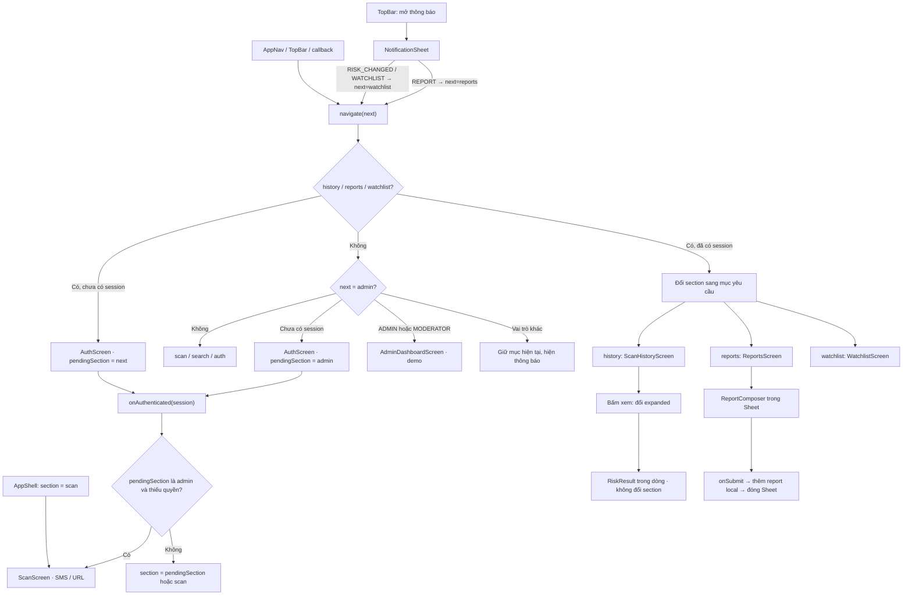

# 3. Xây dựng ứng dụng

BaoTin là ứng dụng hỗ trợ người dùng kiểm tra nội dung có dấu hiệu lừa đảo, xem lịch sử, tra cứu đối tượng, tố giác và theo dõi rủi ro. Giao diện được xây dựng bằng React Native, React và TypeScript trên Expo, hướng đến Web, Android và iOS. Cấu hình khai báo Expo `~57.0.31`, React `19.2.3`, React Native `0.86.3`, NativeWind `4.2.7` và Tailwind CSS `3.4.17`; đây là phiên bản trong cấu hình, không phải kết quả xác nhận chạy thành công trên cả ba nền tảng. Nguồn: [Frontend/package.json, dòng 20–54](/Users/dovandat/BaoTin/Frontend/package.json:20).

Chương này dựa trên mã có sẵn tại /Users/dovandat/BaoTin ngày 22/10/2026, ưu tiên đường thực thi từ App.tsx đến màn hình và API. Thuật ngữ **đã tích hợp trong mã** chỉ việc giao diện có gọi API thực, không đồng nghĩa backend đang vận hành hoặc đã được kiểm thử trong lần khảo sát. **Mock/demo** là dữ liệu hoặc phiên mô phỏng; **chỉ có API client** là phương thức đã khai báo nhưng chưa được giao diện tương ứng gọi. Việc khảo sát chỉ đọc mã, tài liệu và ảnh có sẵn, không chạy ứng dụng, build, test hay sửa source.

| Chức năng | Phạm vi xác định từ source | Dẫn chứng |
|---|---|---|
| Kiểm tra SMS/văn bản và URL | Chỉ chọn được SMS hoặc URL; gửi POST đến endpoint text/url và nhận snapshot server. Luồng đang dùng không tạo kết quả bằng hàm chấm điểm mock. | [Frontend/src/components/ScanComposer.tsx, dòng 7–16](/Users/dovandat/BaoTin/Frontend/src/components/ScanComposer.tsx:7); [Frontend/src/screens/ScanScreen.tsx, dòng 35–50](/Users/dovandat/BaoTin/Frontend/src/screens/ScanScreen.tsx:35); [Frontend/src/api/baotin.ts, dòng 25–27](/Users/dovandat/BaoTin/Frontend/src/api/baotin.ts:25) |
| Lịch sử kiểm tra | Màn hình đang được ghép là ScanHistoryScreen: tải/lọc/phân trang/xóa qua API, mở snapshot tại chỗ. Phiên demo không được cấp lịch sử giả. | [Frontend/App.tsx, dòng 460](/Users/dovandat/BaoTin/Frontend/App.tsx:460); [Frontend/src/screens/ScanHistoryScreen.tsx, dòng 22–55](/Users/dovandat/BaoTin/Frontend/src/screens/ScanHistoryScreen.tsx:22) |
| Đăng nhập, đăng ký và MFA | Có nhánh Auth API khi apiEnabled=true, còn nhánh mặc định tạo phiên giao diện mô phỏng. | [Frontend/src/screens/AuthScreen.tsx, dòng 74–124](/Users/dovandat/BaoTin/Frontend/src/screens/AuthScreen.tsx:74); [Frontend/App.tsx, dòng 256–288](/Users/dovandat/BaoTin/Frontend/App.tsx:256) |
| Theo dõi URL và thông báo | Có nhánh API theo cấu hình EXPO_PUBLIC_API_URL; khi không cấu hình thì dùng mảng mẫu và thao tác local. Thêm URL chỉ được nối ở nhánh API. | [Frontend/App.tsx, dòng 94–95](/Users/dovandat/BaoTin/Frontend/App.tsx:94); [Frontend/App.tsx, dòng 163–224](/Users/dovandat/BaoTin/Frontend/App.tsx:163); [Frontend/App.tsx, dòng 372–413](/Users/dovandat/BaoTin/Frontend/App.tsx:372) |
| Tra cứu | Lọc searchResults từ mock.ts; phương thức Search API có trong adapter nhưng chưa được màn hình gọi. | [Frontend/src/screens/SearchScreen.tsx, dòng 9–19](/Users/dovandat/BaoTin/Frontend/src/screens/SearchScreen.tsx:9); [Frontend/src/api/baotin.ts, dòng 33](/Users/dovandat/BaoTin/Frontend/src/api/baotin.ts:33) |
| Tố giác | Khởi tạo từ myReports và thêm vào state AppShell; chưa gọi API tạo/lấy báo cáo. Bằng chứng chỉ là bộ đếm file giả lập. | [Frontend/App.tsx, dòng 93](/Users/dovandat/BaoTin/Frontend/App.tsx:93); [Frontend/App.tsx, dòng 366–370](/Users/dovandat/BaoTin/Frontend/App.tsx:366); [Frontend/src/components/ReportComposer.tsx, dòng 43–45](/Users/dovandat/BaoTin/Frontend/src/components/ReportComposer.tsx:43) |
| Quản trị | Hiển thị hàng chờ adminQueueDemo; chưa nối Analytics API. Cổng truy cập giao diện xét vai trò trong session. | [Frontend/src/screens/AdminDashboardScreen.tsx, dòng 70–84](/Users/dovandat/BaoTin/Frontend/src/screens/AdminDashboardScreen.tsx:70); [Frontend/src/lib/auth.ts, dòng 9–23](/Users/dovandat/BaoTin/Frontend/src/lib/auth.ts:9) |
| Sáng/tối | Có context và lưu lựa chọn bằng AsyncStorage, không phải lưu lịch sử/báo cáo. | [Frontend/src/theme/AppTheme.tsx, dòng 16–36](/Users/dovandat/BaoTin/Frontend/src/theme/AppTheme.tsx:16) |

Một số tài liệu cũ còn mô tả “toàn bộ mock”, sáu loại quét hoặc lịch sử so sánh uy tín hiện tại. Báo cáo ưu tiên component đang được App.tsx sử dụng và phần cập nhật Live Text/URL Scan trong README. Sáu giá trị của ScanType không đồng nghĩa màn hình hiện tại hỗ trợ sáu luồng quét. Nguồn: [Frontend/README.md, dòng 136–146](/Users/dovandat/BaoTin/Frontend/README.md:136); [Frontend/src/lib/risk.ts, dòng 3–6](/Users/dovandat/BaoTin/Frontend/src/lib/risk.ts:3).

## 3.1. React Native, Component, JSX, Props/State

### 3.1.1. Công nghệ, entry point và cấu trúc source

Entry point khai báo là node_modules/expo/AppEntry.js; các script start, web, android và ios chạy Expo. App.tsx xuất mặc định component App. Component gốc nạp bốn trọng số Roboto qua useFonts; trên native, khi font chưa sẵn sàng, nó trả về một View nền. Sau đó SafeAreaProvider bao AppThemeProvider và AppShell. Nguồn: [Frontend/package.json, dòng 5–10](/Users/dovandat/BaoTin/Frontend/package.json:5); [Frontend/App.tsx, dòng 505–521](/Users/dovandat/BaoTin/Frontend/App.tsx:505).

Cấu trúc chính sau chỉ liệt kê những phần thực sự tồn tại:

```text
Frontend/
├── App.tsx                         # AppShell, state dùng chung, điều hướng
├── package.json                    # Entry point, dependency, script
├── tsconfig.json                   # TypeScript strict
├── src/
│   ├── screens/
│   │   ├── ScanScreen.tsx
│   │   ├── ScanHistoryScreen.tsx    # Lịch sử đang được AppShell sử dụng
│   │   ├── HistoryScreen.tsx        # Lịch sử mock cũ, chưa được AppShell ghép
│   │   ├── SearchScreen.tsx
│   │   ├── ReportsScreen.tsx
│   │   ├── WatchlistScreen.tsx
│   │   ├── AuthScreen.tsx
│   │   └── AdminDashboardScreen.tsx
│   ├── components/
│   │   ├── AppNav.tsx, TopBar.tsx, Motion.tsx
│   │   ├── ScanComposer.tsx, RiskResult.tsx, RiskBadge.tsx
│   │   ├── ReportComposer.tsx, NotificationSheet.tsx
│   │   └── ui/                     # Button, Input, Sheet, FilterBar, AsyncState...
│   ├── api/                        # client, baotin, auth, scan, contracts
│   ├── data/                       # mock.ts, adminDemo.ts
│   ├── lib/                        # auth, apiConfig, risk, time, browserPush...
│   └── theme/                      # AppTheme, palettes
├── global.css
└── babel.config.js
```

Không có thư mục navigation/ hoặc storage/ riêng trong cấu trúc khảo sát. Điều hướng nằm trong AppShell và AppNav; persistence của theme nằm trong AppThemeProvider. TypeScript bật strict và noUncheckedIndexedAccess. Babel dùng jsxImportSource: "nativewind" để xử lý className trong JSX. Nguồn: [Frontend/tsconfig.json, dòng 1–8](/Users/dovandat/BaoTin/Frontend/tsconfig.json:1); [Frontend/babel.config.js, dòng 1–5](/Users/dovandat/BaoTin/Frontend/babel.config.js:1); [Frontend/App.tsx, dòng 300–321](/Users/dovandat/BaoTin/Frontend/App.tsx:300); [Frontend/src/theme/AppTheme.tsx, dòng 20–33](/Users/dovandat/BaoTin/Frontend/src/theme/AppTheme.tsx:20).

AppShell sở hữu phiên đăng nhập, mục đang mở, tố giác, theo dõi, thông báo và trạng thái tải/lỗi chung. Nó chọn component theo visibleSection. Năm màn hình quản trị, lịch sử, tố giác, tra cứu và theo dõi được khai báo bằng lazy; Suspense có fallback skeleton khi tải module. Loading của module khác với loading dữ liệu API trong màn hình. Nguồn: [Frontend/App.tsx, dòng 38–42](/Users/dovandat/BaoTin/Frontend/App.tsx:38); [Frontend/App.tsx, dòng 86–112](/Users/dovandat/BaoTin/Frontend/App.tsx:86); [Frontend/App.tsx, dòng 457–483](/Users/dovandat/BaoTin/Frontend/App.tsx:457).

Lớp api/client.ts quản lý fetch, header JSON, bearer token, timeout 10 giây và thử refresh một lần khi gặp 401 nếu có callback refresh. baotin.ts chứa các lời gọi nghiệp vụ; contracts.ts định nghĩa request/response; scan.ts chuyển snapshot thành dữ liệu trình bày. presentScan lấy nguyên risk.score và risk.level từ server, không tính lại điểm tổng hợp. Nguồn: [Frontend/src/api/client.ts, dòng 27–60](/Users/dovandat/BaoTin/Frontend/src/api/client.ts:27); [Frontend/src/api/baotin.ts, dòng 23–33](/Users/dovandat/BaoTin/Frontend/src/api/baotin.ts:23); [Frontend/src/api/scan.ts, dòng 24–42](/Users/dovandat/BaoTin/Frontend/src/api/scan.ts:24).

Đáng chú ý, apiEnabled=false không còn đồng nghĩa mọi chức năng đều mock. guestScanApi luôn được tạo và scanApi = api ?? guestScanApi. Khi origin để trống, quét vẫn gọi đường dẫn tương đối /api/v1/scans/... cùng origin. Nginx hiện có cấu hình proxy /api/ tới Gateway; cần backend truy cập được để request thành công. Báo cáo chỉ xác nhận cấu trúc mã, không xác nhận proxy đang được triển khai. Nguồn: [Frontend/src/lib/apiConfig.ts, dòng 1–4](/Users/dovandat/BaoTin/Frontend/src/lib/apiConfig.ts:1); [Frontend/App.tsx, dòng 155–161](/Users/dovandat/BaoTin/Frontend/App.tsx:155); [Frontend/nginx.conf, dòng 18–30](/Users/dovandat/BaoTin/Frontend/nginx.conf:18).

### 3.1.2. Phân rã Component và Component Tree

Màn hình lịch sử thể hiện hai tầng trách nhiệm: vỏ ứng dụng quản lý vùng an toàn, điều hướng và cuộn; nội dung màn hình quản lý dữ liệu và tương tác danh sách. Mỗi dòng lịch sử là một View tạo trong map, không có component HistoryItemCard riêng.

**Hình 3.1. Cây component khi mở Lịch sử kiểm tra**

```text
App
└── SafeAreaProvider
    └── AppThemeProvider
        └── AppShell
            └── SafeAreaView
                ├── StatusBar
                ├── View: bố cục chính
                │   ├── AppNav [màn hình rộng]
                │   └── View
                │       ├── TopBar
                │       └── ScrollView
                │           └── View: vùng nội dung
                │               └── Suspense
                │                   └── MotionScreen
                │                       └── ScanHistoryScreen
                │                           └── View
                │                               ├── Text: tiêu đề
                │                               ├── Alert + Button [chưa xác thực]
                │                               └── View [đã xác thực]
                │                                   ├── FilterBar
                │                                   ├── LoadingPanel / ErrorPanel [theo state]
                │                                   ├── View × mỗi item
                │                                   │   ├── Text: preview, thời điểm
                │                                   │   ├── RiskBadge
                │                                   │   ├── Button: xem/ẩn, xóa
                │                                   │   └── RiskResult [dòng mở rộng]
                │                                   ├── EmptyState [mảng rỗng]
                │                                   └── Button + Text + Button [phân trang]
                ├── AppNav [màn hình hẹp]
                └── NotificationSheet [Modal điều khiển bằng visible]
```

Nguồn: [Frontend/App.tsx, dòng 467–501](/Users/dovandat/BaoTin/Frontend/App.tsx:467); [Frontend/App.tsx, dòng 517–520](/Users/dovandat/BaoTin/Frontend/App.tsx:517); [Frontend/src/screens/ScanHistoryScreen.tsx, dòng 42–57](/Users/dovandat/BaoTin/Frontend/src/screens/ScanHistoryScreen.tsx:42). Các nhánh trong dấu ngoặc vuông có điều kiện render, không luôn xuất hiện đồng thời.

| Component tái sử dụng | Nơi sử dụng đã đối chiếu | Ý nghĩa của việc tách |
|---|---|---|
| Button | Bộ quét, lịch sử, tố giác, theo dõi, TopBar | Thống nhất biến thể, icon, loading/disabled và accessibility. Cài đặt: [Frontend/src/components/ui/Button.tsx, dòng 33–59](/Users/dovandat/BaoTin/Frontend/src/components/ui/Button.tsx:33). |
| Input | ScanComposer, SearchScreen, ReportComposer, form thêm URL | Dùng chung nhãn, TextInput, focus, thông báo lỗi và phần tử trailing. [Frontend/src/components/ui/Input.tsx, dòng 5–35](/Users/dovandat/BaoTin/Frontend/src/components/ui/Input.tsx:5). |
| FilterBar | Bộ quét, lịch sử, tra cứu, tố giác | Dùng chung danh sách lựa chọn, trạng thái chọn và callback. [Frontend/src/components/ui/FilterBar.tsx, dòng 3–24](/Users/dovandat/BaoTin/Frontend/src/components/ui/FilterBar.tsx:3). |
| RiskBadge | Kết quả quét, lịch sử, tra cứu, theo dõi | Đổi RiskLevel thành nhãn tiếng Việt và biến thể Badge thống nhất. [Frontend/src/components/RiskBadge.tsx, dòng 4–13](/Users/dovandat/BaoTin/Frontend/src/components/RiskBadge.tsx:4). |
| RiskResult | ScanScreen và ScanHistoryScreen | Dùng chung diễn giải snapshot, cảnh báo AI và chi tiết phân tích. [Frontend/src/screens/ScanScreen.tsx, dòng 63](/Users/dovandat/BaoTin/Frontend/src/screens/ScanScreen.tsx:63); [Frontend/src/screens/ScanHistoryScreen.tsx, dòng 52](/Users/dovandat/BaoTin/Frontend/src/screens/ScanHistoryScreen.tsx:52). |
| LoadingPanel, ErrorPanel, EmptyState | Lịch sử, theo dõi và bảng thông báo; bộ quét dùng loading/error | Thống nhất phản hồi tải, lỗi, rỗng; progressbar/alert và callback thử lại khi có. [Frontend/src/components/ui/AsyncState.tsx, dòng 6–11](/Users/dovandat/BaoTin/Frontend/src/components/ui/AsyncState.tsx:6). |
| Sheet | ReportComposer và NotificationSheet | Đóng gói Modal, lớp phủ, tiêu đề, nút đóng và footer; hẹp mở từ đáy, rộng nằm bên phải. [Frontend/src/components/ui/Sheet.tsx, dòng 7–21](/Users/dovandat/BaoTin/Frontend/src/components/ui/Sheet.tsx:7). |

Nơi sử dụng Input/FilterBar có thể đối chiếu tại [Frontend/src/components/ScanComposer.tsx, dòng 25–41](/Users/dovandat/BaoTin/Frontend/src/components/ScanComposer.tsx:25), [Frontend/src/screens/SearchScreen.tsx, dòng 26–39](/Users/dovandat/BaoTin/Frontend/src/screens/SearchScreen.tsx:26), [Frontend/src/components/ReportComposer.tsx, dòng 36–45](/Users/dovandat/BaoTin/Frontend/src/components/ReportComposer.tsx:36) và [Frontend/src/screens/WatchlistScreen.tsx, dòng 134–148](/Users/dovandat/BaoTin/Frontend/src/screens/WatchlistScreen.tsx:134). Các component dùng chung sở hữu quy tắc trình bày; dữ liệu nghiệp vụ và quyết định gọi API vẫn nằm ở màn hình hoặc AppShell.

### 3.1.3. JSX và React Native component thực sử dụng

Đoạn JSX ngắn sau được trích nguyên văn từ RiskResult:

Nguồn: [Frontend/src/components/RiskResult.tsx, dòng 17–20](/Users/dovandat/BaoTin/Frontend/src/components/RiskResult.tsx:17).

```tsx
    <View className="border-t border-line pt-5 dark:border-dark-line">
        <Text className="font-medium text-xs text-muted dark:text-dark-muted">Kết quả kiểm tra</Text>
        <Text className={`mt-3 font-display text-2xl leading-8 ${critical ? "text-danger dark:text-dark-danger" : "text-ink dark:text-dark-ink"}`}>{result.title}</Text>
        <Text className="mt-2 font-sans text-sm leading-6 text-muted dark:text-dark-muted">{result.summary}</Text>
```

View là khối chứa và bố trí nội dung; Text hiển thị nhãn, tiêu đề và diễn giải. Biểu thức {result.title}, {result.summary} đưa dữ liệu vào cây UI. Template literal trong className đổi màu tiêu đề theo biến critical, được tính từ mức HIGH/CRITICAL tại [Frontend/src/components/RiskResult.tsx, dòng 10–14](/Users/dovandat/BaoTin/Frontend/src/components/RiskResult.tsx:10); các lớp dark: dành cho theme tối.

Các thành phần tương tác nền tảng cũng có thật trong source: Button bọc Pressable và dùng ActivityIndicator khi loading; Input bọc TextInput. Đây là React Native component, không phải thẻ HTML được viết trực tiếp. Nguồn: [Frontend/src/components/ui/Button.tsx, dòng 43–59](/Users/dovandat/BaoTin/Frontend/src/components/ui/Button.tsx:43); [Frontend/src/components/ui/Input.tsx, dòng 21–35](/Users/dovandat/BaoTin/Frontend/src/components/ui/Input.tsx:21).

### 3.1.4. Props và callback từ con lên cha

Hợp đồng Props của ScanComposer thể hiện rõ các giá trị và sự kiện:

Nguồn: [Frontend/src/components/ScanComposer.tsx, dòng 7](/Users/dovandat/BaoTin/Frontend/src/components/ScanComposer.tsx:7).

```tsx
type Props = { kind: SupportedScanType; value: string; scanning: boolean; onKindChange: (kind: SupportedScanType) => void; onValueChange: (value: string) => void; onScan: () => void };
```

ScanScreen giữ kind, value, scanning rồi truyền xuống con. ScanComposer dùng kind cho FilterBar, value cho Input và scanning cho trạng thái nút. Input.onChangeText gọi onValueChange; callback cha xóa kết quả cũ, hủy request cũ rồi cập nhật value. Đổi loại gọi onKindChange, xóa kết quả và nội dung nhập trước khi dùng kind mới. Nút kiểm tra gọi onScan, nối tới hàm scan của cha. Nguồn: [Frontend/src/screens/ScanScreen.tsx, dòng 17–33](/Users/dovandat/BaoTin/Frontend/src/screens/ScanScreen.tsx:17); [Frontend/src/screens/ScanScreen.tsx, dòng 61–63](/Users/dovandat/BaoTin/Frontend/src/screens/ScanScreen.tsx:61); [Frontend/src/components/ScanComposer.tsx, dòng 27–41](/Users/dovandat/BaoTin/Frontend/src/components/ScanComposer.tsx:27).

| Cha → con | Props dữ liệu | Callback cụ thể |
|---|---|---|
| AppShell → AppNav | active=visibleSection, authenticated, adminAllowed, compact | onChange=navigate; nhận chuỗi mục đích rồi kiểm tra điều kiện chuyển mục. [Frontend/App.tsx, dòng 471–488](/Users/dovandat/BaoTin/Frontend/App.tsx:471) |
| AppShell → ScanHistoryScreen | api=scanApi, authenticated=apiEnabled && authenticated | onSignIn, onReport, onWatch; chuyển đến mục tương ứng, không nhận item. [Frontend/App.tsx, dòng 460](/Users/dovandat/BaoTin/Frontend/App.tsx:460) |
| ScanHistoryScreen → RiskResult | result=presentScan(item) | onReport, onWatch được chuyển tiếp từ cha; object snapshot đi qua prop, không qua route. [Frontend/src/screens/ScanHistoryScreen.tsx, dòng 52](/Users/dovandat/BaoTin/Frontend/src/screens/ScanHistoryScreen.tsx:52) |
| ReportsScreen → ReportComposer | visible=composerOpen | onClose đặt cờ false; onSubmit=submitReport nhận NewReport rồi gọi onCreate từ AppShell. [Frontend/src/screens/ReportsScreen.tsx, dòng 25–35](/Users/dovandat/BaoTin/Frontend/src/screens/ReportsScreen.tsx:25); [Frontend/src/screens/ReportsScreen.tsx, dòng 64](/Users/dovandat/BaoTin/Frontend/src/screens/ReportsScreen.tsx:64) |

Luồng dữ liệu đi từ cha xuống con; sự kiện được gửi ngược qua callback để cha thay state sở hữu dữ liệu. Component con không sửa trực tiếp mảng của cha. State thuần trình bày, như mở chi tiết phân tích, vẫn được giữ tại component sử dụng nó.

### 3.1.5. State, sự kiện và ảnh hưởng giao diện

Các state của ScanHistoryScreen được khai báo tại [Frontend/src/screens/ScanHistoryScreen.tsx, dòng 11–20](/Users/dovandat/BaoTin/Frontend/src/screens/ScanHistoryScreen.tsx:11).

| State | Ban đầu và ý nghĩa | Sự kiện thay đổi | Ảnh hưởng UI/dữ liệu |
|---|---|---|---|
| page | 0, chỉ số trang API | Trang trước/sau, đổi lọc, xóa item cuối của trang sau trang đầu | Tải trang khác; UI hiển thị page+1. |
| data | null, sau đó là PageResponse | Tải thành công; không đủ authenticated thì đặt null | items tạo dòng, totalPages quyết định thanh phân trang. |
| loading | false, chờ danh sách | Bắt đầu/kết thúc effect | Hiện LoadingPanel, ẩn các dòng/empty khi tải, khóa đổi trang. |
| error | null, lỗi tải hoặc xóa | Bắt đầu thao tác xóa lỗi; catch ghi thông báo | Hiện ErrorPanel và nút thử lại. |
| expanded | null hoặc scanId đang mở | Bấm xem/ẩn; xóa thành công đặt null | Chỉ dòng tương ứng render RiskResult. |
| removing | null hoặc scanId đang xóa | Bắt đầu/kết thúc remove | Khóa mọi nút xóa; item tương ứng hiện loading. |
| revision | 0, bộ đếm tải lại | retry tăng 1 | Chạy effect lại với cùng trang/bộ lọc. |
| filter | ALL hoặc TEXT/URL | Chọn FilterBar | Đặt page=0 và gửi lại GET với tham số type. |

Các chuyển đổi được cài đặt tại [Frontend/src/screens/ScanHistoryScreen.tsx, dòng 22–55](/Users/dovandat/BaoTin/Frontend/src/screens/ScanHistoryScreen.tsx:22). Setter khiến React render lại theo state mới; thay đổi dữ liệu server chỉ xảy ra qua API tương ứng, không phải chỉ nhờ render lại.

Ở ScanScreen, kind="SMS", value="", scanning=false, result=null và scanError=null. Khi gửi quét, màn hình bật scanning, xóa kết quả/lỗi cũ, nhận response rồi đặt result=presentScan(response). JSX lần lượt chọn loading, error, kết quả hoặc “Chưa có kết quả”. requestId và pending là ref để bỏ phản hồi lỗi thời và hủy request, không phải state render. Sửa nội dung, đổi loại hoặc rời màn hình sẽ ngăn kết quả cũ ghi đè ngữ cảnh mới. Nguồn: [Frontend/src/screens/ScanScreen.tsx, dòng 17–50](/Users/dovandat/BaoTin/Frontend/src/screens/ScanScreen.tsx:17); [Frontend/src/screens/ScanScreen.tsx, dòng 60–63](/Users/dovandat/BaoTin/Frontend/src/screens/ScanScreen.tsx:60).

RiskResult có details=false; nút chi tiết đảo giá trị này để hiện/ẩn điểm, tín hiệu, mô hình và URL nhúng. Đây là tương tác local, không gọi thêm API phân tích. Nguồn: [Frontend/src/components/RiskResult.tsx, dòng 12–38](/Users/dovandat/BaoTin/Frontend/src/components/RiskResult.tsx:12).

AsyncStorage thực sự được dùng với khóa baotin.color-scheme: đọc khi provider mount, ghi khi đổi sáng/tối. Tố giác chỉ nằm ở state AppShell; trang/lọc/expanded nằm ở state màn hình, không có cơ sở coi chúng được lưu bền qua tải lại ứng dụng. Access token nằm trong tokenRef; web refresh dùng cookie, CSRF và credentials: "include", không dùng AsyncStorage để lưu token. Native secure token storage còn trong TODO. Nguồn: [Frontend/src/theme/AppTheme.tsx, dòng 6–32](/Users/dovandat/BaoTin/Frontend/src/theme/AppTheme.tsx:6); [Frontend/App.tsx, dòng 93–108](/Users/dovandat/BaoTin/Frontend/App.tsx:93); [Frontend/src/api/auth.ts, dòng 117–132](/Users/dovandat/BaoTin/Frontend/src/api/auth.ts:117); [Frontend/TODO.md, dòng 13–20](/Users/dovandat/BaoTin/Frontend/TODO.md:13).

## 3.2. Hiển thị và xử lý danh sách dữ liệu

### 3.2.1. Các danh sách và nguồn dữ liệu

| Danh sách thực có | Đầu vào | Render và mức triển khai |
|---|---|---|
| Lịch sử đang dùng | data.items từ scanHistory | map tạo View, key=scanId; API lọc/phân trang/xóa. [Frontend/src/screens/ScanHistoryScreen.tsx, dòng 25–55](/Users/dovandat/BaoTin/Frontend/src/screens/ScanHistoryScreen.tsx:25) |
| Tra cứu | searchResults trong mock.ts | filter rồi map, key=item.id; tìm kiếm và lọc local. [Frontend/src/screens/SearchScreen.tsx, dòng 16–39](/Users/dovandat/BaoTin/Frontend/src/screens/SearchScreen.tsx:16) |
| Tố giác cá nhân | reports ở AppShell, khởi tạo myReports | visible.map, key=report.id; lọc trạng thái, mở phản hồi, thêm local. [Frontend/src/screens/ReportsScreen.tsx, dòng 25–64](/Users/dovandat/BaoTin/Frontend/src/screens/ReportsScreen.tsx:25) |
| Theo dõi | watchlist từ API hoặc mock | items.map, key=item.id; xóa gọi callback nối API hoặc lọc state. [Frontend/src/screens/WatchlistScreen.tsx, dòng 155–179](/Users/dovandat/BaoTin/Frontend/src/screens/WatchlistScreen.tsx:155); [Frontend/App.tsx, dòng 372–385](/Users/dovandat/BaoTin/Frontend/App.tsx:372) |
| Thông báo | notificationItems từ API hoặc mock | map trong ScrollView của sheet, key=item.id; đánh dấu đọc và chuyển mục. [Frontend/src/components/NotificationSheet.tsx, dòng 44–63](/Users/dovandat/BaoTin/Frontend/src/components/NotificationSheet.tsx:44) |
| Quản trị | adminQueueDemo | filterAdminQueue rồi visible.map; hàng chờ minh họa. [Frontend/src/screens/AdminDashboardScreen.tsx, dòng 76–84](/Users/dovandat/BaoTin/Frontend/src/screens/AdminDashboardScreen.tsx:76); [Frontend/src/screens/AdminDashboardScreen.tsx, dòng 170](/Users/dovandat/BaoTin/Frontend/src/screens/AdminDashboardScreen.tsx:170) |
| Chỉ báo và URL nhúng | result.indicators, snapshot.urls | map tạo Text/View; key là chuỗi chỉ báo hoặc url.targetId. [Frontend/src/components/RiskResult.tsx, dòng 33–37](/Users/dovandat/BaoTin/Frontend/src/components/RiskResult.tsx:33) |

mock.ts còn historyItems nhưng thuộc phần lịch sử cũ. AppShell không import mảng đó và không render HistoryScreen; thay vào đó lazy-load ScanHistoryScreen. Không lấy mảng mẫu cũ để khẳng định lịch sử đang dùng có điện thoại/ngân hàng hoặc cột điểm uy tín hiện tại. Nguồn: [Frontend/src/data/mock.ts, dòng 3–21](/Users/dovandat/BaoTin/Frontend/src/data/mock.ts:3); [Frontend/src/screens/HistoryScreen.tsx, dòng 14–50](/Users/dovandat/BaoTin/Frontend/src/screens/HistoryScreen.tsx:14); [Frontend/App.tsx, dòng 24–25](/Users/dovandat/BaoTin/Frontend/App.tsx:24); [Frontend/App.tsx, dòng 39](/Users/dovandat/BaoTin/Frontend/App.tsx:39); [Frontend/App.tsx, dòng 460](/Users/dovandat/BaoTin/Frontend/App.tsx:460).

### 3.2.2. Danh sách tiêu biểu: Lịch sử kiểm tra

ScanHistoryScreen được chọn vì thể hiện đường lấy dữ liệu server, lọc, phân trang, mở item và xóa. PageResponse có items, page, size, totalItems, totalPages. Mỗi ScanApiResponse có scanId, TEXT/URL, preview, điểm/mức rủi ro, tín hiệu quy tắc/mô hình, URL nhúng và thời điểm quét. Nguồn: [Frontend/src/api/contracts.ts, dòng 13–19](/Users/dovandat/BaoTin/Frontend/src/api/contracts.ts:13); [Frontend/src/api/contracts.ts, dòng 43–57](/Users/dovandat/BaoTin/Frontend/src/api/contracts.ts:43).

Effect tải dữ liệu được trích nguyên văn:

Nguồn: [Frontend/src/screens/ScanHistoryScreen.tsx, dòng 22–29](/Users/dovandat/BaoTin/Frontend/src/screens/ScanHistoryScreen.tsx:22).

```tsx
  useEffect(() => {
    if (!authenticated) { setData(null); return; }
    let current = true; setLoading(true); setError(null);
    api.scanHistory(page, 20, { type: filter === "ALL" ? undefined : filter }).then((result) => { if (current) setData(result); })
      .catch((failure) => { if (current) setError(scanErrorMessage(failure)); })
      .finally(() => { if (current) setLoading(false); });
    return () => { current = false; };
  }, [api, authenticated, filter, page, revision]);
```

Không đủ authenticated thì màn hình xóa data và không gọi API lịch sử. Nếu đủ điều kiện, nó yêu cầu 20 item mỗi trang; ALL chuyển thành undefined để không gửi type. page, filter, revision hoặc api thay đổi sẽ kích hoạt lại effect. Biến current được đặt false tại cleanup để phản hồi từ lượt tải cũ không cập nhật state sau khi effect bị thay thế hoặc màn hình unmount. Lịch sử không truyền AbortSignal; cơ chế ở đây là bỏ qua kết quả cũ, khác với hủy request chủ động ở màn hình quét.

Adapter tạo GET /api/v1/scans/history với page, size, sort="createdAt,desc" và type khi có. Thứ tự mới nhất trước là giá trị cố định, không có nút UI đổi sắp xếp. Contract/client hỗ trợ riskLevel nhưng màn hình chưa cung cấp bộ lọc mức rủi ro trong lịch sử. Nguồn: [Frontend/src/api/baotin.ts, dòng 18–28](/Users/dovandat/BaoTin/Frontend/src/api/baotin.ts:18); [Contracts/openapi/threat-service.json, dòng 312–368](/Users/dovandat/BaoTin/Contracts/openapi/threat-service.json:312).

### 3.2.3. Render bằng map và ScrollView

Nguồn: [Frontend/src/screens/ScanHistoryScreen.tsx, dòng 49–53](/Users/dovandat/BaoTin/Frontend/src/screens/ScanHistoryScreen.tsx:49).

```tsx
        {!loading && data?.items.map((item) => <View key={item.scanId} className="mt-5 border-t border-line pt-4 dark:border-dark-line">
          <View className="flex-row items-center gap-3"><View className="min-w-0 flex-1"><Text numberOfLines={2} className="font-medium text-sm text-ink dark:text-dark-ink">{item.preview}</Text><Text className="mt-1 font-sans text-sm text-muted dark:text-dark-muted">{new Date(item.scannedAt).toLocaleString("vi-VN")}</Text></View><RiskBadge level={item.risk.level} /></View>
          <View className="mt-3 flex-row flex-wrap gap-3"><Button label={expanded === item.scanId ? "Ẩn kết quả" : "Xem kết quả lúc quét"} variant="ghost" onPress={() => setExpanded(expanded === item.scanId ? null : item.scanId)} /><Button label="Xóa khỏi lịch sử" variant="ghost" disabled={Boolean(removing)} loading={removing === item.scanId} onPress={() => remove(item.scanId)} /></View>
          {expanded === item.scanId ? <RiskResult result={presentScan(item)} onReport={onReport} onWatch={onWatch} /> : null}
        </View>)}
```

Đầu vào là data.items của trang hiện tại. map tạo một View cho mỗi snapshot; optional chaining tránh truy cập data khi chưa có response, và !loading ngăn render dòng khi đang tải. key={item.scanId} dùng định danh server, không dùng chỉ số mảng. Mỗi dòng có preview giới hạn hai dòng, thời điểm định dạng vi-VN, RiskBadge và nút xem/xóa.

Source này không dùng FlatList, renderItem hay keyExtractor. Cuộn dọc do ScrollView trong AppShell đảm nhiệm; ScanHistoryScreen trả về View. FilterBar có ScrollView ngang riêng cho lựa chọn bộ lọc, không phải danh sách lịch sử. map dựng toàn bộ item của trang, không có ảo hóa như FlatList; phân trang 20 item giới hạn lượng dữ liệu hiển thị mỗi lượt. Chưa đo hiệu năng trong lần khảo sát. Nguồn: [Frontend/App.tsx, dòng 474–485](/Users/dovandat/BaoTin/Frontend/App.tsx:474); [Frontend/src/components/ui/FilterBar.tsx, dòng 21–24](/Users/dovandat/BaoTin/Frontend/src/components/ui/FilterBar.tsx:21).

### 3.2.4. Chọn item và xem thông tin chi tiết

Bấm “Xem kết quả lúc quét” đặt expanded=item.scanId; bấm lại đặt null. Chỉ dòng có expanded bằng scanId render RiskResult ngay bên dưới. Item được chuyển bằng presentScan(item), rồi truyền qua prop result. Không đẩy một màn hình Detail và không truyền itemId qua route params. Nguồn: [Frontend/src/screens/ScanHistoryScreen.tsx, dòng 51–52](/Users/dovandat/BaoTin/Frontend/src/screens/ScanHistoryScreen.tsx:51).

RiskResult cho mở thêm phần phân tích: điểm rủi ro, AI/quy tắc, nhãn/phiên bản mô hình nếu có, chỉ báo và URL nhúng của văn bản. Khi snapshot thiếu AI, UI cảnh báo “Phân tích AI chưa sẵn sàng” và không coi rủi ro thấp là bảo đảm an toàn. presentScan đặt ephemeral=true đối với TEXT nên ẩn nút theo dõi; điều này không có nghĩa văn bản đã đăng nhập không được lưu lịch sử. Phía server vẫn lưu snapshot khi userId khác null. Nguồn: [Frontend/src/api/scan.ts, dòng 25–41](/Users/dovandat/BaoTin/Frontend/src/api/scan.ts:25); [Frontend/src/components/RiskResult.tsx, dòng 21–42](/Users/dovandat/BaoTin/Frontend/src/components/RiskResult.tsx:21); [Threat-Service/src/main/java/com/baotin/threat/infrastructure/ScanStore.java, dòng 38–55](/Users/dovandat/BaoTin/Threat-Service/src/main/java/com/baotin/threat/infrastructure/ScanStore.java:38).

scanHistoryDetail(id) tồn tại trong adapter và contract có endpoint chi tiết, nhưng thao tác mở item dùng snapshot đã có trong response danh sách, không gọi GET detail. Màn hình hiện tại không lấy điểm uy tín mới để so sánh snapshot. Nguồn: [Frontend/src/api/baotin.ts, dòng 29](/Users/dovandat/BaoTin/Frontend/src/api/baotin.ts:29); [Frontend/src/screens/ScanHistoryScreen.tsx, dòng 49–52](/Users/dovandat/BaoTin/Frontend/src/screens/ScanHistoryScreen.tsx:49); [Contracts/docs/scan-v1.md, dòng 9](/Users/dovandat/BaoTin/Contracts/docs/scan-v1.md:9).

### 3.2.5. Lọc, phân trang, tải lại và xóa

| Thao tác | Chuỗi xử lý | Kết quả trên dữ liệu/UI |
|---|---|---|
| Chọn Tất cả/Tin nhắn/URL | setPage(0), setFilter(value), effect GET lại với type tương ứng | Thay dữ liệu bằng trang đầu từ server; không filter mảng đang có ở client. |
| Trang trước/sau | Thay page; khóa nút khi tải hoặc ở biên | GET trang khác, nhãn page+1 / totalPages; không cộng dồn kiểu infinite scroll. |
| Thử lại | retry tăng revision | Tải lại cùng trang/bộ lọc; không có pull-to-refresh hoặc nút refresh độc lập lúc danh sách bình thường. |
| Xóa item | remove(scanId), chờ deleteScanHistory | DELETE thành công mới đóng phần mở và tải lại; không chỉ xóa local. |
| Xóa item duy nhất ở trang sau trang đầu | setPage(page-1) | Nạp lại trang trước; trường hợp khác tăng revision. |

Nguồn: [Frontend/src/screens/ScanHistoryScreen.tsx, dòng 20–39](/Users/dovandat/BaoTin/Frontend/src/screens/ScanHistoryScreen.tsx:20); [Frontend/src/screens/ScanHistoryScreen.tsx, dòng 46–55](/Users/dovandat/BaoTin/Frontend/src/screens/ScanHistoryScreen.tsx:46). Hàm xóa thể hiện rõ thứ tự chờ API rồi cập nhật:

Nguồn: [Frontend/src/screens/ScanHistoryScreen.tsx, dòng 31–39](/Users/dovandat/BaoTin/Frontend/src/screens/ScanHistoryScreen.tsx:31).

```tsx
  const remove = async (id: string) => {
    if (removing) return;
    setRemoving(id); setError(null);
    try {
      await api.deleteScanHistory(id);
      setExpanded(null);
      if (data?.items.length === 1 && page > 0) setPage((value) => value - 1); else retry();
    } catch (failure) { setError(scanErrorMessage(failure)); }
    finally { setRemoving(null); }
```

Adapter gửi DELETE /api/v1/scans/history/{id} và mã hóa id bằng encodeURIComponent. Controller Threat có route tương ứng; câu lệnh SQL xóa ràng buộc cả user_id và id. Query lấy lịch sử cũng ràng buộc user_id, đọc result_snapshot và sắp xếp theo thời gian/ID. Backend chỉ được đọc ở phạm vi cần xác minh đây là thao tác persistence. Nguồn: [Frontend/src/api/baotin.ts, dòng 28–30](/Users/dovandat/BaoTin/Frontend/src/api/baotin.ts:28); [Threat-Service/src/main/java/com/baotin/threat/api/ScanController.java, dòng 42–55](/Users/dovandat/BaoTin/Threat-Service/src/main/java/com/baotin/threat/api/ScanController.java:42); [Threat-Service/src/main/java/com/baotin/threat/infrastructure/ScanStore.java, dòng 97–118](/Users/dovandat/BaoTin/Threat-Service/src/main/java/com/baotin/threat/infrastructure/ScanStore.java:97).

Màn hình không có sửa snapshot, tìm kiếm từ khóa hoặc xác nhận trước xóa; vì vậy không mô tả là CRUD đầy đủ. Tạo lịch sử thuộc luồng quét có người dùng: server chỉ INSERT scan_history khi userId != null; khách không có lịch sử cá nhân. Nguồn: [Frontend/src/screens/ScanHistoryScreen.tsx, dòng 42–55](/Users/dovandat/BaoTin/Frontend/src/screens/ScanHistoryScreen.tsx:42); [Threat-Service/src/main/java/com/baotin/threat/infrastructure/ScanStore.java, dòng 38–55](/Users/dovandat/BaoTin/Threat-Service/src/main/java/com/baotin/threat/infrastructure/ScanStore.java:38).

Để so sánh với xử lý local, SearchScreen giữ query/type/risk trong state và tính results bằng useMemo + searchResults.filter. Từ khóa được trim, đổi chữ thường rồi so khớp includes với value/display; loại và mức rủi ro được kết hợp bằng AND. Nút xóa từ khóa gọi setQuery(""); kết quả rỗng hiện EmptyState. Không có request, loading server hoặc xử lý lỗi mạng trong màn hình tra cứu này. Nguồn: [Frontend/src/screens/SearchScreen.tsx, dòng 13–39](/Users/dovandat/BaoTin/Frontend/src/screens/SearchScreen.tsx:13).

### 3.2.6. Loading, có dữ liệu, empty và error

| Trạng thái lịch sử | Điều kiện | Phản hồi thực có |
|---|---|---|
| Chưa xác thực cho lịch sử | !authenticated | Alert giải thích phiên demo không có lịch sử server, nút Mở đăng nhập; effect không tải. |
| Loading | loading=true | LoadingPanel “Đang tải lịch sử”; các dòng và empty ẩn, nút đổi trang bị khóa. |
| Có dữ liệu | !loading, items có phần tử | map dựng các dòng; có mở snapshot/xóa. |
| Empty | !loading và data.items.length===0 | EmptyState “Chưa có lịch sử”, giải thích quét khi đăng nhập sẽ xuất hiện ở đây. |
| Error | error có giá trị | ErrorPanel với onRetry=retry. scanErrorMessage có thông báo riêng cho HTTP 400/401/413/429/404, còn lại dùng thông báo kết nối chung. |
| Đang xóa | removing có ID | Khóa toàn bộ nút xóa; nút tương ứng hiện loading; lỗi xóa dùng chung error. |

Nguồn: [Frontend/src/screens/ScanHistoryScreen.tsx, dòng 22–55](/Users/dovandat/BaoTin/Frontend/src/screens/ScanHistoryScreen.tsx:22); [Frontend/src/api/scan.ts, dòng 45–53](/Users/dovandat/BaoTin/Frontend/src/api/scan.ts:45); [Frontend/src/components/ui/AsyncState.tsx, dòng 6–11](/Users/dovandat/BaoTin/Frontend/src/components/ui/AsyncState.tsx:6).

Error và dữ liệu không loại trừ nhau hoàn toàn: bắt đầu tải không xóa data cũ; nếu thất bại, loading trở về false nên dữ liệu cũ có thể xuất hiện cùng lỗi. Chưa có thông báo xóa thành công riêng, chưa tự chuyển sang đăng nhập trong nhánh 401 của chính ScanHistoryScreen và empty chưa phân biệt “chưa từng quét” với “không có loại đang lọc”. Đây là nhận xét từ điều kiện source, không phải kết quả thử lỗi khi chạy.

### 3.2.7. Ảnh chụp sẵn có và giới hạn minh họa

Tìm kiếm có xét thư mục ẩn và artifact bị ignore đã phát hiện tám ảnh giao diện liên quan: bốn ảnh desktop.png, tablet.png, mobile.png, mobile-dark.png trong /Users/dovandat/BaoTin/Frontend/.impeccable/review/; bốn ảnh text-light.png, url-dark.png trong hai thư mục kết quả desktop/mobile thuộc /Users/dovandat/BaoTin/Frontend/test-results/. Cả tám ảnh đã được mở kiểm tra nội dung. Tất cả thể hiện màn hình kiểm tra, không phải danh sách lịch sử đã đăng nhập, tra cứu, tố giác hoặc theo dõi. Bốn ảnh review còn là giao diện cũ có sáu lựa chọn, nên không dùng minh họa bộ quét hiện tại.

Vì chưa có ảnh danh sách phù hợp, lịch sử được minh họa bằng đoạn render và cây component. Không dựng ảnh, sửa ảnh hoặc sửa/chạy source để chụp bổ sung.

Ảnh sau chỉ minh họa **danh sách chỉ báo và URL nhúng trong kết quả quét**, thuộc RiskResult cũng dùng khi mở item lịch sử; không phải ảnh danh sách lịch sử. Các dòng OTP, thúc giục hành động và URL nhúng trên ảnh phù hợp với map tại [Frontend/src/components/RiskResult.tsx, dòng 33–37](/Users/dovandat/BaoTin/Frontend/src/components/RiskResult.tsx:33).


**Hình 3.2.** Kết quả SMS ở chế độ sáng, mở chi tiết và báo AI chưa sẵn sàng. Ảnh đã được xem và đường dẫn có thật. Script có lệnh lưu tên ảnh này tại [Frontend/tests/live/scan-stack.live.ts, dòng 20–25](/Users/dovandat/BaoTin/Frontend/tests/live/scan-stack.live.ts:20); ảnh tồn tại không thay cho lần chạy kiểm thử mới và không chứng minh mô hình AI đang hoạt động. Không suy ra độ chính xác mô hình từ ảnh.

## 3.3. Navigation và truyền dữ liệu

### 3.3.1. Mục điều hướng và màn hình

AppSection gồm scan, search, history, reports, watchlist, admin, auth. AppNav liệt kê sáu mục nghiệp vụ; tài khoản/đăng nhập được mở bằng TopBar hoặc callback yêu cầu xác thực. Dưới 720 px, AppNav nằm ở đáy; từ 720 px trở lên dùng thanh bên. Nguồn: [Frontend/src/components/AppNav.tsx, dòng 18–30](/Users/dovandat/BaoTin/Frontend/src/components/AppNav.tsx:18); [Frontend/App.tsx, dòng 89–92](/Users/dovandat/BaoTin/Frontend/App.tsx:89); [Frontend/App.tsx, dòng 471–488](/Users/dovandat/BaoTin/Frontend/App.tsx:471); [Frontend/src/components/TopBar.tsx, dòng 15–17](/Users/dovandat/BaoTin/Frontend/src/components/TopBar.tsx:15).

| section | Component | Điều kiện và đặc điểm |
|---|---|---|
| scan | ScanScreen | Mặc định, cho khách quét; nhận scanApi. |
| search | SearchScreen | Mock; navigate không yêu cầu session. |
| history | ScanHistoryScreen | Chuyển mục yêu cầu session; tải dữ liệu còn yêu cầu apiEnabled && authenticated. |
| reports | ReportsScreen | Yêu cầu session khi chuyển; dữ liệu vẫn local/demo. |
| watchlist | WatchlistScreen | Yêu cầu session; API hoặc mock tùy cấu hình. |
| admin | AdminDashboardScreen | canAccessAdmin(session) mới render; dữ liệu demo. |
| auth | AuthScreen | Đăng nhập/đăng ký, bước MFA hoặc thông tin phiên. |

Nguồn: [Frontend/App.tsx, dòng 300–321](/Users/dovandat/BaoTin/Frontend/App.tsx:300); [Frontend/App.tsx, dòng 457–464](/Users/dovandat/BaoTin/Frontend/App.tsx:457). canAccessAdmin thực tế nhận cả ADMIN và MODERATOR, không chỉ ADMIN như một số nhãn/chú thích cũ: [Frontend/src/lib/auth.ts, dòng 9–23](/Users/dovandat/BaoTin/Frontend/src/lib/auth.ts:9).

Dependency không có React Navigation hoặc Expo Router; đường ghép màn hình không dùng NavigationContainer, Stack Navigator hay Tab Navigator. AppNav tự render Pressable, so sánh active với item.id rồi gọi onChange(item.id). accessibilityRole="tab" ở thanh đáy chỉ là ngữ nghĩa truy cập, không làm component thành Tab Navigator của thư viện. Nguồn: [Frontend/package.json, dòng 20–55](/Users/dovandat/BaoTin/Frontend/package.json:20); [Frontend/src/components/AppNav.tsx, dòng 41–54](/Users/dovandat/BaoTin/Frontend/src/components/AppNav.tsx:41); [Frontend/src/components/AppNav.tsx, dòng 66–75](/Users/dovandat/BaoTin/Frontend/src/components/AppNav.tsx:66).

### 3.3.2. Navigation Flow

**Hình 3.3. Điều hướng state/callback và giao diện mở tại chỗ**



Sơ đồ thể hiện các đích có thể chọn, không phải ba màn hình bảo vệ được mount đồng thời. Nguồn: [Frontend/App.tsx, dòng 300–333](/Users/dovandat/BaoTin/Frontend/App.tsx:300); [Frontend/App.tsx, dòng 445–450](/Users/dovandat/BaoTin/Frontend/App.tsx:445); [Frontend/App.tsx, dòng 457–464](/Users/dovandat/BaoTin/Frontend/App.tsx:457); [Frontend/src/screens/ReportsScreen.tsx, dòng 64](/Users/dovandat/BaoTin/Frontend/src/screens/ReportsScreen.tsx:64).

Ứng dụng không duy trì ngăn xếp màn hình bằng thư viện. Trên Android, BackHandler đăng ký khi mục hiện tại khác scan; Back gọi navigate("scan") và tiêu thụ sự kiện. Đây là về mục quét, không phải pop về màn hình trước đó. Không thấy route path hoặc đồng bộ browser history trong đường điều hướng đang phân tích. Nguồn: [Frontend/App.tsx, dòng 360–364](/Users/dovandat/BaoTin/Frontend/App.tsx:360).

### 3.3.3. Luồng cụ thể: Kiểm tra → đăng nhập → Lịch sử

Nút “Xem lịch sử” ở ScanScreen gắn với onOpenHistory ở cả bố cục rộng/hẹp. AppShell truyền () => navigate("history"). Nguồn: [Frontend/src/screens/ScanScreen.tsx, dòng 58–61](/Users/dovandat/BaoTin/Frontend/src/screens/ScanScreen.tsx:58); [Frontend/App.tsx, dòng 464](/Users/dovandat/BaoTin/Frontend/App.tsx:464).

Nếu chưa có session, navigate lưu mục đích và chuyển sang auth:

Nguồn: [Frontend/App.tsx, dòng 311–317](/Users/dovandat/BaoTin/Frontend/App.tsx:311).

```tsx
    const protectedSections: AppSection[] = ["history", "reports", "watchlist"];
    if (!session && protectedSections.includes(next)) {
      setPendingSection(next);
      setAccessNotice(null);
      setSection("auth");
      return;
    }
```

pendingSection ghi mục người dùng muốn đến; section="auth" khiến khối chọn màn hình trả về AuthScreen. Màn hình xác thực nhận onAuthenticated=handleAuthenticated. Khi hoàn tất, cha xử lý:

Nguồn: [Frontend/App.tsx, dòng 323–333](/Users/dovandat/BaoTin/Frontend/App.tsx:323).

```tsx
  const handleAuthenticated = useCallback((next: AuthSession) => {
    setSession(next);
    setPendingSection(null);
    if (pendingSection === "admin" && !canAccessAdmin(next)) {
      setAccessNotice(adminDeniedMessage(next));
      setSection("scan");
      return;
    }
    setAccessNotice(null);
    setSection(pendingSection ?? "scan");
  }, [pendingSection]);
```

Đối với lịch sử, pendingSection đang là history nên section được chuyển đến đó. Tuy nhiên, phiên demo có session nhưng apiEnabled=false vẫn khiến prop authenticated của ScanHistoryScreen là false. Khi đó UI hiện yêu cầu tài khoản xác thực và không tải lịch sử giả. Có session để chuyển mục và đủ điều kiện tải lịch sử server là hai điều kiện khác nhau. Nguồn: [Frontend/App.tsx, dòng 460](/Users/dovandat/BaoTin/Frontend/App.tsx:460); [Frontend/src/screens/ScanHistoryScreen.tsx, dòng 22–25](/Users/dovandat/BaoTin/Frontend/src/screens/ScanHistoryScreen.tsx:22); [Frontend/src/screens/ScanHistoryScreen.tsx, dòng 44](/Users/dovandat/BaoTin/Frontend/src/screens/ScanHistoryScreen.tsx:44).

Nhánh Auth API đặt access token vào tokenRef, lấy profile rồi chuyển thành AuthSession. Nếu server trả challenge MFA, AuthScreen giữ challenge/mã trong state, chỉ gọi onAuthenticated sau khi hoàn tất MFA. Nhánh demo dùng complete với timer 450 ms và vai trò mô phỏng; timer không phải phản hồi backend. Nguồn: [Frontend/App.tsx, dòng 256–287](/Users/dovandat/BaoTin/Frontend/App.tsx:256); [Frontend/src/screens/AuthScreen.tsx, dòng 74–124](/Users/dovandat/BaoTin/Frontend/src/screens/AuthScreen.tsx:74).

### 3.3.4. Tham số, object và callback thực truyền

Không có route.params trong luồng hiện tại. Các giá trị thực được truyền như sau:

| Ngữ cảnh | Dữ liệu/parameter | Cách nhận và sử dụng | Giới hạn |
|---|---|---|---|
| AppNav chọn mục | item.id: AppSection qua onChange | navigate(next) kiểm tra rồi setSection hoặc mở auth | Không có path/stack/route params. |
| Quét sang lịch sử | onOpenHistory() không đối số | Cha mở history | Không truyền kết quả mới vào danh sách; lịch sử tự GET. |
| Mở item lịch sử | expanded lưu scanId; result=presentScan(item) | RiskResult đọc object để render | Chi tiết inline; không gọi GET detail. |
| Kết quả sang tố giác/theo dõi | onReport()/onWatch() không đối số | Cha mở reports/watchlist | Không truyền targetId/URL để tự điền; không tự thêm theo dõi. |
| Tra cứu chọn hành động item | onScan()/onWatch(), không truyền item | Cha mở scan/watchlist | “Kiểm tra lại” không tự điền giá trị item. |
| Chọn thông báo | NotificationRecord qua onActivate(item) | Đánh dấu đọc, đóng sheet, chọn mục theo type | Handler không đọc ID trong item.data để chọn đúng bản ghi. |
| Gửi form tố giác | NewReport qua onSubmit | ReportsScreen gọi onCreate; AppShell thêm ReportRecord | Không qua route; chưa gọi API; description chưa được giữ trong bản ghi local. |

Nguồn: [Frontend/src/components/AppNav.tsx, dòng 48](/Users/dovandat/BaoTin/Frontend/src/components/AppNav.tsx:48); [Frontend/App.tsx, dòng 445–464](/Users/dovandat/BaoTin/Frontend/App.tsx:445); [Frontend/src/screens/ScanHistoryScreen.tsx, dòng 51–52](/Users/dovandat/BaoTin/Frontend/src/screens/ScanHistoryScreen.tsx:51); [Frontend/src/components/RiskResult.tsx, dòng 40–42](/Users/dovandat/BaoTin/Frontend/src/components/RiskResult.tsx:40); [Frontend/src/screens/SearchScreen.tsx, dòng 35–36](/Users/dovandat/BaoTin/Frontend/src/screens/SearchScreen.tsx:35); [Frontend/src/components/ReportComposer.tsx, dòng 16–31](/Users/dovandat/BaoTin/Frontend/src/components/ReportComposer.tsx:16); [Frontend/App.tsx, dòng 366–370](/Users/dovandat/BaoTin/Frontend/App.tsx:366).

Giao diện đã có đường đi từ kết quả đến khu vực xử lý tiếp theo, nhưng chưa có luồng tự động “chọn đối tượng → điền sẵn tố giác/theo dõi”. Callback không tham số là căn cứ trực tiếp của nhận xét này.

### 3.3.5. Add, đóng form và cập nhật danh sách

**Tạo tố giác bằng Sheet và state local.** ReportsScreen bật composerOpen khi bấm nút tạo; ReportComposer nhận visible/onClose/onSubmit và dùng Sheet bọc Modal React Native. Form có hai bước: chọn loại/đối tượng/danh mục, rồi nhập tiêu đề/mô tả/bằng chứng giả lập. stepValid yêu cầu đối tượng dài hơn 5, tiêu đề dài hơn 5 và mô tả dài hơn 15 ký tự sau trim; đó là validation UI, không chứng minh server chấp nhận. Nguồn: [Frontend/src/screens/ReportsScreen.tsx, dòng 27–39](/Users/dovandat/BaoTin/Frontend/src/screens/ReportsScreen.tsx:27); [Frontend/src/components/ReportComposer.tsx, dòng 18–45](/Users/dovandat/BaoTin/Frontend/src/components/ReportComposer.tsx:18); [Frontend/src/components/ui/Sheet.tsx, dòng 7–21](/Users/dovandat/BaoTin/Frontend/src/components/ui/Sheet.tsx:7).

Gửi form gọi onSubmit(NewReport), đặt bước về 1, xóa target/title/description/evidenceCount rồi onClose. Hàm gửi không reset targetType/category. Nếu chỉ đóng bằng nút hoặc lớp phủ, callback cha chỉ đổi visible; không reset toàn bộ form. Nguồn: [Frontend/src/components/ReportComposer.tsx, dòng 29–36](/Users/dovandat/BaoTin/Frontend/src/components/ReportComposer.tsx:29); [Frontend/src/screens/ReportsScreen.tsx, dòng 64](/Users/dovandat/BaoTin/Frontend/src/screens/ReportsScreen.tsx:64).

ReportsScreen gọi onCreate và bật created để hiện thông báo. AppShell tạo ID BT-DEMO-..., trạng thái SUBMITTED, ưu tiên MEDIUM và thêm vào đầu mảng:

Nguồn: [Frontend/App.tsx, dòng 366–370](/Users/dovandat/BaoTin/Frontend/App.tsx:366).

```tsx
  const createReport = (draft: NewReport) => {
    if (!reduced) LayoutAnimation.configureNext(LayoutAnimation.Presets.easeInEaseOut);
    const report: ReportRecord = { id: `BT-DEMO-${String(reports.length + 1).padStart(3, "0")}`, target: draft.target, targetType: draft.targetType, category: draft.category, title: draft.title, status: "SUBMITTED", priority: "MEDIUM", updated: "Vừa xong", evidenceCount: draft.evidenceCount, moderatorNote: null };
    setReports((current) => [report, ...current]);
  };
```

ReportsScreen nhận items mới, tính lại visible theo filter. Bản ghi mới hiện đầu danh sách khi xem Tất cả; nếu đang lọc VERIFIED/PENDING_REVIEW/NEED_MORE_INFO thì SUBMITTED không khớp và chưa hiện. Chưa gọi api.createReport, không upload tệp và không có màn hình Edit tố giác. Các trạng thái xử lý trong mock không chứng minh đã có quy trình kiểm duyệt server. Nguồn: [Frontend/src/screens/ReportsScreen.tsx, dòng 17–35](/Users/dovandat/BaoTin/Frontend/src/screens/ReportsScreen.tsx:17); [Frontend/src/screens/ReportsScreen.tsx, dòng 48–64](/Users/dovandat/BaoTin/Frontend/src/screens/ReportsScreen.tsx:48); [Frontend/src/components/ReportComposer.tsx, dòng 45](/Users/dovandat/BaoTin/Frontend/src/components/ReportComposer.tsx:45).

**Thêm URL theo dõi ở nhánh API.** WatchlistScreen mở biểu mẫu inline bằng addOpen, không mở màn hình Add riêng. Hàm add kiểm tra đầu vào rồi chờ onAdd(normalized). AppShell.addWatch gọi API, đổi response thành WatchItem, đưa lên đầu state và loại trùng ID. Promise thành công thì form xóa URL, đóng addOpen; thất bại giữ form và hiện addError. Nguồn: [Frontend/src/screens/WatchlistScreen.tsx, dòng 94–115](/Users/dovandat/BaoTin/Frontend/src/screens/WatchlistScreen.tsx:94); [Frontend/App.tsx, dòng 387–398](/Users/dovandat/BaoTin/Frontend/App.tsx:387).

Trong mock không có onAdd: nút thêm chỉ chuyển sang Tra cứu. Nút theo dõi ở Tra cứu lại chỉ chuyển mục, chưa thêm item mock. Vì vậy không mô tả demo là đã thêm được đối tượng qua luồng Tra cứu. Bỏ theo dõi có hai nhánh: lọc state nếu không có API hoặc chờ DELETE thành công rồi lọc state nếu có API. Nguồn: [Frontend/App.tsx, dòng 372–385](/Users/dovandat/BaoTin/Frontend/App.tsx:372); [Frontend/App.tsx, dòng 459–462](/Users/dovandat/BaoTin/Frontend/App.tsx:459); [Frontend/src/screens/WatchlistScreen.tsx, dòng 94–98](/Users/dovandat/BaoTin/Frontend/src/screens/WatchlistScreen.tsx:94); [Frontend/src/screens/SearchScreen.tsx, dòng 36](/Users/dovandat/BaoTin/Frontend/src/screens/SearchScreen.tsx:36).

### 3.3.6. Liên hệ với tài liệu thiết kế

DESIGN.md mô tả mở ứng dụng vào tác vụ kiểm tra, thanh bên desktop, thanh đáy khi hẹp, hai cột từ 1080 px và sheet lớp phủ. Những điểm này đối chiếu được với section khởi tạo scan, compact dưới 720, twoColumn từ 1080 và component Sheet. Nguồn: [Frontend/DESIGN.md, dòng 134–146](/Users/dovandat/BaoTin/Frontend/DESIGN.md:134); [Frontend/DESIGN.md, dòng 191–203](/Users/dovandat/BaoTin/Frontend/DESIGN.md:191); [Frontend/DESIGN.md, dòng 237–243](/Users/dovandat/BaoTin/Frontend/DESIGN.md:237); [Frontend/App.tsx, dòng 91–92](/Users/dovandat/BaoTin/Frontend/App.tsx:91); [Frontend/src/screens/ScanScreen.tsx, dòng 14–16](/Users/dovandat/BaoTin/Frontend/src/screens/ScanScreen.tsx:14); [Frontend/src/components/ui/Sheet.tsx, dòng 8–18](/Users/dovandat/BaoTin/Frontend/src/components/ui/Sheet.tsx:8).

Trong các tài liệu Frontend đã đọc, chưa thấy sơ đồ Screen Flow riêng đủ chi tiết để xác nhận toàn bộ chuyển tiếp như đặc tả hoàn chỉnh. Hình 3.3 vì thế được rút từ source, không trình bày như bản sao thiết kế đã phê duyệt. PRODUCT.md và ARCHITECTURE_ALIGNMENT.md còn ghi một số phạm vi cũ: toàn bộ mock, sáu loại quét và so sánh điểm hiện tại trong lịch sử. Chúng cung cấp ngữ cảnh, còn đường render/call API hiện tại quyết định kết luận triển khai. Nguồn: [Frontend/PRODUCT.md, dòng 25–33](/Users/dovandat/BaoTin/Frontend/PRODUCT.md:25); [Frontend/ARCHITECTURE_ALIGNMENT.md, dòng 5–8](/Users/dovandat/BaoTin/Frontend/ARCHITECTURE_ALIGNMENT.md:5); [Frontend/ARCHITECTURE_ALIGNMENT.md, dòng 20–23](/Users/dovandat/BaoTin/Frontend/ARCHITECTURE_ALIGNMENT.md:20); [Frontend/README.md, dòng 136–144](/Users/dovandat/BaoTin/Frontend/README.md:136).

## Danh mục nguồn và giới hạn kiểm chứng

### Các file đã đối chiếu

Liên kết mở tại dòng đầu của khoảng dẫn chứng. Số dòng thuộc source thực tế tại thời điểm khảo sát; trích đoạn được lấy trực tiếp từ khoảng dòng, không viết lại thành mã ví dụ.

| File hoặc nhóm file | Nội dung đối chiếu |
|---|---|
| [Frontend/AGENTS.md, dòng 1–17](/Users/dovandat/BaoTin/Frontend/AGENTS.md:1); [Frontend/agent.md, dòng 1–43](/Users/dovandat/BaoTin/Frontend/agent.md:1) | Hướng dẫn workspace/Frontend; ghi chú trạng thái cũ được kiểm tra lại từ mã. |
| [Frontend/package.json, dòng 1–55](/Users/dovandat/BaoTin/Frontend/package.json:1); [Frontend/tsconfig.json, dòng 1–9](/Users/dovandat/BaoTin/Frontend/tsconfig.json:1); [Frontend/babel.config.js, dòng 1–6](/Users/dovandat/BaoTin/Frontend/babel.config.js:1) | Entry point, script, dependency, TypeScript và NativeWind. |
| [Frontend/App.tsx, dòng 86–161](/Users/dovandat/BaoTin/Frontend/App.tsx:86); [Frontend/App.tsx, dòng 163–254](/Users/dovandat/BaoTin/Frontend/App.tsx:163) | State dùng chung, nhánh API, tải dữ liệu/polling. |
| [Frontend/App.tsx, dòng 256–364](/Users/dovandat/BaoTin/Frontend/App.tsx:256); [Frontend/App.tsx, dòng 366–450](/Users/dovandat/BaoTin/Frontend/App.tsx:366); [Frontend/App.tsx, dòng 457–521](/Users/dovandat/BaoTin/Frontend/App.tsx:457) | Auth, navigation, thêm/xóa, notification, render shell và provider. |
| [Frontend/src/screens/ScanScreen.tsx, dòng 13–68](/Users/dovandat/BaoTin/Frontend/src/screens/ScanScreen.tsx:13); [Frontend/src/screens/ScanHistoryScreen.tsx, dòng 11–58](/Users/dovandat/BaoTin/Frontend/src/screens/ScanHistoryScreen.tsx:11) | Quét, state, request; danh sách lịch sử, chi tiết và xóa. |
| [Frontend/src/screens/HistoryScreen.tsx, dòng 14–50](/Users/dovandat/BaoTin/Frontend/src/screens/HistoryScreen.tsx:14); [Frontend/src/screens/SearchScreen.tsx, dòng 9–43](/Users/dovandat/BaoTin/Frontend/src/screens/SearchScreen.tsx:9) | Lịch sử mock cũ và tra cứu local. |
| [Frontend/src/screens/ReportsScreen.tsx, dòng 17–67](/Users/dovandat/BaoTin/Frontend/src/screens/ReportsScreen.tsx:17); [Frontend/src/screens/WatchlistScreen.tsx, dòng 21–197](/Users/dovandat/BaoTin/Frontend/src/screens/WatchlistScreen.tsx:21) | Danh sách tố giác, form và thao tác theo dõi. |
| [Frontend/src/screens/AuthScreen.tsx, dòng 22–126](/Users/dovandat/BaoTin/Frontend/src/screens/AuthScreen.tsx:22); [Frontend/src/screens/AuthScreen.tsx, dòng 178–193](/Users/dovandat/BaoTin/Frontend/src/screens/AuthScreen.tsx:178) | Mock/API auth, MFA, SSO bị tắt ở API mode và vai trò demo. |
| [Frontend/src/screens/AdminDashboardScreen.tsx, dòng 70–84](/Users/dovandat/BaoTin/Frontend/src/screens/AdminDashboardScreen.tsx:70); [Frontend/src/screens/AdminDashboardScreen.tsx, dòng 170–219](/Users/dovandat/BaoTin/Frontend/src/screens/AdminDashboardScreen.tsx:170) | Hàng chờ quản trị minh họa và render map. |
| [Frontend/src/components/AppNav.tsx, dòng 18–79](/Users/dovandat/BaoTin/Frontend/src/components/AppNav.tsx:18); [Frontend/src/components/TopBar.tsx, dòng 9–19](/Users/dovandat/BaoTin/Frontend/src/components/TopBar.tsx:9); [Frontend/src/components/Motion.tsx, dòng 14–32](/Users/dovandat/BaoTin/Frontend/src/components/Motion.tsx:14) | Các mục điều hướng, nút thông báo/tài khoản, wrapper chuyển mục. |
| [Frontend/src/components/ScanComposer.tsx, dòng 7–44](/Users/dovandat/BaoTin/Frontend/src/components/ScanComposer.tsx:7); [Frontend/src/components/RiskResult.tsx, dòng 10–46](/Users/dovandat/BaoTin/Frontend/src/components/RiskResult.tsx:10); [Frontend/src/components/RiskBadge.tsx, dòng 4–13](/Users/dovandat/BaoTin/Frontend/src/components/RiskBadge.tsx:4) | Props bộ nhập, JSX kết quả, chi tiết và nhãn rủi ro. |
| [Frontend/src/components/ReportComposer.tsx, dòng 16–50](/Users/dovandat/BaoTin/Frontend/src/components/ReportComposer.tsx:16); [Frontend/src/components/NotificationSheet.tsx, dòng 11–65](/Users/dovandat/BaoTin/Frontend/src/components/NotificationSheet.tsx:11) | Form hai bước, bằng chứng giả lập, sheet và callback. |
| [Frontend/src/components/ui/Button.tsx, dòng 33–60](/Users/dovandat/BaoTin/Frontend/src/components/ui/Button.tsx:33); [Frontend/src/components/ui/Input.tsx, dòng 5–38](/Users/dovandat/BaoTin/Frontend/src/components/ui/Input.tsx:5) | Pressable/TextInput, trạng thái và accessibility. |
| [Frontend/src/components/ui/FilterBar.tsx, dòng 3–27](/Users/dovandat/BaoTin/Frontend/src/components/ui/FilterBar.tsx:3); [Frontend/src/components/ui/AsyncState.tsx, dòng 6–12](/Users/dovandat/BaoTin/Frontend/src/components/ui/AsyncState.tsx:6); [Frontend/src/components/ui/Sheet.tsx, dòng 7–23](/Users/dovandat/BaoTin/Frontend/src/components/ui/Sheet.tsx:7) | map lựa chọn, loading/error và Modal. |
| [Frontend/src/api/contracts.ts, dòng 13–57](/Users/dovandat/BaoTin/Frontend/src/api/contracts.ts:13); [Frontend/src/api/contracts.ts, dòng 148–160](/Users/dovandat/BaoTin/Frontend/src/api/contracts.ts:148) | Kiểu danh sách/snapshot và endpoint. |
| [Frontend/src/api/baotin.ts, dòng 18–56](/Users/dovandat/BaoTin/Frontend/src/api/baotin.ts:18); [Frontend/src/api/client.ts, dòng 27–69](/Users/dovandat/BaoTin/Frontend/src/api/client.ts:27); [Frontend/src/api/scan.ts, dòng 24–54](/Users/dovandat/BaoTin/Frontend/src/api/scan.ts:24) | Adapter, phương thức được/chưa được gọi, transport và trình bày snapshot. |
| [Frontend/src/api/auth.ts, dòng 60–159](/Users/dovandat/BaoTin/Frontend/src/api/auth.ts:60); [Frontend/src/lib/apiConfig.ts, dòng 1–4](/Users/dovandat/BaoTin/Frontend/src/lib/apiConfig.ts:1); [Frontend/src/lib/auth.ts, dòng 1–24](/Users/dovandat/BaoTin/Frontend/src/lib/auth.ts:1) | Auth HTTP, bật API và kiểm tra vai trò UI. |
| [Frontend/src/lib/risk.ts, dòng 3–30](/Users/dovandat/BaoTin/Frontend/src/lib/risk.ts:3); [Frontend/src/lib/risk.ts, dòng 72–80](/Users/dovandat/BaoTin/Frontend/src/lib/risk.ts:72); [Frontend/src/lib/browserPush.ts, dòng 14–39](/Users/dovandat/BaoTin/Frontend/src/lib/browserPush.ts:14) | Kiểu dùng chung, hàm mock còn tồn tại, Notification API trình duyệt. |
| [Frontend/src/data/mock.ts, dòng 3–76](/Users/dovandat/BaoTin/Frontend/src/data/mock.ts:3); [Frontend/src/data/adminDemo.ts, dòng 5–29](/Users/dovandat/BaoTin/Frontend/src/data/adminDemo.ts:5); [Frontend/src/theme/AppTheme.tsx, dòng 6–42](/Users/dovandat/BaoTin/Frontend/src/theme/AppTheme.tsx:6) | Mảng mẫu và persistence riêng của theme. |
| [Frontend/nginx.conf, dòng 18–38](/Users/dovandat/BaoTin/Frontend/nginx.conf:18); [Frontend/tests/live/scan-stack.live.ts, dòng 3–42](/Users/dovandat/BaoTin/Frontend/tests/live/scan-stack.live.ts:3) | Proxy và tên ảnh artifact; chỉ đọc, không thực thi test. |
| [Contracts/AGENTS.md, dòng 1–17](/Users/dovandat/BaoTin/Contracts/AGENTS.md:1); [Threat-Service/AGENTS.md, dòng 1–17](/Users/dovandat/BaoTin/Threat-Service/AGENTS.md:1) | Hướng dẫn phạm vi trước khi đọc contract/backend. |
| [Contracts/openapi/threat-service.json, dòng 312–496](/Users/dovandat/BaoTin/Contracts/openapi/threat-service.json:312); [Contracts/docs/scan-v1.md, dòng 3–15](/Users/dovandat/BaoTin/Contracts/docs/scan-v1.md:3) | Contract lịch sử/detail/delete và nguyên tắc snapshot. |
| [Threat-Service/src/main/java/com/baotin/threat/api/ScanController.java, dòng 15–56](/Users/dovandat/BaoTin/Threat-Service/src/main/java/com/baotin/threat/api/ScanController.java:15); [Threat-Service/src/main/java/com/baotin/threat/infrastructure/ScanStore.java, dòng 38–55](/Users/dovandat/BaoTin/Threat-Service/src/main/java/com/baotin/threat/infrastructure/ScanStore.java:38); [Threat-Service/src/main/java/com/baotin/threat/infrastructure/ScanStore.java, dòng 97–118](/Users/dovandat/BaoTin/Threat-Service/src/main/java/com/baotin/threat/infrastructure/ScanStore.java:97) | Route, INSERT snapshot, phân trang và xóa theo chủ sở hữu. |
| [Frontend/README.md, dòng 136–146](/Users/dovandat/BaoTin/Frontend/README.md:136); [Frontend/TODO.md, dòng 13–61](/Users/dovandat/BaoTin/Frontend/TODO.md:13) | Cập nhật tích hợp và phần chưa hoàn thiện. |
| [Frontend/DESIGN.md, dòng 134–146](/Users/dovandat/BaoTin/Frontend/DESIGN.md:134); [Frontend/DESIGN.md, dòng 191–243](/Users/dovandat/BaoTin/Frontend/DESIGN.md:191); [Frontend/PRODUCT.md, dòng 25–33](/Users/dovandat/BaoTin/Frontend/PRODUCT.md:25); [Frontend/ARCHITECTURE_ALIGNMENT.md, dòng 5–23](/Users/dovandat/BaoTin/Frontend/ARCHITECTURE_ALIGNMENT.md:5) | Ngữ cảnh thiết kế và giới hạn của mô tả cũ. |

### Giới hạn triển khai ảnh hưởng đến chương 3

1. **Quét hiện chỉ hỗ trợ SMS/văn bản và URL.** Các giá trị kiểu dữ liệu khác xuất hiện trong mock/form không chứng minh có đủ sáu luồng quét đang dùng.
2. **Tích hợp API chưa đồng đều.** Quét/lịch sử có đường HTTP thật; Auth/watchlist/notification phụ thuộc chế độ API. Search/Report/Admin còn demo; phương thức API client không chứng minh màn hình đã nối.
3. **Lịch sử là snapshot, không có so sánh uy tín hiện tại trong màn hình đang ghép.** HistoryScreen mock cũ có phần này nhưng không được AppShell dùng. GET detail cũng chưa được gọi khi mở item.
4. **Persistence khác nhau theo dữ liệu.** Theme lưu AsyncStorage; lịch sử dựa vào server store; tố giác mới chỉ ở state và bằng chứng là bộ đếm. Native secure token storage còn thiếu.
5. **Navigation bằng state/callback.** Không có Stack/Tab Navigator, route params hoặc Detail riêng; từ kết quả sang tố giác/theo dõi chưa truyền object để điền sẵn. Notification chưa mở sâu bản ghi theo ID.
6. **Không có CRUD đầy đủ cho mọi danh sách.** Lịch sử đọc/xóa và tạo qua quét, không sửa; báo cáo chỉ thêm demo/đọc; watchlist đọc/thêm/xóa ở nhánh API. Không biến nhãn UI thành hành vi server đã hoàn thành.
7. **Phản hồi UI còn giới hạn.** Lỗi lịch sử có thể đi cùng dữ liệu cũ; chưa có tìm kiếm từ khóa, lọc risk, pull-to-refresh hoặc xác nhận xóa trong lịch sử. AI thiếu dữ liệu phải có cảnh báo, fallback không chứng nhận an toàn.
8. **Ảnh và kiểm chứng chạy thực tế còn giới hạn.** Đã xem tám ảnh nhưng không có ảnh danh sách phù hợp. Không chạy build/test, gọi API hoặc xác nhận backend/model; không suy ra test pass/độ chính xác từ artifact cũ.

### Rà soát độ bao phủ và kết quả khảo sát

| Phần | Nội dung đã trình bày |
|---|---|
| 3.1 | Entry point/công nghệ, cấu trúc source, vị trí navigation/storage, cây component, tái sử dụng, JSX, Props/callback, bảng State–sự kiện–UI. |
| 3.2 | Các danh sách, phân tích ScanHistoryScreen, map/ScrollView, dữ liệu/key, chọn item/xóa API, lọc/phân trang/thử lại, loading/data/empty/error và giới hạn ảnh. |
| 3.3 | Mục/màn hình thật, state/callback, Navigation Flow, luồng đăng nhập rồi về lịch sử, dữ liệu thực truyền, chi tiết inline, thêm báo cáo local/watchlist API và đối chiếu thiết kế. |

Kết quả kiểm chứng gồm đọc/lần theo mã, đối chiếu endpoint/kiểu dữ liệu với contract và store lịch sử, tìm/xem ảnh sẵn có, kiểm tra đường dẫn và khoảng dòng dẫn chứng, đối chiếu trích đoạn với source. Không thực hiện hoặc công bố kết quả build, unit test, E2E hay smoke test API; không sửa code, cấu hình, dependency, lockfile, tài nguyên hoặc Git state để hoàn thiện chương.
