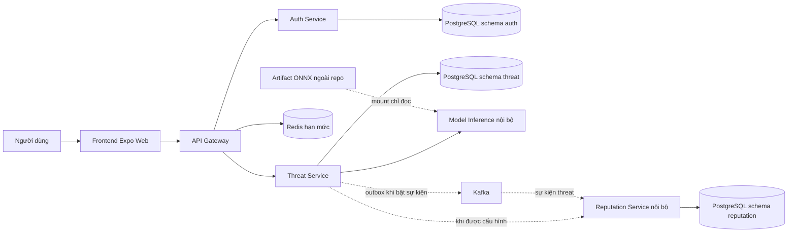
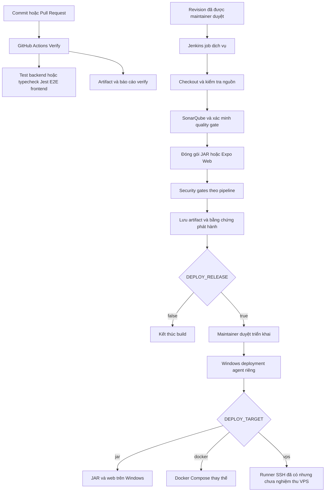
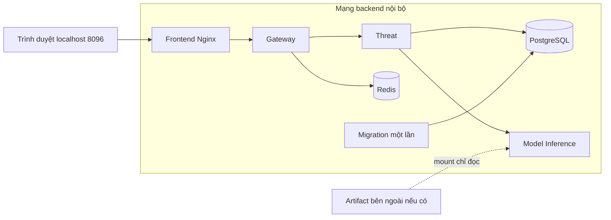
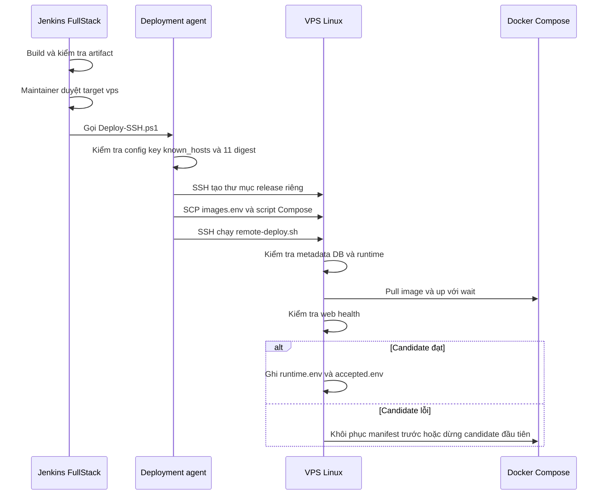

# BÁO CÁO HỌC PHẦN TRIỂN KHAI PHẦN MỀM

**BỘ GIÁO DỤC VÀ ĐÀO TẠO**  
**TRƯỜNG ĐẠI HỌC CMC**

**Tên đề tài:** Triển khai hệ thống BảoTin hỗ trợ kiểm tra tin nhắn và đường dẫn có dấu hiệu lừa đảo

| Thông tin | Nội dung |
|---|---|
| Ngành đào tạo | Công nghệ thông tin |
| Học phần | Triển khai phần mềm |
| Giảng viên hướng dẫn | [Bổ sung họ tên giảng viên] |
| Nhóm thực hiện | [Bổ sung tên hoặc số nhóm] |
| Lớp | [Bổ sung lớp] |
| Sinh viên thực hiện | [Bổ sung họ tên và mã sinh viên] |
| Thời điểm tổng hợp báo cáo | Ngày 03 tháng 11 năm 2026 |

**Hà Nội, tháng 11 năm 2026**

## Bảng phân công công việc

| TT | Mã sinh viên | Họ và tên | Nội dung công việc thực tế | Điểm tự đánh giá hệ số 10 | Ghi chú |
|---|---|---|---|---|---|
| 1 | [Bổ sung] | [Bổ sung] | [Bổ sung theo phân công thực tế] | [Bổ sung] | |
| 2 | [Bổ sung] | [Bổ sung] | [Bổ sung theo phân công thực tế] | [Bổ sung] | |
| 3 | [Bổ sung] | [Bổ sung] | [Bổ sung theo phân công thực tế] | [Bổ sung] | |

Tỷ trọng đánh giá theo mẫu học phần: sinh viên tự đánh giá 30%, giảng viên đánh giá 70%. Số thành viên và nội dung phân công cần được điền theo nhóm thực tế.

## Mục lục

- [Danh sách từ và ký hiệu viết tắt](#danh-sách-từ-và-ký-hiệu-viết-tắt)
- [Danh sách hình vẽ](#danh-sách-hình-vẽ)
- [1. Giới thiệu chung](#1-giới-thiệu-chung)
  - [1.1. Mục tiêu của học phần](#11-mục-tiêu-của-học-phần)
  - [1.2. Tổng quan về phần mềm được lựa chọn để triển khai](#12-tổng-quan-về-phần-mềm-được-lựa-chọn-để-triển-khai)
  - [1.3. Phạm vi và cơ sở đánh giá](#13-phạm-vi-và-cơ-sở-đánh-giá)
- [2. Mô hình triển khai](#2-mô-hình-triển-khai)
  - [2.1. Kiến trúc và trách nhiệm các thành phần](#21-kiến-trúc-và-trách-nhiệm-các-thành-phần)
  - [2.2. Mô hình CI/CD](#22-mô-hình-cicd)
  - [2.3. Các phương án chạy ứng dụng](#23-các-phương-án-chạy-ứng-dụng)
  - [2.4. Mạng dữ liệu và bảo mật triển khai](#24-mạng-dữ-liệu-và-bảo-mật-triển-khai)
- [3. Thiết lập hệ thống CI/CD](#3-thiết-lập-hệ-thống-cicd)
  - [3.1. Jenkins trên máy phát triển](#31-jenkins-trên-máy-phát-triển)
  - [3.2. Pipeline backend](#32-pipeline-backend)
  - [3.3. Pipeline frontend](#33-pipeline-frontend)
  - [3.4. Tích hợp SonarQube](#34-tích-hợp-sonarqube)
  - [3.5. Đóng gói và triển khai bằng Docker Compose](#35-đóng-gói-và-triển-khai-bằng-docker-compose)
  - [3.6. Điều phối phát hành và khôi phục](#36-điều-phối-phát-hành-và-khôi-phục)
  - [3.7. Kết quả và minh chứng hiện có](#37-kết-quả-và-minh-chứng-hiện-có)
- [4. Tự động deploy lên server qua SSH](#4-tự-động-deploy-lên-server-qua-ssh)
  - [4.1. Trạng thái triển khai](#41-trạng-thái-triển-khai)
  - [4.2. Cấu hình và luồng thực hiện đã có](#42-cấu-hình-và-luồng-thực-hiện-đã-có)
  - [4.3. Kiểm tra và rollback trên máy đích](#43-kiểm-tra-và-rollback-trên-máy-đích)
  - [4.4. Đối chiếu yêu cầu địa chỉ public](#44-đối-chiếu-yêu-cầu-địa-chỉ-public)
- [5. Triển khai và giám sát hệ thống với Prometheus và Grafana](#5-triển-khai-và-giám-sát-hệ-thống-với-prometheus-và-grafana)
  - [5.1. Trạng thái hiện tại](#51-trạng-thái-hiện-tại)
  - [5.2. Các cơ chế theo dõi đã có](#52-các-cơ-chế-theo-dõi-đã-có)
  - [5.3. Các bước kiểm tra sức khỏe đã được tài liệu hóa](#53-các-bước-kiểm-tra-sức-khỏe-đã-được-tài-liệu-hóa)
  - [5.4. Đánh giá theo yêu cầu học phần](#54-đánh-giá-theo-yêu-cầu-học-phần)
- [6. Kết luận và cải tiến](#6-kết-luận-và-cải-tiến)
  - [6.1. Tổng kết học phần](#61-tổng-kết-học-phần)
  - [6.2. Đề xuất cải tiến pipeline](#62-đề-xuất-cải-tiến-pipeline)
  - [6.3. Đề xuất cải tiến phần mềm](#63-đề-xuất-cải-tiến-phần-mềm)
- [Phụ lục A. Danh mục minh chứng cần hoàn thiện khi nộp](#phụ-lục-a-danh-mục-minh-chứng-cần-hoàn-thiện-khi-nộp)
- [Phụ lục B. Tài liệu và mã nguồn tham chiếu](#phụ-lục-b-tài-liệu-và-mã-nguồn-tham-chiếu)

## Danh sách từ và ký hiệu viết tắt

| Ký hiệu | Nội dung | Ý nghĩa trong đề tài |
|---|---|---|
| API | Application Programming Interface | Giao diện trao đổi giữa frontend và backend hoặc giữa các dịch vụ |
| CI | Continuous Integration | Tích hợp mã nguồn và thực hiện kiểm tra tự động |
| CD | Continuous Delivery hoặc Continuous Deployment | Chuẩn bị và triển khai bản phát hành; hệ thống hiện có bước duyệt trước triển khai |
| SCM | Source Code Management | Quản lý mã nguồn bằng Git |
| SHA | Secure Hash Algorithm | Nhận dạng commit hoặc kiểm tra tính toàn vẹn artifact bằng giá trị băm |
| JAR | Java Archive | Tệp đóng gói ứng dụng Java backend |
| JWT | JSON Web Token | Token truy cập có chữ ký |
| JWKS | JSON Web Key Set | Bộ khóa công khai dùng xác minh JWT |
| RBAC | Role Based Access Control | Phân quyền theo vai trò |
| MFA | Multi Factor Authentication | Xác thực nhiều yếu tố |
| TOTP | Time Based One Time Password | Mã xác thực một lần dựa trên thời gian |
| CSRF | Cross Site Request Forgery | Giả mạo yêu cầu từ một website khác |
| CORS | Cross Origin Resource Sharing | Kiểm soát origin được phép gọi API từ trình duyệt |
| SAST | Static Application Security Testing | Phân tích bảo mật tĩnh mã nguồn |
| SBOM | Software Bill of Materials | Danh mục thành phần phần mềm trong artifact hoặc image |
| SSH | Secure Shell | Kênh quản trị và thực thi lệnh từ xa có mã hóa |
| SCP | Secure Copy | Sao chép tệp qua SSH |
| VPS | Virtual Private Server | Máy chủ riêng ảo |
| ONNX | Open Neural Network Exchange | Định dạng mô hình dùng cho suy luận |
| E2E | End to End | Kiểm thử luồng xuyên qua các thành phần ứng dụng |
| PID | Process Identifier | Mã tiến trình, được kết hợp thời điểm khởi động để nhận diện tiến trình do bộ triển khai quản lý |
| FTS | Full Text Search | Tìm kiếm toàn văn; hiện thuộc định hướng Search Service |

## Danh sách hình vẽ

| Số hình | Nội dung | Vị trí |
|---|---|---|
| Hình 2.1 | Luồng quét SMS/URL và các ranh giới dịch vụ | Mục 2.1 |
| Hình 2.2 | Luồng kiểm tra, đóng gói và triển khai qua Jenkins | Mục 2.2 |
| Hình 2.3 | Mô hình demo quét khách bằng Docker Compose | Mục 2.3 |
| Hình 3.1 | Ảnh có sẵn của chức năng kiểm tra SMS trên desktop | Mục 3.7 |
| Hình 3.2 | Ảnh có sẵn của kết quả URL trên trình duyệt có kích thước mobile | Mục 3.7 |
| Hình 4.1 | Luồng triển khai SSH được mô tả trong mã nguồn | Mục 4.2 |

Các sơ đồ thể hiện cấu trúc hoặc luồng xử lý đọc từ repo. Hình 3.1 và Hình 3.2 là ảnh kết quả có sẵn, không thay thế ảnh nghiệm thu Jenkins, SonarQube hoặc giám sát.

## 1. Giới thiệu chung

### 1.1. Mục tiêu của học phần

Học phần Triển khai phần mềm hướng tới việc chuyển một ứng dụng từ mã nguồn thành hệ thống có thể cài đặt, vận hành và kiểm tra sau phát hành. Ngoài khả năng chạy ứng dụng trên máy phát triển, quá trình triển khai cần kiểm soát được phiên bản mã nguồn, thư viện phụ thuộc, cấu hình môi trường và dữ liệu tồn tại qua các lần cập nhật.

Đối với đề tài BảoTin, các nội dung được xem xét gồm tổ chức pipeline bằng Jenkinsfile, phân tích mã nguồn bằng SonarQube, đóng gói backend và frontend, triển khai qua Docker Compose, chuẩn bị triển khai từ xa bằng SSH và theo dõi tình trạng hoạt động của dịch vụ. Việc duy trì bí mật ngoài mã nguồn, kiểm tra sức khỏe sau triển khai và có phương án khôi phục cũng là yêu cầu xuyên suốt.

Qua cấu trúc của dự án, có thể rút ra ba nội dung học tập chính. Thứ nhất, một bản build thành công cần gắn với nguồn mã và artifact cụ thể để có thể truy vết. Thứ hai, kiểm thử, phân tích tĩnh và kiểm tra sức khỏe phục vụ các mục đích khác nhau nên không thể dùng thay thế cho nhau. Thứ ba, triển khai một hệ thống nhiều dịch vụ phải tính đến khả năng tương thích cơ sở dữ liệu và bảo toàn dữ liệu khi rollback.

### 1.2. Tổng quan về phần mềm được lựa chọn để triển khai

#### 1.2.1. Bài toán và mục đích sử dụng

BảoTin là hệ thống hỗ trợ người dùng kiểm tra tin nhắn và đường dẫn có dấu hiệu lừa đảo. Người dùng nhập nội dung SMS hoặc URL, hệ thống phân tích các tín hiệu hiện có và trả kết quả gồm mức rủi ro, điểm số, dấu hiệu theo quy tắc và thông tin mô hình khi mô hình sẵn sàng. Người dùng đã xác thực có thể quản lý lịch sử quét của chính mình.

Kết quả phân tích có ý nghĩa hỗ trợ nhận diện rủi ro. Khi thiếu mô hình hoặc thành phần phân tích không khả dụng, hệ thống phải thể hiện trạng thái phân tích chưa đầy đủ. Một điểm rủi ro thấp trong điều kiện thiếu tín hiệu không đủ để kết luận nội dung an toàn. Nguyên tắc này đã được thể hiện trong backend và giao diện quét hiện tại. [S08] [S09] [S10]

#### 1.2.2. Chức năng hiện có và mức độ hoàn thiện

| Nhóm chức năng | Hiện trạng trong mã nguồn | Giới hạn cần phân biệt |
|---|---|---|
| Tài khoản và xác thực | Auth có đăng ký, đăng nhập, JWT, refresh session, cookie web/CSRF, TOTP, khôi phục và các luồng xác minh | Khả năng của backend không đồng nghĩa mọi luồng đã được nối đầy đủ trên frontend |
| Cổng API | Gateway có route allowlist, xác minh JWT/JWKS, CORS, hạn mức Redis và loại bỏ header danh tính không đáng tin | Endpoint nội bộ và endpoint dịch vụ chưa hoàn thiện không được tự động công khai |
| Quét tin nhắn và URL | Threat có điều phối quét, chuẩn hóa URL, quy tắc, kết hợp tín hiệu, fallback và lịch sử theo chủ sở hữu; frontend có đường gọi API thật | Phạm vi quét được nối hiện tại là SMS/Text và URL |
| Suy luận mô hình | Model Inference có ONNX Runtime, kiểm tra checksum, tokenizer/parity, warm-up và giới hạn thực thi | Không có trọng số huấn luyện thực tế trong repo; cần artifact ngoài repo để suy luận bằng mô hình thật |
| Tính điểm uy tín | Reputation có bộ tính điểm, API nội bộ, lưu trữ, inbox/outbox, adapter Kafka và cache Redis | Chưa đủ minh chứng tích hợp toàn bộ chuỗi producer, broker và consumer trên môi trường triển khai |
| Báo cáo, tìm kiếm, chiến dịch, phân tích, thông báo | Report, Search, Campaign, Analytics và Notification hiện là startup scaffold | Có thể build và kiểm tra health, nhưng chưa có backend nghiệp vụ tương ứng |
| Các màn hình demo khác | Frontend có các bề mặt báo cáo, tra cứu, theo dõi, thông báo và quản trị | Phải đối chiếu adapter và backend đang chạy; sự xuất hiện của màn hình không chứng minh nghiệp vụ đầu cuối đã hoàn thiện |

README frontend có các ghi chú từ nhiều thời điểm: phần cũ mô tả quét bằng mock, còn phần cập nhật ngày 22/10/2026 ghi nhận quét SMS/URL gọi Gateway thật. Gateway hiện cũng khai báo sẵn các route Scan v1. Vì vậy, báo cáo dùng trạng thái mã nguồn mới cho luồng quét, đồng thời không suy diễn các dịch vụ scaffold đã có nghiệp vụ chỉ từ giao diện demo. [S06] [S08] [S09] [S11]

#### 1.2.3. Công nghệ và yêu cầu môi trường

| Thành phần | Công nghệ đọc được từ repo | Điều kiện triển khai đáng chú ý |
|---|---|---|
| Frontend | Expo 57, React 19.2.3, React Native 0.86.3, TypeScript, NativeWind | CI dùng Node.js 24; đích phát hành chính là Expo Web tĩnh |
| Backend | Java 21, Spring Boot 4.1.1, Gradle Wrapper | Dùng JDK 21 khi biên dịch; runtime cần cấu hình riêng theo từng dịch vụ |
| API Gateway | Spring Cloud Gateway WebFlux, Spring Security, Redis reactive | Không dùng PostgreSQL; cần Auth/JWKS và Redis theo các chức năng được bật |
| Dữ liệu nghiệp vụ | PostgreSQL; schema và quyền riêng cho dịch vụ đã triển khai lưu trữ | Tách runtime role và migration role; không chia sẻ quyền quản trị cho ứng dụng |
| Cache và hạn mức | Redis | Không công khai cổng dữ liệu ra Internet |
| Sự kiện | Kafka tại các adapter đã có, tiêu biểu Threat và Reputation | Demo quét khách tắt phát sự kiện; không phải mọi cấu hình Compose đều có Kafka |
| AI inference | ONNX Runtime Java 1.31.0, mô hình SMS PhoBERT và URL CANINE theo luồng export | Runtime native dùng glibc; cần model, tokenizer và bộ manifest hợp lệ |
| CI và phân tích | Jenkins, SonarQube, Gitleaks, Trivy, SBOM CycloneDX | Token và cấu hình nhạy cảm được cấp từ bên ngoài mã nguồn |
| Container | Docker, Docker Compose | Các runner triển khai mới tài liệu hóa Docker Engine 26+ và Compose 2.40+ |
| Điều phối trên Windows | PowerShell và deployment agent riêng | Một số runner yêu cầu PowerShell 7.4+; không thể dùng nguyên đường dẫn Windows trên máy khác |

Phiên bản frontend được đối chiếu từ `package.json`; Java, Spring Boot và ONNX Runtime được đối chiếu từ các tệp `build.gradle`. Không có kết quả đo tài nguyên thống nhất cho toàn hệ thống trong tập minh chứng đã đọc, nên không đưa ra cấu hình CPU/RAM tối thiểu như một số liệu đã nghiệm thu. [S07] [S12] [S13] [S14]

### 1.3. Phạm vi và cơ sở đánh giá

Báo cáo xem xét trạng thái repo tại thời điểm tổng hợp, bao gồm mã nguồn, Jenkinsfile, Dockerfile, Compose, workflow, tài liệu vận hành và kết quả kiểm tra đã lưu. Hoạt động tổng hợp chỉ đọc hiện trạng; không chạy lại build, kiểm thử, container, migration, SSH hoặc triển khai dịch vụ.

Các kết luận được phân biệt theo ba mức: cấu hình hoặc chức năng đọc được từ mã nguồn; kết quả có trong log, XML hoặc ảnh lưu sẵn; và checkpoint triển khai được README ghi nhận. Checkpoint lịch sử không được xem là xác nhận hệ thống đang chạy ở thời điểm viết báo cáo.

Điểm phân biệt này cần thiết vì phần hạ tầng ghi nhận FullStack số 12 thành công ngày 19/10/2026, trong khi các cập nhật quét thật và inference nằm ở trạng thái mã nguồn mới hơn. Những nhận định cũ như “tám dịch vụ còn là scaffold” không còn mô tả đầy đủ mã hiện tại. Tương tự, kết quả kiểm thử mô hình bằng fixture không chứng minh độ chính xác của mô hình huấn luyện thực tế. [S01] [S08] [S09] [S10]

## 2. Mô hình triển khai

### 2.1. Kiến trúc và trách nhiệm các thành phần

Dự án được tổ chức thành nhiều repository con trong cùng workspace. Frontend phụ trách giao diện; Gateway là điểm vào API; Auth quản lý danh tính; Threat điều phối quét; Model Inference thực hiện suy luận nội bộ; Reputation sở hữu điểm uy tín. Contracts tập trung hợp đồng API và sự kiện, còn Infra quản lý cấu hình CI và triển khai.

Việc tách trách nhiệm giúp giới hạn ảnh hưởng khi thay đổi một thành phần. Chẳng hạn, Model Inference không tự xác minh báo cáo hoặc quyết định trạng thái nghiệp vụ; Threat không sở hữu nguồn dữ liệu điểm uy tín lâu dài; Gateway không chứa logic tính điểm hoặc đọc trực tiếp schema nghiệp vụ.



*Hình 2.1. Luồng quét và các thành phần có liên quan trong mã nguồn. Sơ đồ không khẳng định tất cả thành phần đang cùng chạy trong một môi trường.*

Luồng quét tiêu biểu bắt đầu khi trình duyệt gửi `POST /api/v1/scans/text` hoặc `POST /api/v1/scans/url`. Gateway kiểm tra đường dẫn, phương thức, các chính sách hạn mức và token nếu được cung cấp, sau đó chuyển yêu cầu tới Threat. Threat kiểm tra đầu vào, chuẩn hóa dữ liệu, áp dụng quy tắc và gọi mô hình qua kênh nội bộ. Với người dùng đã đăng nhập, dữ liệu lịch sử được ràng buộc với chủ sở hữu trong token. Kết quả cuối cùng trả về frontend kèm trạng thái thiếu tín hiệu nếu có. [S08] [S09]

Một số bất biến quan trọng của luồng này gồm: khách không được đọc lịch sử cá nhân; request có bearer token sai không được chuyển thành khách để tiếp tục; dữ liệu văn bản thô không được lưu mặc định; token nội bộ mô hình không được chuyển xuống trình duyệt; và thiếu AI không được tạo ra nhãn hoặc độ tin cậy giả. Những bất biến này ảnh hưởng trực tiếp đến cấu hình secret, mạng và ca kiểm tra sau triển khai.

### 2.2. Mô hình CI/CD

Hệ thống chia quá trình kiểm tra và phát hành thành hai luồng. GitHub Actions đảm nhiệm verify với quyền đọc mã nguồn, chạy kiểm thử và build theo workflow. Jenkins đảm nhiệm release, áp dụng SonarQube và các cổng kiểm tra bảo mật trước khi artifact được lựa chọn để triển khai.



*Hình 2.2. Luồng CI/CD được tổng hợp từ workflow, Jenkinsfile dịch vụ và Jenkinsfile điều phối.*

Sơ đồ không thể hiện verify là một stage nằm trong Jenkins release, vì pipeline hiện tại không chạy lại test tại đó. Đối với backend, `release-evidence.json` ghi rõ chính sách `external_verify`. Vì vậy, một release Jenkins thành công không tự chứng minh bộ kiểm thử của cùng revision đã được chạy và đạt ở luồng verify. Việc liên kết chặt hai loại bằng chứng là một hướng cải tiến của pipeline. [S03] [S04] [S05] [S15]

Jenkinsfile điều phối xây dựng lần lượt 10 backend và Frontend. Cách chạy tuần tự nhằm giới hạn áp lực tài nguyên trên máy phát triển và dừng khi một job con thất bại. Số build của từng job con được lưu lại để bước triển khai sử dụng đúng artifact, thay vì tự lấy một bản “mới nhất” có thể thay đổi trong thời gian chạy. [S03]

### 2.3. Các phương án chạy ứng dụng

#### 2.3.1. Phương án chính bằng JAR và web tĩnh

Phương án phát hành chính được tài liệu Infra mô tả là 10 tiến trình backend Java và một web server Node.js trên Windows. Jenkins build ở luồng Linux/Docker, sau đó deployment agent Windows tải artifact đã duyệt và khởi động runtime. PostgreSQL và Redis được chạy riêng bằng Docker Compose. [S16] [S17]

| Thành phần | Địa chỉ mặc định trong tài liệu JAR | Phạm vi |
|---|---|---|
| API Gateway | `127.0.0.1:8090` | Điểm vào API qua ingress được duyệt |
| Web tĩnh | `127.0.0.1:8091` | Giao diện web |
| Auth | `127.0.0.1:8181` | Nội bộ |
| Threat đến Analytics | Các cổng `8182` đến `8189` | Nội bộ; cấu hình phải phù hợp yêu cầu mới của dịch vụ |
| PostgreSQL dependency | `127.0.0.1:15432` | Chỉ host runtime truy cập |
| Redis dependency | `127.0.0.1:16379` | Chỉ host runtime truy cập |

Đây là địa chỉ của phương án JAR được tài liệu hóa, không phải xác nhận listener hiện đang tồn tại trên máy đang đọc repo. Sau khi máy Windows khởi động lại, runtime JAR/web cần quy trình khởi động thủ công; tài liệu chưa ghi nhận đã cài autostart cho chúng. [S16]

#### 2.3.2. Phương án Docker đầy đủ

Thư mục `Infra/alternative` cung cấp cấu hình chạy 10 backend và Expo Web bằng Linux container, dùng artifact CI hoặc image bất biến. Frontend công bố cổng loopback mặc định `8095`, còn các dịch vụ dùng mạng dependency riêng. Secret được chuẩn bị vào volume và mount theo phạm vi của từng dịch vụ. [S18]

Tuy nhiên, Compose alternative hiện vẫn có phần khai báo Threat, Reputation và Model Inference tối giản từ giai đoạn scaffold. Các dịch vụ mới đã có yêu cầu DB, khóa, token và artifact riêng nhưng các khai báo đó chưa phản ánh đầy đủ các yêu cầu này. Vì vậy, cấu hình và checkpoint container cũ không đủ để kết luận toàn bộ mã hiện tại sẽ chạy hoàn chỉnh chỉ bằng việc đổi image.

#### 2.3.3. Demo quét khách bằng Compose

Đối với luồng SMS/URL mới, `Threat-Service/compose.demo.yml` mô tả một môi trường có phạm vi rõ hơn: frontend, Gateway, Threat, Model Inference, PostgreSQL, Redis và một container migration chạy một lần. Chỉ frontend được công bố tại loopback, mặc định `http://localhost:8096`. [S19]



*Hình 2.3. Mô hình demo quét khách theo Compose hiện có.*

Demo không chạy Auth và Reputation, đồng thời tắt phát Kafka. Do đó, nó phù hợp minh họa quét khách, chuẩn hóa đầu vào và xử lý khi thiếu AI; không đại diện cho toàn bộ sản phẩm có đăng nhập, lịch sử cá nhân và chuỗi sự kiện. Container Model Inference được cho phép khởi động trước dù chưa ready để Threat có thể thể hiện fallback đúng thiết kế. [S09] [S19]

### 2.4. Mạng dữ liệu và bảo mật triển khai

Cấu trúc mạng thay đổi theo phương án chạy. Với JAR trên host, PostgreSQL và Redis cần cổng loopback để tiến trình host truy cập. Với demo hoặc alternative container, các thành phần trao đổi qua mạng Docker và chỉ ingress/frontend được công bố. Vì vậy, yêu cầu “dịch vụ dữ liệu không công khai” phải được áp dụng theo từng topology, thay vì hiểu rằng mọi môi trường đều không có port mapping. [S17] [S18] [S19]

Đối với dữ liệu, việc tạo schema, migration và cấp quyền được tách khỏi runtime. Ứng dụng không nên chạy bằng tài khoản PostgreSQL quản trị hoặc mang mật khẩu migrator. Khi rollback, ưu tiên khôi phục artifact ứng dụng tương thích với schema hiện có; không tự động xóa bảng hoặc hạ migration. Với Auth, bộ triển khai kiểm tra reader version, schema revision và khả năng đọc định dạng mã hóa trước khi thay bản chạy. [S16] [S20]

Đối với secret, Jenkins dùng credential riêng cho SCM, registry và SonarQube; runtime dùng file hoặc config-tree ngoài Git. Khóa ký JWT, khóa mã hóa và token gọi mô hình không được đóng vào frontend bundle hoặc Docker image. Đối với ingress web, origin phải được cấu hình chính xác để cookie và CORS hoạt động đúng; không dùng wildcard để che lỗi tích hợp. [S04] [S10] [S16]

## 3. Thiết lập hệ thống CI/CD

### 3.1. Jenkins trên máy phát triển

#### 3.1.1. Cấu trúc stack CI

Cấu hình quản lý hiện hành nằm trong `Infra/ci-stack/compose.yml`, gồm bốn container chính. Đây là phương án tiếp nhận installation đã tồn tại, sử dụng image snapshot, volume và network ngoài Compose; không phải bộ cài mới độc lập trên một máy trống. [S02]

| Container hoặc dịch vụ | Vai trò | Cổng và dữ liệu |
|---|---|---|
| Jenkins | Quản lý job, credential, lịch sử và chạy pipeline | Cổng host mặc định `8081` đến container `8080`; dữ liệu Jenkins dùng external volume |
| Docker in Docker | Docker daemon phục vụ build và scanner | Trao đổi với Jenkins qua mạng CI và chứng thư TLS; không publish cổng trong stack |
| SonarQube | Phân tích mã và cung cấp quality gate | Host `9001` đến container `9000`; Jenkins gọi hostname nội bộ `sonarqube:9000` |
| PostgreSQL của Sonar | Lưu dữ liệu SonarQube | Mạng riêng, không publish port ra host |

Tài liệu cũ còn sử dụng Jenkins ở cổng `8080`; tài liệu stack CI hiện hành đặt mặc định `8081`. Khi thao tác trên một installation thực tế phải dùng manifest được cấu hình cho installation đó. Không thể kết luận cổng đang dùng chỉ bằng cách đọc ví dụ cũ. [S02] [S21]

#### 3.1.2. Các bước cấu hình được thể hiện trong repo

Trước hết, operator chuẩn bị manifest và các tệp môi trường riêng bên ngoài repo, trỏ tới đúng image, volume và network đang tồn tại. Tiếp theo, quy trình chuyển quản lý stack thực hiện kiểm tra trạng thái, dừng các writer theo thứ tự và tiếp nhận lại dữ liệu. Script có phương án rollback về container trước đó; không tạo một tập volume rỗng thay thế installation cũ. [S02]

Đối với job, `Infra/jenkins/init/baotin-ci.groovy` và tài liệu Jenkins mô tả việc cấu hình folder `baotin`, các job backend, Frontend và FullStack, cùng credential tương ứng. Các cập nhật về sau yêu cầu pin revision đã duyệt trước khi tải Jenkinsfile. Kiểm tra “đang ở main” trong nội dung pipeline không thay thế kiểm soát nguồn Jenkinsfile và quyền sửa job. [S21] [S15]

Deployment agent được tách khỏi controller và có nhãn `baotin-deploy-desktop`. Agent này chạy các thao tác phát hành trên Windows; secret runtime không được đưa vào luồng build. Quyết định tách build và deploy làm rõ ranh giới giữa mã nguồn được biên dịch và tài khoản có quyền vận hành ứng dụng. [S03] [S16]

Lệnh kiểm tra stack đã được tài liệu hóa có dạng:

```powershell
# Ví dụ cấu trúc lệnh; thay bằng đường dẫn manifest ngoài repo của installation.
docker compose --env-file EXTERNAL_MANIFEST -f Infra/ci-stack/compose.yml ps
```

Lệnh này chỉ minh họa việc đọc trạng thái. Báo cáo không chạy adoption, restart hoặc cấu hình lại Jenkins trong quá trình tổng hợp.

### 3.2. Pipeline backend

Jenkinsfile backend là pipeline build-only: tạo và kiểm tra artifact, không tự triển khai production từ từng repository dịch vụ. Pipeline của Auth là ví dụ đại diện; mẫu chung được quản lý tại `Infra/ci/templates`. [S04] [S15]

| Thứ tự | Stage | Nội dung chính |
|---|---|---|
| 1 | `Checkout` | Lấy nguồn, ghi commit revision và từ chối nguồn ngoài main được phép trong luồng đặc quyền |
| 2 | `Build daemon preflight` | Kiểm tra Docker daemon sẵn sàng và engine ID không thay đổi giữa hai lần kiểm tra |
| 3 | `SonarQube quality gate` | Compile main classes, gửi phân tích, chờ compute engine và xác minh verdict cùng metric |
| 4 | `Build release artifact` | Chạy `bootJar`, xác định đúng JAR và tạo bằng chứng nguồn cùng SHA-256 |
| 5 | `JAR security and SBOM gates` | Quét secret, quét phụ thuộc đóng trong JAR và sinh SBOM |
| 6 | `Alternative Docker image gates` | Khi được bật, build image và kiểm tra bảo mật image |
| 7 | `Publish trusted-main digest` | Khi đủ điều kiện, push registry và lưu tham chiếu image bằng digest |

Thứ tự Sonar trước đóng gói là một ràng buộc đáng chú ý. Java cần bytecode để Sonar phân tích, vì vậy script gọi `clean classes sonar`. JAR chỉ được tạo sau khi quality gate đạt, bằng `bootJar` không kèm một lần `clean` mới làm mất bằng chứng phân tích. [S04] [S22]

Đoạn rút gọn sau thể hiện thứ tự thực tế của pipeline Auth:

```groovy
stage('SonarQube quality gate') {
    steps {
        withCredentials([string(credentialsId: 'sonar-token', variable: 'SONAR_TOKEN')]) {
            sh 'sh ci/sonar-quality-gate.sh'
        }
    }
}
// Sau khi gate đạt, stage kế tiếp mới chạy Gradle bootJar.
```

Artifact backend được lưu gồm JAR và `release-evidence.json`. Bằng chứng phát hành ghi tên dịch vụ, source revision, SHA-256 của JAR và `testPolicy` là `external_verify`. Báo cáo bảo mật được lưu tại `build/security/*.json`. Nhờ đó, bước phát hành có dữ liệu để đối chiếu artifact nhận được với nguồn và kết quả cổng kiểm tra. [S04]

Luồng Jenkins release hiện không chạy unit test hoặc integration test. Workflow backend `.github/workflows/ci-cd.yml` chạy `./gradlew --no-daemon test bootJar --max-workers=1` trên pull request hoặc khi gọi thủ công. Việc giữ test ở luồng riêng giảm công việc lặp khi release, nhưng cần quản lý bằng chứng verify cùng revision để tránh phát hành mã chưa được kiểm thử đầy đủ. [S15] [S23]

### 3.3. Pipeline frontend

Frontend được đóng gói chủ yếu thành Expo Web tĩnh, không phải APK hoặc bản iOS cài đặt. Jenkinsfile frontend thực hiện checkout nguồn hợp lệ, quét secret, chạy SonarQube, build web và lưu `build/web.tar.gz`. Image Docker chỉ được build/push khi `BUILD_DOCKER_IMAGE=true`. [S05]

Script `Frontend/ci/build-web.sh` dùng Node.js 24 trong container, lấy mã bằng `git archive HEAD`, rồi chạy `npm ci`, `npm run typecheck` và `npm run build:web`. Kết quả `dist` được đóng thành tệp nén để chuyển sang bộ triển khai. Cách lấy mã bằng Git archive giúp tránh đưa `node_modules`, tệp môi trường cục bộ hoặc tệp riêng của operator vào gói build. [S24]

Luồng verify frontend được định nghĩa riêng trong `.github/workflows/ci.yml`, gồm hai job độc lập:

- `dependency-audit`: kiểm tra policy ngoại lệ, chạy audit và lưu báo cáo phụ thuộc.
- `verify`: cài dependency, chạy Expo Doctor, TypeScript, Jest, build web và Playwright E2E.

Workflow frontend có cả trigger pull request, push vào main/develop và gọi thủ công. Điều này khác với workflow verify backend chỉ có pull request/manual. Jenkins release frontend không chạy Jest/E2E và không nhập LCOV cũ để tạo cảm giác có coverage. [S05] [S25]

Repo còn có bộ kiểm thử `test:e2e:scan` dùng cấu hình riêng để gọi stack quét thật. Bộ E2E giao diện thông thường có fixture API và không được dùng làm bằng chứng suy luận backend thật. Trong cấu hình live scan, dự án `mobile` là Chromium với viewport hẹp, không phải một lần cài ứng dụng Android/iOS trên thiết bị thật. [S26]

### 3.4. Tích hợp SonarQube

#### 3.4.1. Kết nối và xác thực

Jenkins truyền token bằng credential `sonar-token`. Script backend chỉ chấp nhận Sonar ở hostname nội bộ CI, kiểm tra report phân tích, chờ compute-engine task, lấy `analysisId` và truy vấn quality gate của đúng lần phân tích đó. Token không được ghi trực tiếp vào Jenkinsfile hoặc in ra log. [S22]

Các trường hợp thiếu report, task thất bại, quá thời gian, truy vấn lỗi hoặc gate không đạt đều làm pipeline thất bại. Sau khi server trả `OK`, script vẫn chạy validator để kiểm tra cấu trúc và metric bắt buộc. Như vậy, một phản hồi `OK` nhưng không có dữ liệu đo phù hợp không đủ để cho phép release. [S22] [S27]

#### 3.4.2. Chính sách quality gate hiện có

`Sync-QualityGates.ps1` khai báo bốn nhóm gate theo baseline. Các ngưỡng sau là chính sách cấu hình trong repo, không phải số đo mới của mã nguồn tại ngày viết báo cáo. [S28]

| Gate | Project được gán trong script | Điều kiện làm gate lỗi |
|---|---|---|
| `baotin-scaffold` | Analytics, Campaign, Model Inference, Notification, Report, Reputation, Search, Threat | `bugs > 0`, `vulnerabilities > 0`, `blocker_violations > 1` |
| `baotin-api-gateway` | API Gateway | `bugs > 2`, `vulnerabilities > 0`, `critical_violations > 8` |
| `baotin-auth-service` | Auth | `bugs > 6`, `vulnerabilities > 0`, `critical_violations > 35` |
| `baotin-frontend` | Frontend | `vulnerabilities > 0`, `bugs > 0` |

Các gate dùng cách giữ ngưỡng theo baseline để ngăn nợ chất lượng tăng thêm. Gate đạt không có nghĩa Auth không còn bug hoặc Gateway không còn critical issue. Đây là điểm cần trình bày trung thực khi đánh giá chất lượng mã nguồn.

Tên nhóm `baotin-scaffold` và danh sách gán project vẫn giữ từ giai đoạn cũ dù Threat, Reputation và Model Inference đã có nghiệp vụ. Mức kiểm soát phù hợp cho các dịch vụ này cần được đánh giá lại khi cập nhật policy. Không nên coi nhãn gate là mô tả mức độ hoàn thiện của mã nguồn hiện tại.

Các chú thích cũ trong tài liệu còn nhắc coverage frontend 80%, nhưng cấu hình gate frontend hiện không có condition coverage. Cả backend và frontend release đều không chạy test để sinh coverage mới. Do đó, báo cáo không sử dụng các số coverage cũ để khẳng định chất lượng release hiện hành. [S15] [S28]

#### 3.4.3. Kết quả tích hợp được ghi nhận

Tài liệu Sonar và CI stack ghi nhận FullStack số 12 ngày 19/10/2026 đã qua đủ 11 project gate trước đóng gói, sau đó triển khai JAR/web thành công. Tài liệu cũng ghi nhận CI analysis account được tách khỏi tài khoản quản trị và không có quyền tự tạo gate. Đây là checkpoint tài liệu hiện có; trong tập minh chứng đã đọc chưa có bộ ảnh Jenkins/Sonar tương ứng để gắn trực tiếp vào báo cáo. [S01] [S02] [S29]

Việc truy cập được trang đăng nhập Sonar qua mạng ngoài chỉ chứng minh khả năng truy cập trang quản trị tại checkpoint đó. Nó không chứng minh website BảoTin đã được triển khai thành công trên server public.

### 3.5. Đóng gói và triển khai bằng Docker Compose

#### 3.5.1. Dockerfile backend

Dockerfile backend sử dụng nhiều giai đoạn. Giai đoạn builder chạy JDK 21 và Gradle Wrapper để tạo JAR. Giai đoạn runtime chỉ chứa môi trường chạy Java và JAR đã build, sử dụng user không phải root. Các image nền được pin theo digest, giúp xác định chính xác nội dung nền thay vì phụ thuộc duy nhất vào một tag có thể thay đổi. [S30]

Auth dùng JRE Alpine trong runtime. Model Inference dùng Temurin JRE Jammy và `libgomp1`, vì thư viện native ONNX cần glibc. Sự khác biệt này là yêu cầu kỹ thuật của runtime, không thể thay đồng loạt mọi backend bằng cùng một image tối giản mà không kiểm tra tương thích. [S10] [S31]

Dockerfile có healthcheck gọi `/actuator/health`. Tuy nhiên, container được build thành công chưa đủ để chứng minh dịch vụ sẵn sàng: Auth cần cấu hình khóa và DB, Threat cần DB và hash key, còn Model Inference cần artifact mô hình hợp lệ. Với inference thiếu model, việc báo không sẵn sàng là hành vi đúng.

#### 3.5.2. Dockerfile frontend

Frontend dùng Node.js để kiểm tra kiểu và export web, sau đó chuyển nội dung tĩnh sang Nginx unprivileged chạy cổng `8080`. Healthcheck gọi `/healthz`. Compose hoặc reverse proxy quyết định cổng host và cách chuyển `/api/` tới Gateway. [S32]

Biến `EXPO_PUBLIC_API_URL` được đưa vào giai đoạn build. Một bundle web đã export không tự thay địa chỉ API chỉ vì bổ sung biến môi trường ở container runtime. Khi dùng same-origin, frontend gọi đường `/api/...` và cần Nginx hoặc ingress chuyển đúng đường đó tới Gateway. [S06] [S32]

#### 3.5.3. Trình tự trong Compose demo hiện có

Compose demo quét tổ chức thứ tự khởi động theo phụ thuộc. PostgreSQL và Redis có healthcheck; migration chờ PostgreSQL khỏe; Threat chờ migration hoàn tất; Gateway chờ Threat và Redis; frontend chờ Gateway. Inference chỉ cần bắt đầu chạy để Threat có thể hoạt động ở chế độ suy giảm nếu chưa có model. [S19]

Những lệnh dưới đây là quy trình đã có trong README Threat. Chúng được trích để mô tả triển khai và không được thực thi khi tổng hợp báo cáo:

```bash
# Chạy trong Threat-Service khi cần triển khai demo thực tế.
python3 ops/create-demo-env.py
docker compose --env-file .env.demo -f compose.demo.yml up -d --build
docker compose --env-file .env.demo -f compose.demo.yml ps
```

Script chuẩn bị môi trường tạo giá trị bí mật riêng cho demo. Cơ sở dữ liệu dùng volume để giữ dữ liệu qua vòng đời container. Việc bỏ tệp môi trường hoặc thay khóa tùy tiện trong khi vẫn dùng volume cũ có thể làm sai mật khẩu hoặc mất khả năng đọc dữ liệu; vì vậy cấu hình và volume phải được quản lý cùng nhau. Không dùng xóa volume như một bước khắc phục thông thường.

#### 3.5.4. Các cổng kiểm tra bảo mật

Luồng JAR dùng Gitleaks để kiểm tra secret và Trivy để phân tích phụ thuộc đã đóng gói, rồi sinh SBOM CycloneDX. Nếu scan lỗi, không nhận diện được thành phần JAR cần quét hoặc phát hiện lỗ hổng HIGH/CRITICAL theo policy, gate phải chặn. Luồng image bổ sung kiểm tra hệ điều hành và thư viện nằm trong image. [S33]

Scanner dùng cache chung trên Docker daemon và có cơ chế khóa theo tên container để tránh nhiều writer ghi chồng cache. Script giữ khóa trong thời gian quét và không tự xóa một holder chưa xác minh là đã kết thúc. Đây là yêu cầu về tính đúng đắn khi nhiều job cùng sử dụng tài nguyên CI, không phải logic nghiệp vụ của ứng dụng. [S15] [S33]

Frontend có policy audit riêng với hai ngoại lệ advisory chưa có bản vá được README ghi nhận, hết hạn ngày 19/11/2026 lúc 00:00 UTC. Việc có ngoại lệ được duyệt không đồng nghĩa dependency đã được vá. Cần giữ việc đánh giá rủi ro này tách khỏi kết quả Sonar và kết quả test giao diện. [S06]

### 3.6. Điều phối phát hành và khôi phục

`Infra/Jenkinsfile` có ba tham số chính: `DEPLOY_RELEASE=false`, `BUILD_DOCKER_IMAGES=false` và `DEPLOY_TARGET` gồm `jar`, `docker`, `vps`. Mặc định pipeline chỉ build, không lên lịch triển khai hoặc kết nối SSH. Khi bật triển khai, pipeline yêu cầu maintainer duyệt rồi mới chạy trên deployment agent. [S03]

Với đích JAR, bộ triển khai tải đúng build number thành công, kiểm tra artifact và các điều kiện môi trường, sau đó mới thay bản chạy. Các kiểm tra gồm cổng không trùng, cấu hình phù hợp, metadata tương thích DB/reader/cipher và quyền sở hữu tiến trình. PID được đối chiếu cùng thời điểm khởi động để tránh dừng nhầm một tiến trình khác có PID tái sử dụng. [S16]

Trạng thái release mới chỉ được ghi nhận sau khi kiểm tra sức khỏe các thành phần đạt yêu cầu. Nếu bản thay thế thất bại và có bản trước tương thích, bộ triển khai khôi phục JAR/web trước đó. Quy trình không tự chạy down-migration hoặc xóa volume. Với Auth, khóa ký và khóa mã hóa bền vững cũng phải được giữ đúng, vì rollback image không khôi phục được dữ liệu đã mất khóa. [S16]

Tài liệu có mô tả một vấn đề vận hành thực tế: tiến trình con đã khỏe nhưng giữ handle stdout/stderr của Jenkins khiến bước triển khai không kết thúc. Cách triển khai hiện tại tách tiến trình với danh sách handle được phép, đồng thời giữ kiểm tra PID/thời điểm khởi động. Trường hợp này cho thấy health `UP` phải được kết hợp với trạng thái job kết thúc `SUCCESS` và runtime còn hoạt động sau job. [S16]

### 3.7. Kết quả và minh chứng hiện có

#### 3.7.1. Kết quả kiểm thử lưu trong workspace

Các số liệu dưới đây được đọc từ tệp kết quả và log đã có. Chúng không phải kết quả chạy mới ngày 03/11/2026, và không được cộng thành tổng số test của một release thống nhất vì có thể thuộc các lần chạy khác nhau.

| Phạm vi | Kết quả lưu sẵn | Nguồn và giới hạn |
|---|---|---|
| Threat backend | 17 test, 0 failure, 0 error, 0 skipped trong ba XML; timestamp ngày 22/10/2026 | `ScanDomainTests` 5, `SignalClientsTests` 4, `ThreatServiceApplicationTests` 8; không phải số liệu của toàn bộ 10 backend |
| Model Inference | 11 test, 0 failure, 0 error, 0 skipped trong bốn XML; timestamp ngày 22/10/2026 | API 4, application 1, tokenizer parity 1, ONNX 5; fixture không thay thế trọng số thật |
| Gateway Scan routes | 2 test, 0 failure, 0 error, 0 skipped trong XML còn lưu | Chỉ bộ `ScanRoutesTests`, không phải toàn bộ test Gateway |
| Frontend E2E thông thường | `22 passed (14.5s)` | `.verification/frontend-playwright-final.log`; kiểm thử giao diện có thể dùng fixture API |
| Frontend live scan | `2 passed (9.2s)` | `.verification/scan-live-acceptance.log`; hai project desktop/mobile trong cấu hình Chromium |
| Frontend export | Có dòng `Exported: dist` | `.verification/frontend-acceptance-build.log`; export thành công không tự chứng minh mọi API hoạt động |

Log live scan tương ứng với test gọi thật các route `/api/v1/scans/text` và `/url`, kiểm tra HTTP 200, chuẩn hóa URL, không phản hồi lại chuỗi query nhạy cảm của fixture, cảnh báo khi AI chưa sẵn sàng và lịch sử khách trả 401. Test cũng kiểm tra trình duyệt không gửi request tới `/internal/` và giao diện không tràn ngang ở hai viewport. [S26] [S34]

Repo có một tệp health JSON đơn lẻ của model với `status=UP`. Tệp này không nêu đầy đủ image, cấu hình, loại health probe hoặc nguồn trọng số, nên không được dùng để khẳng định model thật đã sẵn sàng. Đối với model hiện tại, README và kiểm tra readiness mới là cơ sở để phân biệt trường hợp thiếu artifact. [S10]

#### 3.7.2. Kết quả triển khai được tài liệu ghi nhận

| Mốc tài liệu | Nội dung ghi nhận | Cách sử dụng trong báo cáo |
|---|---|---|
| Ngày 08/10/2026 | Một checkpoint JAR/web và Docker alternative, kiểm tra Auth/Gateway và rollback | Kết quả lịch sử của phiên bản tại mốc đó; không coi là nghiệm thu các service mới |
| Ngày 19/10/2026 | FullStack số 12 thành công, 11 gate trước đóng gói, JAR/web sau job còn khỏe, hash triển khai khớp artifact | Dẫn chứng theo README Infra và CI stack; chưa có ảnh hoặc artifact gốc tương ứng trong tập minh chứng đã đọc |
| Ngày 22/10/2026 | Cập nhật scan/inference và các log/XML/ảnh demo hiện còn lưu | Cơ sở mô tả chức năng mới và kết quả demo quét; không suy ra đã rollout vào FullStack số 12 |

Tài liệu Infra hiện ghi nhận container/image ứng dụng alternative cục bộ đã được gỡ theo yêu cầu ở một checkpoint sau đó, còn source triển khai và dependency vẫn được giữ. Do đó, checkpoint “alternative đã kiểm tra đạt” không được chuyển thành nhận định “alternative hiện đang chạy”. [S01]

#### 3.7.3. Hình ảnh chức năng có sẵn


*Hình 3.1. Ảnh kết quả SMS ở chế độ sáng trên desktop, lưu bởi kiểm thử live scan. Nội dung URL và chuỗi demo trong ô nhập là dữ liệu kiểm thử. Ảnh thể hiện cảnh báo AI chưa sẵn sàng và các dấu hiệu theo quy tắc; không chứng minh model huấn luyện thật đã chạy.*


*Hình 3.2. Ảnh kết quả URL ở giao diện tối trên Chromium có viewport mobile. Ảnh cho thấy mức rủi ro thấp vẫn đi cùng thông báo chưa đủ thông tin; đây không phải minh chứng chạy native Android/iOS.*

Hai hình sử dụng tệp có sẵn dưới `Frontend/test-results`; cần giữ các tệp nguồn này khi di chuyển báo cáo. Chưa có ảnh Jenkins pipeline, trang SonarQube của đúng analysis, kết quả `docker compose ps`, VPS public hoặc dashboard Prometheus/Grafana trong bộ hình được sử dụng. Danh mục bổ sung được trình bày ở Phụ lục A.

## 4. Tự động deploy lên server qua SSH

### 4.1. Trạng thái triển khai

Dự án đã có lựa chọn `DEPLOY_TARGET=vps`, runner PowerShell và script thực thi Docker Compose trên máy Linux qua SSH. Tuy nhiên, `Infra/vps/README.vi.md` ghi rõ máy đích chưa được cấu hình và chưa có kết nối VPS/key thật để nghiệm thu. Vì vậy, trạng thái phù hợp là **đã chuẩn bị mã triển khai và kiểm tra ngoại tuyến, chưa có bằng chứng triển khai thành công lên VPS**. [S20]

Mẫu học phần đề nghị có pipeline tương tự local và bổ sung stage SSH. Repo sử dụng cách tổ chức một pipeline FullStack với tham số chọn đích, thay vì duy trì một bản sao riêng cho VPS. Cách này dùng chung luồng build và gate, còn thao tác máy đích do runner riêng phụ trách. Báo cáo mô tả đúng cấu trúc đang có, không khẳng định đã tạo một job VPS độc lập.

### 4.2. Cấu hình và luồng thực hiện đã có

#### 4.2.1. Điều kiện trước khi kết nối

Runner yêu cầu cấu hình host, user, port, root triển khai, đường dẫn private key, file `known_hosts` đã xác minh và manifest image. Các biến đường dẫn `VPS_CONFIG_FILE`, `VPS_IMAGE_MANIFEST`, `VPS_SSH_KEY_FILE` được khai báo trong cấu hình ngoài Git của deployment node. [S20] [S35]

| Điều kiện | Cách mã nguồn kiểm soát |
|---|---|
| Danh tính máy đích | `StrictHostKeyChecking=yes` và `UserKnownHostsFile` riêng |
| Danh tính tài khoản | Từ chối user `root`, kiểm tra định dạng host/user/port/root |
| Private key | Yêu cầu tệp thường; key phải được giữ ngoài source workspace theo quy trình của runner |
| Chế độ đăng nhập | `BatchMode=yes` và `IdentitiesOnly=yes` |
| Image phát hành | Đủ đúng 11 key, đúng repo image được ánh xạ và dạng `@sha256:` |
| Môi trường máy đích | Có Docker Compose, `jq`, `curl`, dependency và secret runtime đã chuẩn bị |

Host fingerprint phải được đối chiếu qua kênh độc lập, chẳng hạn console nhà cung cấp VPS. Thu thập key bằng `ssh-keyscan` không tự chứng minh máy đang kết nối là máy hợp lệ. [S20]

#### 4.2.2. Trình tự truyền và chạy release



*Hình 4.1. Luồng xử lý được đọc từ runner SSH và script remote. Đây là sơ đồ triển khai đã chuẩn bị, không phải ảnh ghi nhận một lần SSH thực tế.*

Runner tạo thư mục release có định danh riêng, dùng SCP gửi manifest image và các tệp triển khai, rồi gọi script remote. Secret runtime và khóa bền vững phải có sẵn ở máy đích; runner không truyền chúng trong manifest image. [S35] [S36]

Repo có chế độ kiểm tra đầu vào không kết nối:

```powershell
# Chạy từ Infra khi đã có các tệp cấu hình ngoài repo phù hợp.
.\vps\Deploy-SSH.ps1 `
  -ConfigFile EXTERNAL_VPS_ENV `
  -ImageManifest EXTERNAL_DIGEST_MANIFEST `
  -KeyFile EXTERNAL_PRIVATE_KEY `
  -ValidateOnly
```

Lệnh trên là ví dụ quy trình đã có, chưa được chạy trong lần viết báo cáo. Một kết quả preflight đạt chỉ cho biết đầu vào vượt qua kiểm tra tương ứng; không chứng minh kết nối mạng, quyền Docker hoặc ứng dụng trên VPS hoạt động.

### 4.3. Kiểm tra và rollback trên máy đích

`remote-deploy.sh` xác nhận có cấu hình runtime, ghép image manifest vào candidate config, kiểm tra Compose và pull image. Trước khi thay bản chạy, script đọc khả năng của image Auth và metadata DB để đối chiếu reader floor, schema và cipher. Việc migration DB nằm ngoài script phát hành này. [S36]

Khi candidate được khởi động, script dùng `docker compose up -d --wait --wait-timeout 180` và gọi `/healthz` của web trên loopback. Nếu đạt, candidate trở thành cấu hình được chấp nhận. Nếu thất bại, script dùng `accepted.env` trước đó để khôi phục; với lần đầu chưa có accepted release, nó dừng candidate và giữ volume. [S36]

Repo có các kiểm tra cấu hình và transport bằng SSH/SCP shim. Chúng hữu ích để kiểm tra nhánh lỗi kết nối, lỗi upload hoặc lỗi lệnh từ xa nhưng không sử dụng socket hay VPS thật. Mặt khác, runner VPS dùng Compose alternative, nên cũng chịu giới hạn cấu hình dịch vụ mới đã nêu ở mục 2.3.2. Cần hoàn thiện và nghiệm thu cấu hình runtime mới trước khi xem đây là tuyến triển khai đầy đủ cho mã hiện tại. [S20] [S18]

### 4.4. Đối chiếu yêu cầu địa chỉ public

| Yêu cầu | Hiện trạng đọc được |
|---|---|
| Có cơ chế deploy qua SSH | Có runner và script remote |
| Có kiểm tra host key và image bất biến | Có trong mã nguồn |
| Đã cấu hình VPS thật | Chưa có minh chứng; README ghi chưa cấu hình |
| Đã chạy pipeline target VPS thành công | Chưa có bằng chứng |
| Ứng dụng truy cập được qua địa chỉ public của server | Chưa được xác nhận |

Domain `baotin.rimiprod.me` xuất hiện trong hướng dẫn chuẩn bị origin và Cloudflare. Tài liệu đồng thời ghi rõ chưa cấu hình DNS/tunnel trong checkpoint triển khai đó. Hơn nữa, cổng web của alternative/VPS mặc định chỉ bind loopback, nên SSH và health nội bộ đạt vẫn chưa đáp ứng yêu cầu public nếu chưa có ingress thích hợp. [S16] [S20]

Do chưa có bằng chứng ứng dụng hoạt động qua địa chỉ public, báo cáo không ghi nhận hoàn thành phần bonus triển khai server. Theo mẫu học phần, phần local và phần bonus server cần được đánh giá độc lập.

## 5. Triển khai và giám sát hệ thống với Prometheus và Grafana

### 5.1. Trạng thái hiện tại

Trong mã nguồn và cấu hình triển khai được khảo sát, chưa có bộ Prometheus/Grafana hoàn chỉnh. Cụ thể, chưa có service Compose tương ứng, cấu hình scrape, datasource Grafana, dashboard provisioning hoặc ảnh dashboard được dùng làm minh chứng.

Master plan có nhắc đến Prometheus, Grafana và Micrometer như định hướng kiến trúc. Tuy nhiên, mô tả trong kế hoạch không đồng nghĩa thành phần đã được cài đặt. Các build Gradle được đối chiếu cũng chưa khai báo `micrometer-registry-prometheus` cho các dịch vụ đã khảo sát. [S37] [S12] [S13] [S14]

Vì vậy, phần này trình bày đúng cơ chế theo dõi đang có và khoảng trống so với mẫu, thay vì đưa ra trình tự cài đặt giả định như công việc đã thực hiện.

### 5.2. Các cơ chế theo dõi đã có

#### 5.2.1. Spring Boot Actuator

Các backend có Actuator health và bật probe. Auth, Gateway và Reputation hiện chỉ expose nhóm endpoint `health`; Threat và Model Inference expose `health,info`. Những cấu hình đó chưa tạo một endpoint Prometheus có thể scrape. [S38]

Liveness phản ánh tiến trình còn có thể hoạt động; readiness phản ánh khả năng nhận công việc theo điều kiện dịch vụ. Với Model Inference, thiếu artifact vẫn cho phép liveness `UP`, nhưng readiness `DOWN` và inference trả lỗi không khả dụng. Đây là cách tránh báo giả hệ thống AI đã sẵn sàng. [S10] [S38]

Trong demo, Threat được thiết kế tiếp tục trả kết quả suy giảm khi AI không có. Vì vậy, giám sát đúng phải phân biệt “website và scan API còn phục vụ” với “hai model đã được nạp và xác minh”, thay vì dùng một chỉ báo chung cho mọi năng lực.

#### 5.2.2. Docker healthcheck

Dockerfile và Compose có healthcheck cho ứng dụng, PostgreSQL, Redis và stack CI. Chẳng hạn PostgreSQL dùng `pg_isready`, Redis dùng ping, Sonar kiểm tra trạng thái hệ thống và web kiểm tra `/healthz`. Điều kiện `service_healthy` hoặc `service_completed_successfully` điều phối thứ tự khởi động ở các vị trí phù hợp. [S02] [S17] [S19]

Healthcheck giúp phát hiện dịch vụ chưa khởi động hoặc endpoint sức khỏe lỗi, nhưng không lưu chuỗi thời gian phục vụ phân tích xu hướng. Nó cũng không tự cung cấp dashboard nghiệp vụ, cảnh báo theo tỷ lệ lỗi hay thống kê p95. Vì vậy Docker health không thay thế Prometheus/Grafana.

#### 5.2.3. Metric trong ứng dụng

`ModelRegistry` đã ghi một counter `baotin_model_requests_total` có nhãn loại model và kết quả, cùng timer `baotin_model_latency_seconds`. Các metric được ghi bằng Micrometer trong quá trình thực thi model. [S39]

Có hai giới hạn khi sử dụng những chỉ số này. Thứ nhất, khai báo metric trong code chưa chứng minh metric đã được xuất ra Prometheus. Thứ hai, các nhánh từ chối trước khi vào thực thi, như model thiếu hoặc không còn permit, không đều đi qua counter/timer của khối suy luận. Do đó không nên coi counter hiện tại là tổng mọi HTTP request suy luận được nhận.

Threat cũng ghi `baotin_scan_total` với nhãn loại quét và mức khả dụng AI, cùng `baotin_scan_latency_seconds`. Các metric này tạo cơ sở theo dõi tần suất và độ trễ quét, nhưng vẫn cần registry xuất dữ liệu và cấu hình thu thập trước khi sử dụng trên dashboard. Counter quét được tăng sau khi lưu kết quả thành công, nên không đại diện cho mọi yêu cầu lỗi hoặc bị từ chối. [S41]

#### 5.2.4. Log và kiểm tra sau phát hành

Bộ triển khai trực tiếp quản lý log riêng cho tiến trình, trạng thái release và kiểm tra readiness sau khi khởi động. Các log CI lưu trạng thái gate, artifact và lỗi triển khai; correlation ID hỗ trợ đối chiếu yêu cầu giữa Gateway và dịch vụ. Đây là nền tảng để chẩn đoán lỗi, nhưng repo chưa cho thấy một hệ thống thu thập log và dashboard giám sát tập trung hoàn chỉnh. [S16] [S08]

### 5.3. Các bước kiểm tra sức khỏe đã được tài liệu hóa

Đối với runtime JAR đã cấu hình theo tài liệu Infra, các endpoint được hướng dẫn kiểm tra gồm:

```powershell
# Thực hiện trên host runtime phù hợp; không phải kết quả đã chạy trong báo cáo.
Invoke-RestMethod http://127.0.0.1:8090/actuator/health/readiness -NoProxy
Invoke-RestMethod http://127.0.0.1:8091/healthz -NoProxy
Invoke-RestMethod http://127.0.0.1:9001/api/system/status -NoProxy
```

Đối với demo Compose, có thể đọc trạng thái bằng lệnh đã có trong hướng dẫn:

```bash
docker compose --env-file .env.demo -f compose.demo.yml ps
```

Khi đánh giá kết quả, cần đối chiếu đúng vai trò: web trả HTML thành công, API readiness phù hợp, model có trạng thái artifact rõ ràng và job triển khai đã kết thúc. Endpoint quản trị/health cần được kiểm tra qua loopback hoặc mạng vận hành; không tự mở `/actuator/**` hoặc model nội bộ ra Internet để phục vụ chụp ảnh minh chứng. [S16] [S19]

### 5.4. Đánh giá theo yêu cầu học phần

| Nội dung mẫu yêu cầu | Hiện trạng |
|---|---|
| Mô tả thành phần giám sát | Có thể mô tả Actuator, healthcheck, log và metric code hiện có |
| Cài đặt Prometheus trên pipeline local | Chưa có cấu hình hoặc kết quả triển khai để xác nhận |
| Cài đặt Grafana và kết nối dữ liệu | Chưa có datasource/provisioning hoặc kết quả để xác nhận |
| Có hình ảnh dashboard và chỉ số vận hành | Chưa có minh chứng tương ứng |
| Có cảnh báo tự động | Chưa có rule hoặc kết quả alerting để xác nhận |

Như vậy, cơ chế health hiện có hỗ trợ kiểm tra triển khai nhưng chưa hoàn thành yêu cầu Prometheus/Grafana của mẫu. Báo cáo giữ nguyên phần này để phản ánh đầy đủ cấu trúc học phần; nội dung còn thiếu được xác định là hạng mục cần thực hiện và nghiệm thu riêng.

## 6. Kết luận và cải tiến

### 6.1. Tổng kết học phần

Đề tài BảoTin thể hiện được một quy trình triển khai có phân tách trách nhiệm: verify bằng GitHub Actions; release và điều phối bằng Jenkins; phân tích tĩnh bằng SonarQube; quét secret, phụ thuộc và sinh SBOM; đóng gói JAR/web hoặc Docker; cùng các bước kiểm tra và rollback có xét dữ liệu bền vững.

Ở cấp độ phần mềm, mã hiện tại đã có các thành phần quan trọng phục vụ quét SMS/URL: Gateway kiểm soát truy cập, Threat điều phối phân tích và lịch sử, Model Inference nạp artifact có kiểm tra, Reputation tính điểm từ tín hiệu. Luồng quét khách có Compose riêng và có log, XML, ảnh kiểm thử lưu trong workspace. Các kết quả này cho thấy hướng triển khai đã được cụ thể hóa bằng mã và một số bằng chứng thực thi.

Mặt khác, chưa đủ cơ sở để kết luận toàn bộ sản phẩm đã hoàn thiện hoặc sẵn sàng vận hành công khai. Năm dịch vụ vẫn là scaffold; model huấn luyện thật chưa nằm trong repo; cấu hình alternative đầy đủ chưa theo kịp yêu cầu mới; chưa có nghiệm thu VPS public; và Prometheus/Grafana chưa được triển khai theo mẫu. Các checkpoint Jenkins lịch sử cũng cần được gắn lại với revision, artifact và hình ảnh nếu sử dụng làm hồ sơ nộp chính thức.

| Nội dung đánh giá | Kết luận theo hiện trạng |
|---|---|
| Jenkinsfile và điều phối CI/CD | Có cấu hình, runner và checkpoint lịch sử được tài liệu ghi nhận |
| Tích hợp SonarQube | Có stage, validator và policy; gate đạt chỉ có ý nghĩa trong phạm vi baseline |
| Docker và Compose | Có Dockerfile, topology và log demo; cần bổ sung ảnh nghiệm thu và đồng bộ tuyến full stack |
| Kiểm thử chức năng mới | Có kết quả lưu sẵn cho Threat, inference, Gateway scan và frontend live scan |
| SSH/VPS public | Có mã chuẩn bị; chưa có nghiệm thu thực tế |
| Prometheus/Grafana local | Chưa có triển khai và minh chứng |

### 6.2. Đề xuất cải tiến pipeline

Các đề xuất sau là công việc tiếp theo, không phải thay đổi đã thực hiện trong báo cáo.

**Ưu tiên thứ nhất là đồng bộ cấu hình phát hành với mã hiện tại.** Threat cần DB runtime, khóa và endpoint model; Model Inference cần token và artifact mount; Reputation cần cấu hình DB, xác thực và các adapter được bật. Các điều kiện đó phải được bổ sung vào tuyến triển khai đầy đủ và kiểm tra riêng trước khi dùng image mới. Cần giữ nguyên nguyên tắc migration độc lập, không cấp quyền owner/migrator cho runtime và không làm mất dữ liệu để ép health đạt.

**Ưu tiên thứ hai là liên kết verify với release theo cùng revision.** Một release cần kiểm chứng được nguồn test, kết quả test và nguồn artifact cùng thuộc commit nào. Có thể giữ việc không chạy lặp test ở release, nhưng cần một bằng chứng verify đáng tin cậy của đúng revision trước promotion. Cải tiến này giải quyết khoảng trống giữa test ở workflow riêng và policy `external_verify` đang có.

**Ưu tiên thứ ba là cập nhật chính sách chất lượng.** Các dịch vụ đã vượt giai đoạn scaffold cần baseline và điều kiện đánh giá phù hợp. Nợ chất lượng của Auth/Gateway nên được xử lý từng nhóm với regression test trước khi siết ngưỡng. Với coverage, chỉ thêm condition khi pipeline có dữ liệu coverage mới và nguồn gốc rõ ràng; không nhập báo cáo cũ để làm gate xanh.

**Ưu tiên thứ tư là hoàn thiện giám sát local theo mẫu.** Cần bổ sung Prometheus registry và endpoint được bảo vệ phù hợp, cấu hình scrape trong mạng vận hành, Grafana datasource/dashboard và rule cảnh báo. Chỉ số nên phân biệt web/API còn phục vụ, model chưa sẵn sàng, lỗi xác thực, lỗi DB và tình trạng outbox. Sau khi triển khai cần lưu ảnh dashboard có khoảng thời gian và nguồn dữ liệu rõ ràng.

**Ưu tiên thứ năm là nghiệm thu SSH/VPS khi có môi trường đích.** Chuẩn bị VPS, fingerprint/known_hosts, secret, registry pull và ingress HTTPS; chạy target VPS sau khi xác minh 11 image; kiểm tra truy cập public từ mạng ngoài, đăng nhập/cookie nếu thuộc phạm vi, và một tình huống rollback có kiểm soát. Việc truy cập trang đăng nhập Sonar không được dùng thay minh chứng website public.

Cuối cùng, cần thống nhất một tài liệu trạng thái theo từng checkpoint và lưu cùng revision/artifact/ảnh. Cách ghi này giúp tránh những mô tả cũ như “tám scaffold”, cổng Jenkins cũ hoặc coverage cũ bị sao chép vào báo cáo mới. Những ngoại lệ dependency có hạn cũng cần được theo dõi và gỡ khi có bản vá, không tự gia hạn chỉ để CI đạt.

### 6.3. Đề xuất cải tiến phần mềm

Đối với AI, cần cung cấp bộ model SMS/URL thật kèm tokenizer, preprocessing, nhãn, checksum và corpus parity. Sau đó đo độ chính xác trên tập dữ liệu phù hợp, độ trễ và tài nguyên theo môi trường chạy. Các số liệu của fixture hiện tại chỉ kiểm tra tính đúng đắn kỹ thuật của pipeline suy luận, không đáp ứng đánh giá chất lượng mô hình.

Đối với nghiệp vụ, cần triển khai từng dịch vụ còn scaffold theo hợp đồng trong Contracts. Report cần có trạng thái xử lý và kiểm duyệt thực; Search cần projection và tìm kiếm; Campaign cần nhóm đối tượng; Notification cần thông báo và watchlist; Analytics cần tổng hợp từ sự kiện. Mỗi phần nên có kiểm thử quyền truy cập và ca lỗi trước khi mở route trên Gateway hoặc thay dữ liệu demo trên giao diện.

Đối với chuỗi sự kiện, cần nghiệm thu Threat outbox, Kafka và Reputation trên cùng môi trường, bao gồm replay trùng event, lỗi broker, retry và dữ liệu cũ đến muộn. Các adapter đã có là cơ sở triển khai nhưng không đủ để khẳng định luồng liên dịch vụ đã hoạt động ổn định.

Đối với giao diện, tiếp tục nối các luồng Auth còn thiếu và loại bỏ sự nhập nhằng giữa demo với dữ liệu thật. Các thông báo thiếu AI và quyền lịch sử hiện có cần được giữ khi mở rộng chức năng. Kiểm thử native Android/iOS phải được tổ chức riêng; kết quả Chromium viewport mobile không thay thế việc kiểm tra trên ứng dụng native.

## Phụ lục A. Danh mục minh chứng cần hoàn thiện khi nộp

| Mã | Minh chứng | Hiện trạng trong phạm vi báo cáo | Nội dung cần thấy rõ |
|---|---|---|---|
| MC01 | Jenkins trên máy cá nhân | Có cấu hình và checkpoint tài liệu; chưa gắn ảnh | Trang quản lý, job và thời điểm; che dữ liệu nhạy cảm |
| MC02 | FullStack và job con | Có Jenkinsfile và checkpoint số 12 trong README | Build number, revision, stage, kết quả kết thúc |
| MC03 | SonarQube | Có policy và script kiểm tra; chưa gắn ảnh | Project, analysis, metric, ngưỡng và verdict tương ứng |
| MC04 | Docker build và Compose | Có cấu hình và log demo | Image, dịch vụ, trạng thái health và cổng công bố |
| MC05 | SMS desktop | Đã dùng Hình 3.1 có sẵn | Nội dung demo, kết quả, cảnh báo AI |
| MC06 | URL viewport mobile | Đã dùng Hình 3.2 có sẵn | Kết quả, giao diện tối và cảnh báo phân tích thiếu |
| MC07 | Kiểm thử | Có XML và log lưu sẵn | Tên suite, số test, lỗi, thời điểm và revision nếu có |
| MC08 | SSH/VPS | Chưa có nghiệm thu | Pipeline target VPS, health và địa chỉ public thật |
| MC09 | Prometheus | Chưa có | Target, trạng thái scrape, metric thu được |
| MC10 | Grafana | Chưa có | Datasource, dashboard, khoảng thời gian và tình huống kiểm tra |
| MC11 | Rollback | Có runner và mô tả lịch sử; chưa gắn bộ ảnh | Candidate lỗi, khôi phục, health và dữ liệu sau khôi phục |

Ảnh và báo cáo kiểm tra cần ghi đúng lần chạy, không dùng ảnh của nhóm khác hoặc thay số liệu. Khi đóng thành hồ sơ nộp theo mẫu, các hình minh chứng nên được gộp cùng phần thuyết minh và chú thích. Tệp MD này giữ đường dẫn tới ảnh hiện có trong workspace; ảnh hạ tầng còn thiếu cần bổ sung từ chính môi trường thực hiện, không thay bằng hình minh họa cấu hình.

## Phụ lục B. Tài liệu và mã nguồn tham chiếu

Các nguồn sau là tài liệu và tệp có trong workspace, được dùng để đối chiếu nội dung. README có thể chứa checkpoint lịch sử; khi có khác biệt, phần mô tả mã hiện tại ưu tiên cấu hình thực thi và cập nhật mới có liên quan. Ngày tổng hợp: 03/11/2026.

| Mã | Nguồn | Nội dung đối chiếu |
|---|---|---|
| M01 | Mẫu báo cáo Triển khai phần mềm do người dùng cung cấp, tệp Word trên Desktop | Bố cục sáu phần, bảng phân công và yêu cầu minh chứng |
| S01 | [S01] | Trạng thái và checkpoint hạ tầng |
| S02 | [S02] và [cấu hình stack CI](Infra/ci-stack/compose.yml) | Jenkins/dind/Sonar/DB, cổng và external volume |
| S03 | [S03] | Điều phối 11 job con và lựa chọn jar/docker/vps |
| S04 | [S04] | Pipeline backend đại diện và bằng chứng artifact |
| S05 | [S05] | Pipeline release frontend |
| S06 | [S06] | Phạm vi frontend, lịch sử cập nhật, API thật và demo |
| S07 | [S07] | Phiên bản và script frontend |
| S08 | [S08] và [cấu hình route](API-Gateway/src/main/resources/application.properties) | Gateway, route scan và giới hạn công khai |
| S09 | [S09] và [ScanService](Threat-Service/src/main/java/com/baotin/threat/application/ScanService.java) | Quét, fallback, lưu lịch sử, sự kiện và demo |
| S10 | [S10] | Runtime ONNX, artifact thiếu và phạm vi kiểm thử |
| S11 | [Report](Report-Service/README.md), [Search](Search-Service/README.md), [Campaign](Campaign-Service/README.md), [Analytics](Analytics-Service/README.md), [Notification](Notification-Service/README.md) | Năm backend còn scaffold |
| S12 | [S12] | Công nghệ và dependency Auth |
| S13 | [S13] | Công nghệ và dependency Gateway |
| S14 | [S14] | Công nghệ và dependency Model Inference |
| S15 | [S15] | Phân tách verify/release, gate và điều phối |
| S16 | [S16] và [hướng dẫn host](Infra/direct/HOST_READY.vi.md) | Runtime JAR/web, kiểm tra phát hành và origin |
| S17 | [S17] | PostgreSQL/Redis dependency và cổng loopback |
| S18 | [S18] và [Compose alternative](Infra/alternative/docker-compose.yml) | Phương án container và giới hạn cấu hình hiện tại |
| S19 | [S19] | Topology demo quét khách |
| S20 | [S20] | Chuẩn bị VPS, chưa nghiệm thu kết nối thật |
| S21 | [S21] | Cấu hình Jenkins và các ghi chú lịch sử |
| S22 | [S22] | Chờ phân tích và cưỡng chế Sonar gate |
| S23 | [S23] | Workflow verify backend |
| S24 | [S24] | Build Expo Web thành artifact tĩnh |
| S25 | [S25] | Audit và verify frontend |
| S26 | [S26] và [cấu hình live scan](Frontend/playwright.scan.config.ts) | Phạm vi kiểm thử browser qua API thật |
| S27 | [S27] | Kiểm tra cấu trúc, metric và policy gate |
| S28 | [S28] | Ngưỡng và ánh xạ quality gate thực tế |
| S29 | [S29] | Tích hợp Sonar và checkpoint lịch sử |
| S30 | [S30] | Docker build/runtime backend đại diện |
| S31 | [S31] | Runtime glibc cho ONNX |
| S32 | [S32] | Expo export, biến public lúc build và Nginx |
| S33 | [S33] | Gitleaks, Trivy, SBOM và cache lock |
| S34 | [S34] và [log E2E giao diện](.verification/frontend-playwright-final.log) | Kết quả kiểm thử lưu sẵn |
| S35 | [S35] | Kiểm tra đầu vào và transport SSH/SCP |
| S36 | [S36] | Kiểm tra máy đích và rollback Docker |
| S37 | [S37] | Định hướng kiến trúc và observability |
| S38 | [Auth](Auth-Service/src/main/resources/application.properties), [Gateway](API-Gateway/src/main/resources/application.properties), [Threat](Threat-Service/src/main/resources/application.properties), [Reputation](Reputation-Service/src/main/resources/application.properties), [Inference](Model-Inference-Service/src/main/resources/application.properties) | Actuator và cấu hình endpoint hiện tại |
| S39 | [S39] | Counter, timer và trạng thái nạp model |
| S40 | [S40] và [bộ tính điểm](Reputation-Service/src/main/java/com/baotin/reputation/domain/ReputationCalculator.java) | Nghiệp vụ Reputation và giới hạn tích hợp |
| S41 | [S41] | Counter và timer của luồng quét |

Các XML được dùng tại mục 3.7 nằm trong `Threat-Service/build/test-results/test/`, `Model-Inference-Service/build/test-results/test/` và `API-Gateway/build/test-results/test/`. Đây là artifact kiểm thử cục bộ có thể bị thay thế trong lần build sau, vì vậy cần lưu kèm bản báo cáo nếu sử dụng làm minh chứng lâu dài.

[S01]: Infra/README.md
[S02]: Infra/ci-stack/README.vi.md
[S03]: Infra/Jenkinsfile
[S04]: Auth-Service/Jenkinsfile
[S05]: Frontend/Jenkinsfile
[S06]: Frontend/README.md
[S07]: Frontend/package.json
[S08]: API-Gateway/README.md
[S09]: Threat-Service/README.md
[S10]: Model-Inference-Service/README.md
[S11]: Report-Service/README.md
[S12]: Auth-Service/build.gradle
[S13]: API-Gateway/build.gradle
[S14]: Model-Inference-Service/build.gradle
[S15]: Infra/ci/README.md
[S16]: Infra/direct/README.md
[S17]: Infra/direct/dependencies/docker-compose.yml
[S18]: Infra/alternative/README.md
[S19]: Threat-Service/compose.demo.yml
[S20]: Infra/vps/README.vi.md
[S21]: Infra/jenkins/README.md
[S22]: Auth-Service/ci/sonar-quality-gate.sh
[S23]: Auth-Service/.github/workflows/ci-cd.yml
[S24]: Frontend/ci/build-web.sh
[S25]: Frontend/.github/workflows/ci.yml
[S26]: Frontend/tests/live/scan-stack.live.ts
[S27]: Auth-Service/ci/sonar-validate-gate.pl
[S28]: Infra/sonarqube/Sync-QualityGates.ps1
[S29]: Infra/sonarqube/README.md
[S30]: Auth-Service/Dockerfile
[S31]: Model-Inference-Service/Dockerfile
[S32]: Frontend/Dockerfile
[S33]: Auth-Service/ci/jar-security-gates.sh
[S34]: .verification/scan-live-acceptance.log
[S35]: Infra/vps/Deploy-SSH.ps1
[S36]: Infra/vps/remote-deploy.sh
[S37]: Infra/workspace/BaoTin_Backend_Architecture_Master_Plan.md
[S38]: Model-Inference-Service/src/main/resources/application.properties
[S39]: Model-Inference-Service/src/main/java/com/baotin/modelinference/application/ModelRegistry.java
[S40]: Reputation-Service/README.md
[S41]: Threat-Service/src/main/java/com/baotin/threat/application/ScanService.java
