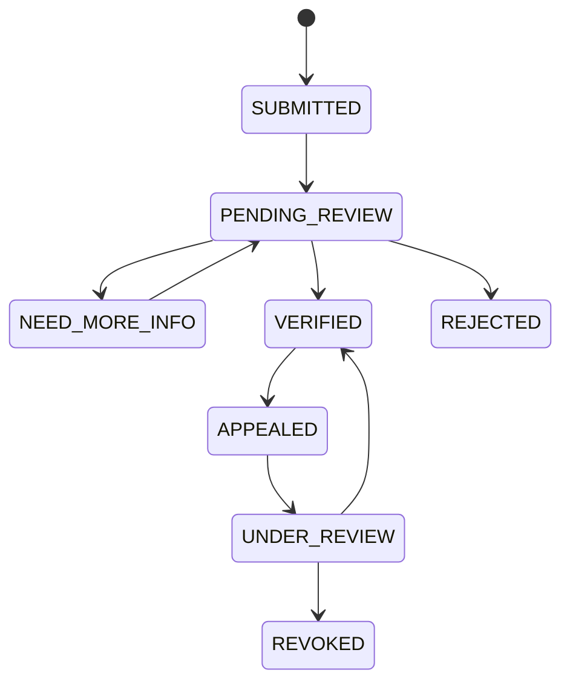
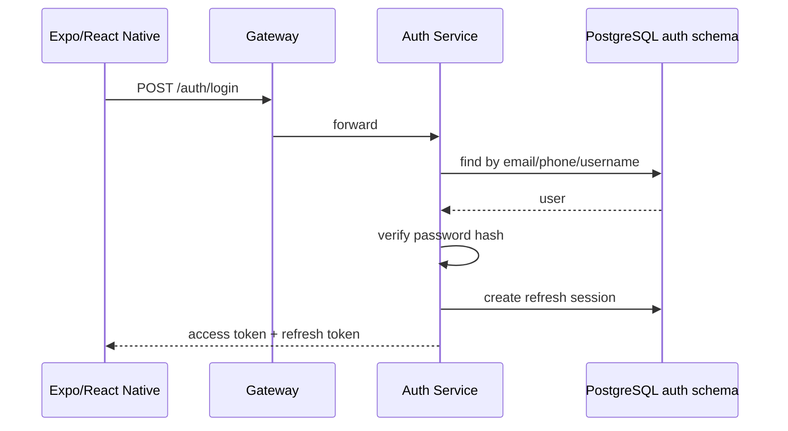
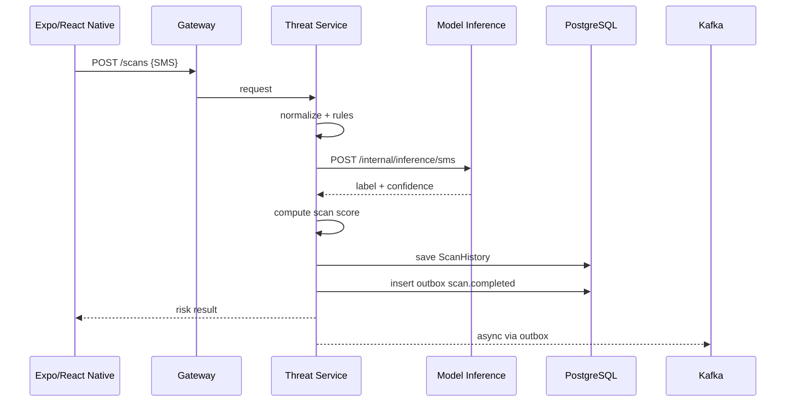
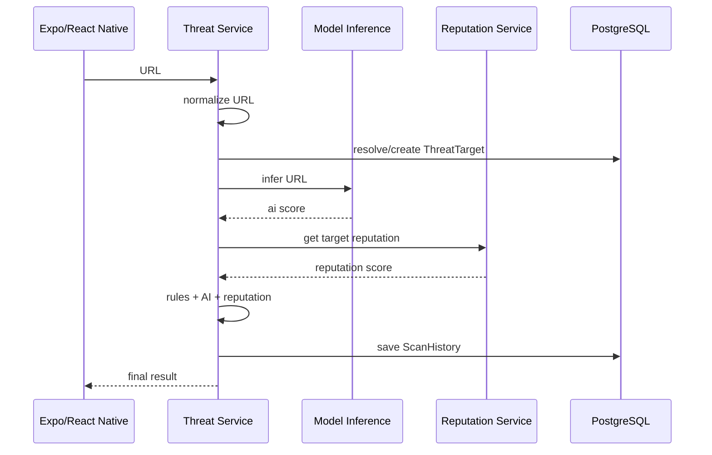
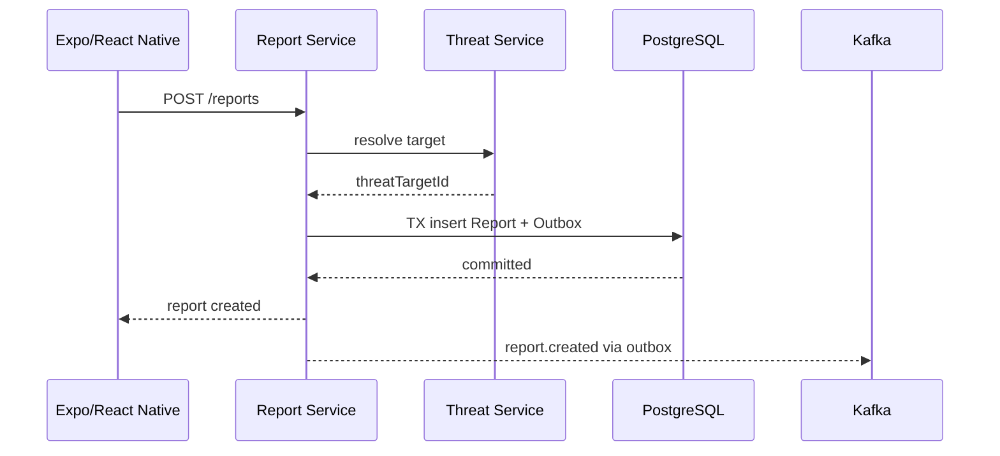
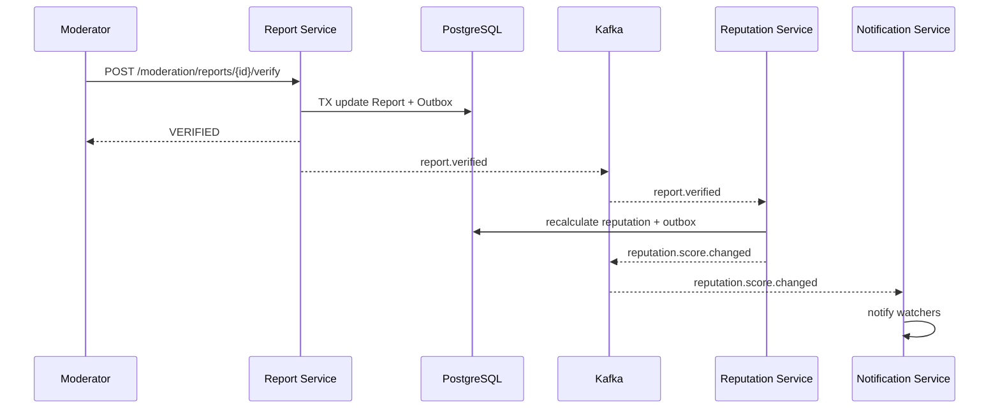

# BảoTin — Backend Architecture & Implementation Master Plan

> **Tài liệu thiết kế tổng thể để bắt đầu triển khai backend BảoTin**  
> Phạm vi: Spring Boot Microservices, 01 PostgreSQL database vật lý, Redis, Kafka, Transactional Outbox + Inbox/Idempotent Consumer, ONNX inference, MinIO, Expo Web + React Native (Android/iOS).  
> Trạng thái AI hiện tại: **đã fine-tune 2 model và đã có 2 file ONNX**.  
> Định hướng: **Spring Boot/backend là trọng tâm; AI là tín hiệu bổ trợ cho hệ thống đánh giá rủi ro.**

---

# Mục lục

1. [Quyết định kiến trúc quan trọng](#1-quyết-định-kiến-trúc-quan-trọng)
2. [Cấu trúc multi-repository hiện tại và cách tổ chức](#2-cấu-trúc-multi-repository-hiện-tại-và-cách-tổ-chức)
3. [Kiến trúc tổng thể](#3-kiến-trúc-tổng-thể)
4. [Vai trò và ranh giới từng service](#4-vai-trò-và-ranh-giới-từng-service)
5. [Thiết kế một PostgreSQL database duy nhất](#5-thiết-kế-một-postgresql-database-duy-nhất)
6. [Quy ước dữ liệu dùng chung](#6-quy-ước-dữ-liệu-dùng-chung)
7. [Thiết kế Auth Service](#7-thiết-kế-auth-service)
8. [Thiết kế Threat Service và Scan History](#8-thiết-kế-threat-service-và-scan-history)
9. [Thiết kế Report Service và Evidence](#9-thiết-kế-report-service-và-evidence)
10. [Thiết kế Reputation Service](#10-thiết-kế-reputation-service)
11. [Thiết kế Model Inference Service](#11-thiết-kế-model-inference-service)
12. [Thiết kế Notification Service](#12-thiết-kế-notification-service)
13. [Thiết kế Search Service](#13-thiết-kế-search-service)
14. [Thiết kế Campaign Service](#14-thiết-kế-campaign-service)
15. [Thiết kế Analytics Service](#15-thiết-kế-analytics-service)
16. [API Gateway](#16-api-gateway)
17. [Kafka và Event-Driven Architecture](#17-kafka-và-event-driven-architecture)
18. [Transactional Outbox Pattern](#18-transactional-outbox-pattern)
19. [Inbox Pattern và xử lý duplicate](#19-inbox-pattern-và-xử-lý-duplicate)
20. [Luồng nghiệp vụ chính](#20-luồng-nghiệp-vụ-chính)
21. [Redis](#21-redis)
22. [MinIO / Object Storage](#22-minio--object-storage)
23. [Contracts Repository](#23-contracts-repository)
24. [Security](#24-security)
25. [Privacy và retention](#25-privacy-và-retention)
26. [Observability](#26-observability)
27. [Testing strategy](#27-testing-strategy)
28. [Docker và môi trường local](#28-docker-và-môi-trường-local)
29. [CI/CD cho mô hình multi-repository](#29-cicd-cho-mô-hình-multi-repository)
30. [Cấu trúc source code chuẩn cho từng Spring Boot repo](#30-cấu-trúc-source-code-chuẩn-cho-từng-spring-boot-repo)
31. [Quy ước REST API](#31-quy-ước-rest-api)
32. [Kế hoạch triển khai theo từng phase](#32-kế-hoạch-triển-khai-theo-từng-phase)
33. [MVP và phạm vi mở rộng](#33-mvp-và-phạm-vi-mở-rộng)
34. [Checklist Definition of Done](#34-checklist-definition-of-done)
35. [Những thứ không nên làm](#35-những-thứ-không-nên-làm)
36. [Sơ đồ cuối cùng](#36-sơ-đồ-cuối-cùng)

---

# 1. Quyết định kiến trúc quan trọng

## 1.1. Có thể dùng một database duy nhất không?

**Có. Với BảoTin quy mô vừa và nhỏ, nên dùng một PostgreSQL instance/database vật lý duy nhất ở giai đoạn hiện tại.**

Tuy nhiên không nên để tất cả service sử dụng chung một nhóm bảng và tự do `JOIN` lẫn nhau.

Thiết kế đề xuất:

```text
PostgreSQL
└── database: baotin
    ├── schema: auth
    ├── schema: threat
    ├── schema: report
    ├── schema: reputation
    ├── schema: campaign
    ├── schema: notification
    ├── schema: search
    └── schema: analytics
```

Nguyên tắc:

- Một PostgreSQL server.
- Một database `baotin`.
- Mỗi service **sở hữu schema riêng**.
- Service chỉ được `INSERT/UPDATE/DELETE` schema của chính nó.
- Không tạo foreign key xuyên schema giữa các service.
- Không viết query kiểu `report.reports JOIN auth.users`.
- ID của entity thuộc service khác chỉ được lưu dưới dạng **logical reference UUID**.
- Dữ liệu giữa các service đồng bộ bằng REST hoặc Kafka.
- Mỗi service quản lý migration của schema mình bằng Flyway.
- Khi hệ thống lớn, một schema có thể được tách thành database riêng mà ít phải sửa business logic.

Đây là phương án cân bằng giữa:

```text
Database-per-service thuần túy
        và
Shared-database monolith
```

Nó phù hợp với đồ án và hệ thống vừa/nhỏ vì:

- Dễ chạy local.
- Dễ backup.
- Dễ triển khai.
- Không phải vận hành 7–10 PostgreSQL instance.
- Vẫn giữ được ownership của microservice.
- Sau này vẫn có đường tách database.

---

## 1.2. AI đứng ở đâu trong hệ thống?

AI **không quyết định Report có phải scam hay không**.

AI chỉ tạo signal:

```text
SMS / URL
    ↓
Model Inference Service
    ↓
label + confidence
    ↓
Threat/Reputation logic
```

Hai file ONNX hiện tại được đưa vào `Model-Inference-Service`.

Ví dụ:

```json
{
  "model": "sms-phobert",
  "modelVersion": "1.0.0",
  "label": "SCAM",
  "confidence": 0.9462
}
```

Reputation Service mới là nơi kết hợp:

```text
Community reports
Verified reports
Rule-based signals
AI signal
Campaign association
Time decay
```

để sinh ra `riskScore`.

---

## 1.3. Kafka dùng vào đâu?

Kafka dùng cho **domain event bất đồng bộ**, không dùng thay REST.

REST:

```text
"Tôi cần câu trả lời ngay."
```

Kafka:

```text
"Một việc vừa xảy ra; service nào quan tâm thì xử lý."
```

Ví dụ REST:

- login
- refresh token
- scan URL
- scan SMS
- lấy scan history
- lấy profile
- xem report
- moderator review report

Ví dụ Kafka:

- report đã được tạo
- report được moderator xác minh
- threat được cập nhật
- risk score thay đổi
- campaign được phát hiện
- notification cần gửi
- analytics cần cập nhật

---

## 1.4. Outbox bắt buộc ở đâu?

Service nào vừa:

1. ghi database
2. vừa cần phát Kafka event

thì phải dùng **Transactional Outbox**.

Không viết:

```java
repository.save(entity);
kafkaTemplate.send(...);
```

theo kiểu hai thao tác độc lập.

Phải:

```text
DB transaction
├── UPDATE domain data
└── INSERT outbox_event

COMMIT
```

sau đó Outbox Publisher mới gửi Kafka.

Consumer phải dùng **Inbox/Idempotency** để chịu được duplicate event.

---

# 2. Cấu trúc multi-repository hiện tại và cách tổ chức

Theo cấu trúc hiện tại, mỗi folder của workspace là một Git repository riêng.

Workspace local có thể giữ dạng:

```text
BaoTin/
├── AI/
├── Analytics-Service/
├── API-Gateway/
├── Auth-Service/
├── Campaign-Service/
├── Contracts/
├── Frontend/
├── Infra/
├── Model-Inference-Service/
├── Notification-Service/
├── Report-Service/
├── Reputation-Service/
├── Search-Service/
└── Threat-Service/
```

Nếu `Identity-Service` vẫn còn trong workspace cũ thì:

> **Merge toàn bộ chức năng cần thiết vào Auth-Service rồi retire Identity-Service.**

Không cần một Git repository cha chứa toàn bộ các repo trên.

`BaoTin/` có thể chỉ là workspace local.

## 2.1. Vai trò từng repository

| Repository | Vai trò |
|---|---|
| `AI` | Training, evaluation, export ONNX, tokenizer/preprocessing artifacts |
| `API-Gateway` | Single entry point cho Web/Mobile |
| `Auth-Service` | User, login, JWT, refresh token, OAuth Google/Facebook, RBAC |
| `Threat-Service` | Scan, Scan History, Threat Target, normalization, orchestration |
| `Report-Service` | Report, moderation, evidence, appeal |
| `Reputation-Service` | Tính và lưu Risk/Reputation Score |
| `Model-Inference-Service` | Load 2 ONNX model và cung cấp inference |
| `Notification-Service` | Push/email, preferences, watchlist notification |
| `Search-Service` | Search/read projection |
| `Campaign-Service` | Phát hiện/nhóm campaign lừa đảo |
| `Analytics-Service` | Aggregate metrics nghiệp vụ |
| `Contracts` | OpenAPI/Event Schema/API contract dùng chung |
| `Infra` | Docker Compose, Postgres, Kafka, Redis, MinIO, monitoring |
| `Frontend` | Expo Web + React Native (Web/Android/iOS) |

## 2.2. Naming

Có thể giữ tên repo hiện tại để tránh mất công rename.

Tên runtime/container/Kubernetes nên dùng lowercase:

```text
api-gateway
auth-service
threat-service
report-service
reputation-service
model-inference-service
notification-service
search-service
campaign-service
analytics-service
```

---

# 3. Kiến trúc tổng thể

```mermaid
flowchart TB
    U[Expo Web / React Native (Android/iOS)]

    GW[API Gateway]

    AUTH[Auth Service]
    THREAT[Threat Service]
    REPORT[Report Service]
    REP[Reputation Service]
    MODEL[Model Inference Service]
    NOTI[Notification Service]
    SEARCH[Search Service]
    CAMP[Campaign Service]
    ANA[Analytics Service]

    PG[(PostgreSQL: baotin)]
    REDIS[(Redis)]
    KAFKA[(Kafka)]
    MINIO[(MinIO)]

    U -->|HTTPS| GW

    GW --> AUTH
    GW --> THREAT
    GW --> REPORT
    GW --> NOTI
    GW --> SEARCH
    GW --> CAMP
    GW --> ANA

    THREAT -->|REST internal| MODEL
    THREAT -->|REST internal| REP
    REPORT -->|REST internal| THREAT

    AUTH --> PG
    THREAT --> PG
    REPORT --> PG
    REP --> PG
    NOTI --> PG
    SEARCH --> PG
    CAMP --> PG
    ANA --> PG

    GW --> REDIS
    AUTH --> REDIS
    THREAT --> REDIS
    REP --> REDIS

    REPORT --> MINIO

    AUTH <--> KAFKA
    THREAT <--> KAFKA
    REPORT <--> KAFKA
    REP <--> KAFKA
    NOTI <--> KAFKA
    SEARCH <--> KAFKA
    CAMP <--> KAFKA
    ANA <--> KAFKA
```

## 3.1. Nguyên tắc dependency

Luồng dependency nên giữ càng ít vòng càng tốt.

Core:

```text
Gateway
  ↓
Auth / Threat / Report / Search / Notification
```

Threat orchestration:

```text
Threat
 ├── Model Inference
 └── Reputation
```

Report:

```text
Report
  └── Threat resolve target
```

Bất đồng bộ:

```text
Domain Service
    ↓
Outbox
    ↓
Kafka
    ↓
Consumer Services
```

Không để:

```text
Auth -> Report -> Threat -> Auth -> ...
```

thành vòng dependency.

---

# 4. Vai trò và ranh giới từng service

## 4.1. API Gateway

Có trách nhiệm:

- Route request.
- CORS.
- Global rate limiting.
- Correlation ID.
- Request size limits.
- Basic request logging.
- JWT validation tại edge.
- Chặn endpoint không public.
- Không chứa business logic.
- Không truy cập database.

Không được:

- Query report database.
- Tính risk.
- Gọi AI.
- Quản lý user.
- Aggregate quá nhiều business workflow.

---

## 4.2. Auth Service

Sở hữu:

- User.
- Username.
- Email.
- Phone.
- Password.
- Google SSO.
- Facebook SSO.
- Role.
- Permission.
- Refresh session.
- Verification/reset token.
- Account status.

---

## 4.3. Threat Service

Đây là service trọng tâm của user-facing flow.

Sở hữu:

- Threat Target.
- Scan.
- Scan Result.
- Scan History.
- Normalization.
- Rule signal mức scan.
- Orchestration giữa inference và reputation.
- Public threat detail snapshot.

Không quyết định Report status.

---

## 4.4. Report Service

Sở hữu:

- Report.
- Evidence.
- Moderation.
- Moderator review.
- Request more information.
- Appeal.
- Report status history.

AI không được tự set `VERIFIED`.

---

## 4.5. Reputation Service

Sở hữu:

- Risk score.
- Risk level.
- Score components.
- Score history.
- Rules/weights.
- Recalculation.

Đây là nguồn sự thật cho:

```text
Threat Target hiện có độ rủi ro bao nhiêu?
```

---

## 4.6. Model Inference Service

Sở hữu:

- Runtime inference.
- Model metadata.
- Model version.
- Preprocessing/tokenization.
- ONNX Runtime session.

Không sở hữu:

- User.
- Report.
- Threat.
- Risk score cuối.
- Database business.

---

## 4.7. Notification Service

Sở hữu:

- Device token.
- Notification preferences.
- Watch subscriptions.
- Notification delivery log.

---

## 4.8. Search Service

Sở hữu:

- Read/search projection.
- Search index.

Không sở hữu dữ liệu nguồn.

Giai đoạn đầu dùng PostgreSQL Full Text Search + `pg_trgm`.

Chưa cần Elasticsearch/OpenSearch.

---

## 4.9. Campaign Service

Sở hữu:

- Campaign.
- Campaign member.
- Relationship/association phục vụ campaign.
- Rule phát hiện campaign.

Có thể triển khai Phase sau.

---

## 4.10. Analytics Service

Sở hữu:

- Dữ liệu aggregate.
- Daily metrics.
- Trend.
- Dashboard metrics.

Không lưu raw SMS.

Có thể triển khai sau MVP.

---

# 5. Thiết kế một PostgreSQL database duy nhất

## 5.1. Database vật lý

```text
database = baotin
```

Schemas:

```sql
CREATE SCHEMA auth;
CREATE SCHEMA threat;
CREATE SCHEMA report;
CREATE SCHEMA reputation;
CREATE SCHEMA campaign;
CREATE SCHEMA notification;
CREATE SCHEMA search;
CREATE SCHEMA analytics;
```

## 5.2. Database users/roles

Nên có runtime DB role riêng:

```text
baotin_auth
baotin_threat
baotin_report
baotin_reputation
baotin_campaign
baotin_notification
baotin_search
baotin_analytics
```

Quyền:

```text
baotin_auth        -> auth.*
baotin_threat      -> threat.*
baotin_report      -> report.*
...
```

Không cấp:

```text
baotin_report -> UPDATE auth.users
```

## 5.3. Không cross-schema foreign key

Ví dụ `report.reporter_user_id` chứa UUID của Auth Service:

```text
report.reports.reporter_user_id
```

nhưng không tạo:

```sql
FOREIGN KEY (...) REFERENCES auth.users(id)
```

Lý do:

- Không coupling migration.
- Sau này tách DB dễ.
- Auth vẫn sở hữu lifecycle User.

Tương tự:

```text
report.threat_target_id
```

không FK sang `threat.threat_targets`.

---

# 6. Quy ước dữ liệu dùng chung

## 6.1. ID

Dùng UUID cho toàn hệ thống.

Ví dụ Java:

```java
UUID id;
```

Không dùng integer auto increment làm public ID.

## 6.2. Timestamp

PostgreSQL:

```sql
TIMESTAMPTZ
```

Java:

```java
Instant
```

API ISO-8601 UTC:

```text
2026-09-24T04:10:30Z
```

Frontend tự đổi local timezone.

## 6.3. Soft delete

Không phải bảng nào cũng soft delete.

User:

```text
status = ACTIVE / LOCKED / DISABLED / DELETED
```

Report:

giữ audit, không hard delete tùy tiện.

Scan history:

cho phép user delete.

## 6.4. Optimistic locking

Các aggregate dễ xung đột nên có:

```text
version BIGINT
```

JPA:

```java
@Version
private Long version;
```

Dùng cho:

- Report moderation.
- Reputation.
- User account state.

---

# 7. Thiết kế Auth Service

## 7.1. Kiểu đăng nhập

BảoTin hỗ trợ:

```text
Email + Password
Phone + Password
Username + Password
Google SSO
Facebook SSO
```

Login password API nhận một trường:

```json
{
  "identifier": "user@example.com",
  "password": "..."
}
```

`identifier` có thể là:

- email
- phone
- username

Auth Service normalize rồi tìm đúng account.

## 7.2. Quy tắc đăng ký

Đề xuất:

- Username bắt buộc và unique.
- Cần tối thiểu email hoặc phone.
- Password account phải có password hash.
- OAuth-only user không bắt buộc password.
- Có thể bổ sung password sau.
- Email/phone phải verify trước khi dùng chức năng nhạy cảm.

## 7.3. Tables

### `auth.users`

```text
id                  UUID PK
username            VARCHAR(50)
username_normalized VARCHAR(50) UNIQUE
email               VARCHAR(320) NULL
email_normalized    VARCHAR(320) NULL UNIQUE
phone               VARCHAR(20) NULL
phone_normalized    VARCHAR(20) NULL UNIQUE
password_hash       VARCHAR(255) NULL
display_name        VARCHAR(120)
avatar_url          TEXT NULL
status              VARCHAR(30)
email_verified_at   TIMESTAMPTZ NULL
phone_verified_at   TIMESTAMPTZ NULL
last_login_at       TIMESTAMPTZ NULL
created_at          TIMESTAMPTZ
updated_at          TIMESTAMPTZ
version             BIGINT
```

Không nên lưu plaintext password.

### `auth.oauth_accounts`

```text
id                UUID PK
user_id           UUID NOT NULL
provider          VARCHAR(30)
provider_subject  VARCHAR(255)
provider_email    VARCHAR(320) NULL
created_at        TIMESTAMPTZ
updated_at        TIMESTAMPTZ
UNIQUE(provider, provider_subject)
```

Provider:

```text
GOOGLE
FACEBOOK
```

FK nội schema:

```text
oauth_accounts.user_id -> auth.users.id
```

được phép vì cùng owner.

### `auth.roles`

```text
id
code
name
```

Role:

```text
USER
MODERATOR
ADMIN
```

### `auth.user_roles`

```text
user_id
role_id
PRIMARY KEY(user_id, role_id)
```

### `auth.refresh_sessions`

```text
id
user_id
token_hash
device_id
device_name
user_agent
ip_hash          NULL
expires_at
last_used_at
revoked_at       NULL
created_at
```

**Chỉ lưu hash của refresh token.**

### `auth.verification_tokens`

Dùng cho:

- email verify
- phone verify/OTP
- reset password

```text
id
user_id
type
token_hash
expires_at
consumed_at
created_at
```

### `auth.outbox_events`

Theo format chung phần Outbox.

## 7.4. JWT

Đề xuất:

```text
Access token: 10–15 phút
Refresh token: 30 ngày
Refresh token rotation: ON
```

JWT claims tối thiểu:

```json
{
  "sub": "user-uuid",
  "roles": ["USER"],
  "sid": "session-uuid",
  "iat": 0,
  "exp": 0,
  "iss": "baotin-auth"
}
```

Nên dùng asymmetric signing:

```text
RS256 hoặc ES256
```

Auth giữ private key.

Gateway/services chỉ cần public key/JWKS.

## 7.5. OAuth Google/Facebook

Flow:

```text
Frontend
   ↓
Auth Service
   ↓
Google/Facebook
   ↓
OAuth callback
   ↓
Auth Service maps OAuthAccount -> User
   ↓
BảoTin access + refresh token
```

Mobile nên dùng Authorization Code + PKCE/deep-link callback.

Không để frontend tự quyết định OAuth account tương ứng user nào.

## 7.6. Endpoint

```text
POST /api/v1/auth/register
POST /api/v1/auth/login
POST /api/v1/auth/refresh
POST /api/v1/auth/logout

GET  /api/v1/auth/me
PATCH /api/v1/auth/me

POST /api/v1/auth/forgot-password
POST /api/v1/auth/reset-password

POST /api/v1/auth/verify-email
POST /api/v1/auth/verify-phone

GET  /api/v1/auth/oauth2/google
GET  /api/v1/auth/oauth2/facebook
GET  /api/v1/auth/oauth2/callback/{provider}

GET    /api/v1/auth/sessions
DELETE /api/v1/auth/sessions/{sessionId}
```

---

# 8. Thiết kế Threat Service và Scan History

## 8.1. Threat Target

Một `ThreatTarget` là một đối tượng có thể được cộng đồng/report/reputation theo dõi lâu dài.

Types:

```text
URL
PHONE
BANK_ACCOUNT
EMAIL
SOCIAL_ACCOUNT
```

SMS thông thường **không tự động trở thành ThreatTarget**.

SMS chỉ trở thành dữ liệu report/threat lâu dài nếu user thực sự report hoặc moderator xác minh.

## 8.2. `threat.threat_targets`

```text
id                 UUID PK
type               VARCHAR(40)
canonical_hash     VARCHAR(128)
encrypted_value    BYTEA NULL
public_value       TEXT NULL
masked_value       VARCHAR(500)
domain             VARCHAR(253) NULL
status             VARCHAR(30)
first_seen_at      TIMESTAMPTZ
last_seen_at       TIMESTAMPTZ
created_at         TIMESTAMPTZ
updated_at         TIMESTAMPTZ
version            BIGINT

UNIQUE(type, canonical_hash)
```

### Với URL

Có thể lưu:

```text
public_value = normalized URL
domain       = example.com
```

Trước khi lưu nên:

- lower-case hostname
- bỏ fragment
- normalize scheme/host
- loại bỏ known tracking params
- không lưu token/session secrets trong query

### Với phone/bank/email

Nên có:

```text
canonical_hash  = HMAC-SHA256(normalized value)
encrypted_value = AES-GCM(value)
masked_value    = 098****123
```

Public API trả masked value nếu không cần full value.

## 8.3. Scan

Types:

```text
SMS
URL
PHONE
BANK_ACCOUNT
EMAIL
SOCIAL_ACCOUNT
```

### `threat.scan_history`

```text
id                  UUID PK
user_id             UUID NULL
scan_type           VARCHAR(40)
threat_target_id    UUID NULL

input_hash          VARCHAR(128)
content_preview     VARCHAR(300) NULL
encrypted_content   BYTEA NULL

ai_label            VARCHAR(80) NULL
ai_score            NUMERIC(6,5) NULL
rule_score          NUMERIC(6,2) NULL
reputation_score    NUMERIC(6,2) NULL
final_score         NUMERIC(6,2)
risk_level          VARCHAR(20)

result_snapshot     JSONB
model_name          VARCHAR(100) NULL
model_version       VARCHAR(50) NULL

created_at          TIMESTAMPTZ
content_expires_at  TIMESTAMPTZ NULL
```

Không FK `user_id` sang auth schema.

## 8.4. Vì sao lưu snapshot?

Ví dụ:

```text
24/09:
risk = 32
```

Ngày 26/09 có thêm nhiều report:

```text
current risk = 89
```

Scan history phải hiển thị:

```text
Risk lúc quét: 32
Risk hiện tại: 89
```

Do đó phải lưu `result_snapshot`.

## 8.5. Scan URL

Request:

```http
POST /api/v1/scans
```

```json
{
  "type": "URL",
  "content": "https://example.com/login"
}
```

Threat Service:

```text
1. validate
2. normalize URL
3. resolve/create ThreatTarget
4. chạy deterministic URL rules
5. gọi Model-Inference-Service
6. lấy current reputation
7. combine thành Scan Risk
8. lưu ScanHistory nếu logged-in
9. publish scan.completed async
10. trả result
```

## 8.6. Scan SMS

```text
1. validate length
2. normalize text đúng như training pipeline yêu cầu
3. SHA/HMAC hash content
4. call SMS model
5. run text rules
6. compute scan score
7. nếu user login -> lưu history
8. raw SMS encrypted chỉ giữ tạm
```

Không tạo permanent ThreatTarget chỉ vì user scan SMS.

## 8.7. Scan phone/bank/email

Không có AI bắt buộc.

```text
normalize
→ resolve ThreatTarget
→ Reputation Service
→ risk result
```

## 8.8. Endpoint

```text
POST   /api/v1/scans
GET    /api/v1/scans/history
GET    /api/v1/scans/history/{id}
DELETE /api/v1/scans/history/{id}
DELETE /api/v1/scans/history

GET    /api/v1/threats/{id}
GET    /api/v1/threats/lookup?type=URL&value=...

PUT    /internal/v1/threat-targets/resolve
GET    /internal/v1/threat-targets/{id}
```

## 8.9. Guest scan

Có thể cho guest scan:

```text
URL/SMS scan không cần login
```

nhưng:

- rate limit thấp hơn
- không có history
- không watchlist
- không report evidence nhạy cảm nếu chưa đăng nhập

---

# 9. Thiết kế Report Service và Evidence

## 9.1. Report fields

### `report.reports`

```text
id                       UUID PK
reporter_user_id         UUID NOT NULL
threat_target_id         UUID NOT NULL

target_type_snapshot     VARCHAR(40)
target_display_snapshot  VARCHAR(500)

category                 VARCHAR(60)
title                    VARCHAR(200)
description              TEXT
occurred_at              TIMESTAMPTZ NULL

amount_lost              NUMERIC(18,2) NULL
currency                 VARCHAR(3) NULL
transaction_reference_enc BYTEA NULL

status                   VARCHAR(40)
priority                 VARCHAR(20)

ai_label                 VARCHAR(80) NULL
ai_confidence            NUMERIC(6,5) NULL

moderator_user_id        UUID NULL
moderator_note           TEXT NULL
reviewed_at              TIMESTAMPTZ NULL

created_at               TIMESTAMPTZ
updated_at               TIMESTAMPTZ
version                  BIGINT
```

## 9.2. Report category

Khởi đầu:

```text
FAKE_SHIPPER
BANK_IMPERSONATION
GOV_IMPERSONATION
PHISHING
INVESTMENT_SCAM
JOB_SCAM
PRIZE_SCAM
ACCOUNT_THEFT
SOCIAL_IMPERSONATION
MARKETPLACE_SCAM
OTHER
```

Không hardcode logic vào frontend; backend expose enum/config endpoint nếu cần.

## 9.3. Report state machine



MVP có thể chưa làm appeal ngay:

```text
SUBMITTED
PENDING_REVIEW
NEED_MORE_INFO
VERIFIED
REJECTED
```

## 9.4. AI không đổi trạng thái

Không bao giờ:

```text
AI > 95%
→ status = VERIFIED
```

Đúng:

```text
AI > 95%
→ priority có thể tăng
→ moderator thấy signal
→ status vẫn PENDING_REVIEW
```

## 9.5. Evidence

### `report.evidence`

```text
id                UUID PK
report_id         UUID NOT NULL
type              VARCHAR(30)
object_key        VARCHAR(700)
original_filename VARCHAR(255)
mime_type         VARCHAR(150)
size_bytes        BIGINT
sha256            VARCHAR(64)
uploaded_by       UUID
created_at        TIMESTAMPTZ
deleted_at        TIMESTAMPTZ NULL
```

File thật nằm MinIO.

Không lưu ảnh/PDF trực tiếp trong PostgreSQL.

## 9.6. Evidence limits

MVP:

```text
ảnh: jpg/png/webp
PDF
max 10 MB/file
max 5 file/report
```

Có thể bổ sung malware scanning sau.

## 9.7. Report creation flow

```text
Client
  ↓
Report Service
  ↓
Threat Service resolve target
  ↓
Report DB transaction:
  ├─ INSERT report
  └─ INSERT outbox_event
  ↓
COMMIT
  ↓
response
```

Kafka xử lý phần hậu kỳ.

## 9.8. Moderator endpoint

```text
GET  /api/v1/moderation/reports
GET  /api/v1/moderation/reports/{id}

POST /api/v1/moderation/reports/{id}/verify
POST /api/v1/moderation/reports/{id}/reject
POST /api/v1/moderation/reports/{id}/request-info
```

Spring Security:

```text
ROLE_MODERATOR
ROLE_ADMIN
```

## 9.9. User endpoint

```text
POST /api/v1/reports
GET  /api/v1/reports/me
GET  /api/v1/reports/{id}

POST /api/v1/reports/{id}/evidence
DELETE /api/v1/reports/{id}/evidence/{evidenceId}
```

---

# 10. Thiết kế Reputation Service

## 10.1. Khái niệm

Risk Score gắn với:

> **ThreatTarget**

Không gắn trực tiếp vào User.

SMS scan riêng lẻ có `scan risk`, không nhất thiết có permanent reputation.

## 10.2. `reputation.target_reputation`

```text
threat_target_id       UUID PK

report_signal          NUMERIC(6,2)
rule_signal            NUMERIC(6,2)
ai_signal              NUMERIC(6,2)
campaign_signal        NUMERIC(6,2)

final_score            NUMERIC(6,2)
risk_level             VARCHAR(20)
confidence             NUMERIC(6,5)

total_report_count     INTEGER
verified_report_count  INTEGER

calculation_version    VARCHAR(30)
calculated_at          TIMESTAMPTZ
version                BIGINT
```

## 10.3. History

### `reputation.score_history`

```text
id
threat_target_id
old_score
new_score
old_level
new_level
reason
components JSONB
calculated_at
```

Có thể dùng để:

- audit
- chart risk
- notification khi risk tăng mạnh

## 10.4. Risk levels

Khởi điểm:

```text
0–24   LOW
25–49  MEDIUM
50–74  HIGH
75–100 CRITICAL
```

Tên có thể đổi UI:

```text
THẤP
TRUNG BÌNH
CAO
RẤT CAO
```

## 10.5. Công thức khởi điểm

Không coi các trọng số dưới đây là chân lý; đưa vào config để tuning.

URL:

```text
35% verified/community report signal
25% deterministic rule signal
25% AI URL model signal
15% campaign/association signal
```

Phone/bank account:

```text
55% verified/community report signal
20% deterministic rule signal
25% campaign/association signal
```

SMS scan ephemeral:

```text
70% AI SMS model
30% deterministic text rules
```

Điểm cần nhấn mạnh:

- `SMS scan score` ≠ `Threat reputation score`.
- AI chỉ là một signal trong permanent threat reputation.
- Report verified có trọng lượng lớn hơn report chưa review.
- Có time-decay.

## 10.6. Time decay

Report cũ giảm ảnh hưởng theo thời gian.

Khái niệm:

```text
weight = exp(-lambda * age)
```

Không cần công thức quá phức tạp ở MVP.

Có thể đơn giản:

```text
0–30 ngày    x1.0
31–90 ngày   x0.8
91–180 ngày  x0.6
>180 ngày    x0.4
```

## 10.7. Trigger recalculation

Reputation Service subscribe:

```text
report.verified
report.rejected/revoked
threat.updated
campaign.updated
```

Sau khi tính:

```text
reputation.score.changed
```

nếu score/level thay đổi đáng kể.

## 10.8. API

Internal:

```text
GET  /internal/v1/reputation/targets/{threatTargetId}
POST /internal/v1/reputation/targets/{threatTargetId}/recalculate
```

Public nên ưu tiên Threat Service aggregate kết quả để frontend không phụ thuộc nhiều service.

---

# 11. Thiết kế Model Inference Service

## 11.1. Input hiện có

Đã có:

```text
2 model ONNX
```

Nhưng **ONNX file chưa đủ**.

Phải đóng gói cùng:

```text
tokenizer artifacts
label mapping
max_length
normalization/preprocessing config
model version
model checksum
```

Ví dụ:

```text
models/
├── sms/
│   └── 1.0.0/
│       ├── model.onnx
│       ├── tokenizer.json
│       ├── tokenizer-config.json
│       ├── labels.json
│       ├── preprocessing.json
│       ├── metrics.json
│       └── sha256.txt
│
└── url/
    └── 1.0.0/
        ├── model.onnx
        ├── tokenizer.json
        ├── tokenizer-config.json
        ├── labels.json
        ├── preprocessing.json
        ├── metrics.json
        └── sha256.txt
```

**Preprocessing inference phải giống preprocessing lúc fine-tune.**

Sai khác tokenizer/normalization có thể làm model giảm chất lượng rất mạnh.

## 11.2. Runtime

Ưu tiên:

```text
Spring Boot
+ ONNX Runtime Java
```

để backend vẫn Java-centric.

Nếu tokenizer của model quá khó tái hiện chính xác bằng Java, có hai phương án:

1. dùng Java binding tương thích Hugging Face tokenizer;
2. tạm thời chạy inference service bằng Python/ONNX Runtime.

Không nên tự viết lại tokenizer bằng tay nếu không chắc 100% tương thích.

## 11.3. Service không cần database

Model Inference Service có thể stateless:

```text
request
→ preprocess
→ tokenize
→ ONNX session
→ logits
→ softmax
→ response
```

## 11.4. Load model

Load ONNX **một lần khi app startup**.

Không load mỗi request.

```text
Application startup
 ├─ load sms session
 └─ load url session
```

## 11.5. Endpoint

Internal only:

```text
POST /internal/v1/inference/sms
POST /internal/v1/inference/url

GET /internal/v1/models
GET /actuator/health
```

### SMS request

```json
{
  "text": "Tin nhắn cần kiểm tra"
}
```

Response:

```json
{
  "model": "sms-phobert",
  "modelVersion": "1.0.0",
  "label": "SCAM",
  "confidence": 0.9462,
  "latencyMs": 42
}
```

### URL request

```json
{
  "url": "https://example.com"
}
```

## 11.6. Timeout

Threat Service gọi Model Inference:

```text
connect timeout: ~500ms–1s
request timeout: tùy benchmark, ví dụ 2–3s
```

Nếu AI service unavailable:

```text
Threat Service vẫn hoạt động
→ result dựa trên rules + reputation
→ aiAvailable = false
```

Không để toàn hệ thống scan chết vì AI chết.

## 11.7. Model versioning

Mỗi response phải có:

```text
modelName
modelVersion
```

Scan history lưu version.

Sau này có model mới:

```text
sms 1.0.0
sms 1.1.0
```

có thể audit kết quả cũ.

---

# 12. Thiết kế Notification Service

## 12.1. Chức năng

- Push mobile.
- In-app notification.
- Email optional.
- Notification preferences.
- Watchlist.
- Delivery log.

## 12.2. Tables

### `notification.device_tokens`

```text
id
user_id
platform
token
device_id
active
created_at
last_seen_at
```

Platform:

```text
ANDROID
IOS
WEB
```

### `notification.preferences`

```text
user_id PK
risk_change_enabled
report_update_enabled
campaign_alert_enabled
push_enabled
email_enabled
updated_at
```

### `notification.watch_subscriptions`

```text
id
user_id
threat_target_id
created_at
UNIQUE(user_id, threat_target_id)
```

### `notification.notifications`

```text
id
user_id
type
title
body
data JSONB
status
created_at
read_at
```

### `notification.delivery_attempts`

```text
id
notification_id
channel
status
attempt
provider_message_id
error
created_at
```

## 12.3. Events

Consume:

```text
reputation.score.changed
report.reviewed
campaign.detected
```

Ví dụ:

```text
risk 22 -> 86
+
user đang watch target
→ push notification
```

---

# 13. Thiết kế Search Service

Để tối ưu hệ thống vừa/nhỏ:

> **Chưa dùng Elasticsearch/OpenSearch.**

Dùng PostgreSQL:

- full-text search
- trigram
- GIN index

## 13.1. Extension

Có thể bật:

```sql
CREATE EXTENSION IF NOT EXISTS pg_trgm;
```

## 13.2. Read model

### `search.search_documents`

```text
id
document_type
reference_id
title
display_value
search_text
risk_score
risk_level
status
metadata JSONB
updated_at
```

Search Service consume event:

```text
threat.created
threat.updated
reputation.score.changed
campaign.created
campaign.updated
```

để cập nhật projection.

## 13.3. API

```text
GET /api/v1/search?q=...
GET /api/v1/search?q=...&type=URL
GET /api/v1/search?q=...&riskLevel=HIGH
```

Nếu tương lai dữ liệu quá lớn:

```text
Search Service implementation
PostgreSQL FTS
      ↓
OpenSearch
```

API bên ngoài không cần đổi nhiều.

---

# 14. Thiết kế Campaign Service

Campaign Service là **Phase 2/3**, không chặn MVP.

## 14.1. Mục tiêu

Nhóm các target có dấu hiệu thuộc cùng một chiến dịch.

Ví dụ:

```text
Phone A
Phone B
URL X
Bank Account C
```

xuất hiện cùng report pattern trong thời gian gần nhau.

## 14.2. Tables

### `campaign.campaigns`

```text
id
name
status
risk_level
first_seen_at
last_seen_at
created_at
updated_at
```

### `campaign.campaign_members`

```text
campaign_id
threat_target_id
relation_type
confidence
first_seen_at
last_seen_at
PRIMARY KEY(campaign_id, threat_target_id)
```

### `campaign.threat_links`

```text
id
source_target_id
target_target_id
relation_type
weight
evidence_count
created_at
updated_at
```

## 14.3. Không cần AI bắt buộc

Ban đầu rule-based:

- cùng bank account
- cùng URL/domain
- cùng số điện thoại
- cùng report description pattern
- temporal burst
- cùng target trong nhiều report

---

# 15. Thiết kế Analytics Service

Analytics không nằm trên critical path.

Consume Kafka rồi aggregate.

## 15.1. Tables

### `analytics.daily_metrics`

```text
metric_date
total_scans
sms_scans
url_scans
high_risk_scans
reports_created
reports_verified
reports_rejected
new_threats
active_users
PRIMARY KEY(metric_date)
```

### `analytics.category_daily`

```text
metric_date
category
count
PRIMARY KEY(metric_date, category)
```

### `analytics.risk_level_daily`

```text
metric_date
risk_level
count
PRIMARY KEY(metric_date, risk_level)
```

Không lưu raw SMS trong analytics.

---

# 16. API Gateway

## 16.1. Route

Ví dụ:

```text
/api/v1/auth/**           -> auth-service
/api/v1/scans/**          -> threat-service
/api/v1/threats/**        -> threat-service
/api/v1/reports/**        -> report-service
/api/v1/moderation/**     -> report-service
/api/v1/notifications/**  -> notification-service
/api/v1/watchlist/**      -> notification-service
/api/v1/search/**         -> search-service
/api/v1/campaigns/**      -> campaign-service
/api/v1/analytics/**      -> analytics-service
```

Model Inference:

```text
KHÔNG expose qua gateway
```

## 16.2. Correlation ID

Nếu client chưa gửi:

```text
X-Correlation-Id
```

Gateway generate UUID.

Forward đến tất cả services.

Kafka event cũng chứa correlation ID.

## 16.3. Rate limiting

Redis-backed rate limit.

Ví dụ khởi điểm:

Guest scan:

```text
20 request / 10 phút / IP
```

Logged-in:

```text
100 request / 10 phút / user
```

Report:

```text
10 report / giờ / user
```

Con số cần tuning, không hardcode vào business code.

## 16.4. Request size

Gateway chặn file/request quá lớn trước khi vào service.

---

# 17. Kafka và Event-Driven Architecture

## 17.1. Topic strategy

Để hệ thống vừa/nhỏ, không tạo 50 topic.

Dùng domain topic:

```text
baotin.auth.events.v1
baotin.threat.events.v1
baotin.report.events.v1
baotin.reputation.events.v1
baotin.campaign.events.v1
baotin.notification.events.v1
```

Analytics đọc nhiều topic.

## 17.2. Event type nằm trong envelope

Ví dụ topic:

```text
baotin.report.events.v1
```

chứa:

```text
report.created
report.verified
report.rejected
report.revoked
```

## 17.3. Event envelope chuẩn

```json
{
  "eventId": "uuid",
  "eventType": "report.verified",
  "eventVersion": 1,
  "occurredAt": "2026-09-24T04:20:00Z",

  "producer": "report-service",
  "aggregateType": "Report",
  "aggregateId": "uuid",

  "correlationId": "uuid",
  "causationId": "uuid-or-null",
  "traceId": "trace-id",

  "payload": {}
}
```

## 17.4. Kafka key

Dùng:

```text
aggregateId
```

làm Kafka message key.

Mục đích:

- Event cùng aggregate có khả năng nằm cùng partition.
- Giữ ordering theo aggregate.

## 17.5. Consumer groups

Ví dụ topic `baotin.report.events.v1`:

```text
reputation-service-v1
search-service-v1
analytics-service-v1
campaign-service-v1
```

Mỗi group nhận bản riêng.

Nếu Reputation Service chạy 3 instance:

```text
cả 3 cùng group reputation-service-v1
```

Kafka phân partition giữa các instance.

## 17.6. Partition

Local/MVP:

```text
3 partitions / topic
```

đủ.

Production thật có thể tune theo throughput.

## 17.7. DLT

Có Dead Letter Topic.

Ví dụ:

```text
baotin.report.events.v1.DLT
```

Sau N lần retry consumer vẫn lỗi thì message vào DLT.

Phải có monitoring DLT.

---

# 18. Transactional Outbox Pattern

Đây là phần bắt buộc nếu muốn thiết kế backend đẹp và đúng.

## 18.1. Vấn đề dual-write

Sai:

```text
BEGIN
UPDATE report
COMMIT

Kafka send
```

Nếu DB thành công nhưng Kafka lỗi:

```text
report VERIFIED
nhưng Reputation không bao giờ biết
```

Ngược lại nếu Kafka send trước rồi DB rollback cũng lỗi consistency.

## 18.2. Outbox solution

Trong **cùng transaction**:

```text
BEGIN

UPDATE report

INSERT report.outbox_events

COMMIT
```

Sau đó background worker publish.

## 18.3. Table chuẩn

Mỗi producer service có table riêng trong schema của nó.

Ví dụ `report.outbox_events`:

```text
id               UUID PK
aggregate_type   VARCHAR(100)
aggregate_id     UUID
event_type       VARCHAR(150)
event_version    INTEGER
topic            VARCHAR(200)
message_key      VARCHAR(200)

payload          JSONB
headers          JSONB

status           VARCHAR(30)
occurred_at      TIMESTAMPTZ
published_at     TIMESTAMPTZ NULL

attempts         INTEGER DEFAULT 0
next_attempt_at  TIMESTAMPTZ NULL
last_error       TEXT NULL

created_at       TIMESTAMPTZ
```

Status:

```text
PENDING
PROCESSING
PUBLISHED
FAILED
```

Index:

```sql
CREATE INDEX idx_outbox_pending
ON report.outbox_events(status, next_attempt_at, created_at);
```

## 18.4. Domain transaction

Pseudo-code:

```java
@Transactional
public void verifyReport(UUID reportId, UUID moderatorId) {
    Report report = reportRepository.getForUpdate(reportId);

    report.verify(moderatorId);

    reportRepository.save(report);

    outboxRepository.save(
        OutboxEvent.reportVerified(report)
    );
}
```

Không gọi Kafka trong method trên.

## 18.5. Publisher

Background scheduler:

```text
500ms – 2s một lần
```

Query batch:

```sql
SELECT *
FROM report.outbox_events
WHERE status = 'PENDING'
  AND (next_attempt_at IS NULL OR next_attempt_at <= now())
ORDER BY created_at
LIMIT 100
FOR UPDATE SKIP LOCKED;
```

Worker:

```text
claim batch
→ Kafka send
→ wait broker ack
→ mark PUBLISHED
```

## 18.6. Duplicate vẫn có thể xảy ra

Trường hợp:

```text
Kafka send thành công
process crash
chưa kịp mark PUBLISHED
```

Restart:

```text
publish lại
```

Đây là bình thường.

Vì thế consumer bắt buộc idempotent bằng Inbox.

## 18.7. Retry

Ví dụ:

```text
attempt 1: +5s
attempt 2: +15s
attempt 3: +1m
attempt 4: +5m
attempt 5: FAILED
```

FAILED cần alert/admin inspection.

## 18.8. Cleanup

Job định kỳ:

```text
PUBLISHED older than 7–30 ngày
→ archive/delete
```

MVP có thể giữ 30 ngày.

## 18.9. Polling hay Debezium?

Hiện tại:

> **Polling Outbox Publisher**

vì đơn giản, dễ code, dễ thuyết trình.

Không cần Debezium/CDC ở MVP.

Khi hệ thống lớn:

```text
Outbox table
→ Debezium
→ Kafka
```

có thể thay mà không đổi domain transaction.

---

# 19. Inbox Pattern và xử lý duplicate

## 19.1. Inbox table

Mỗi consumer service có:

```text
<schema>.inbox_events
```

Ví dụ:

```text
event_id        UUID PK
event_type      VARCHAR(150)
consumer        VARCHAR(100)
received_at     TIMESTAMPTZ
processed_at    TIMESTAMPTZ NULL
payload_hash    VARCHAR(64) NULL
```

## 19.2. Consumer transaction

Pseudo-code:

```java
@Transactional
public void handle(Event event) {

    if (inboxRepository.existsById(event.id())) {
        return;
    }

    // business update
    recalculate(...);

    inboxRepository.save(
        InboxEvent.processed(event.id())
    );
}
```

Kafka offset chỉ commit sau khi method xử lý thành công.

## 19.3. Mục tiêu

Hệ thống đạt:

```text
at-least-once delivery
+
idempotent consumer
≈ effectively-once business effect
```

Không quảng cáo là "exactly once toàn hệ thống".

---

# 20. Luồng nghiệp vụ chính

# 20.1. Login password



---

# 20.2. Scan SMS



Nếu Model Inference unavailable:

```text
T -> rules only
result.aiAvailable = false
```

---

# 20.3. Scan URL



---

# 20.4. Tạo Report



---

# 20.5. Moderator xác minh Report



---

# 20.6. Watchlist notification

```text
User watches Threat A
       ↓
notification.watch_subscriptions

Risk A: 20 -> 81
       ↓
reputation.score.changed
       ↓
Kafka
       ↓
Notification Service
       ↓
query watchers
       ↓
FCM / in-app notification
```

---

# 21. Redis

Một Redis instance đủ.

Dùng prefix theo service.

## 21.1. Gateway

```text
gateway:rate:{route}:{principal}
```

## 21.2. Auth

Có thể dùng:

```text
auth:otp:{challengeId}
auth:revoked-jti:{jti}
```

Refresh token source of truth vẫn ở PostgreSQL.

## 21.3. Threat/Reputation

```text
threat:scan:idempotency:{userId}:{key}
reputation:target:{targetId}
```

TTL risk cache:

```text
1–5 phút
```

Khi `reputation.score.changed`:

```text
invalidate cache
```

## 21.4. Không dùng Redis làm source of truth

Không để:

```text
Risk chỉ tồn tại Redis
```

Risk chính vẫn PostgreSQL.

---

# 22. MinIO / Object Storage

Dùng MinIO cho:

- screenshot evidence
- PDF
- attachment

Bucket:

```text
baotin-evidence
```

Object key:

```text
reports/{reportId}/{uuid}.{ext}
```

Không để filename user quyết định path.

## 22.1. Metadata DB

Postgres chỉ lưu:

```text
object_key
mime
size
sha256
```

## 22.2. Access

Không public bucket.

Download:

```text
authenticated request
→ Report Service permission check
→ signed URL ngắn hạn / stream file
```

---

# 23. Contracts Repository

`Contracts` rất quan trọng vì hệ thống là multi-repo.

Không bỏ Java Entity vào Contracts.

Sai:

```text
contracts:
 UserEntity
 ReportEntity
 ThreatEntity
```

Đúng:

```text
Contracts/
├── events/
│   ├── auth/
│   ├── report/
│   ├── threat/
│   ├── reputation/
│   └── campaign/
│
├── openapi/
│   ├── auth-service.yaml
│   ├── threat-service.yaml
│   ├── report-service.yaml
│   └── ...
│
├── protobuf/
│   └── optional/
│
└── docs/
    ├── event-envelope.md
    └── compatibility.md
```

## 23.1. Event version

Event:

```text
report.verified v1
```

Nếu additive compatible change:

```text
vẫn v1
```

Nếu breaking:

```text
v2
```

Không sửa schema cũ rồi hy vọng tất cả consumer update cùng lúc.

## 23.2. OpenAPI

Mỗi service có thể sinh OpenAPI riêng.

Contracts repo lưu bản approved/tagged.

Frontend có thể generate client từ OpenAPI.

---

# 24. Security

## 24.1. Defense in depth

Không chỉ gateway verify JWT.

Service quan trọng cũng là Resource Server và validate token.

Gateway:

```text
edge validation
```

Service:

```text
authorization cuối cùng
```

## 24.2. RBAC

```text
USER
MODERATOR
ADMIN
```

Ví dụ:

```java
@PreAuthorize("hasAnyRole('MODERATOR','ADMIN')")
```

## 24.3. Password

Dùng password hashing mạnh qua Spring Security PasswordEncoder.

Không tự viết crypto.

Không log password.

## 24.4. Refresh token

- random high entropy
- raw token chỉ gửi client
- server lưu hash
- rotate mỗi lần refresh
- reuse detection nếu có thời gian
- revoke session khi logout

## 24.5. Sensitive fields

Các dữ liệu như:

- số tài khoản
- phone
- transaction ref
- raw SMS

không nên log plaintext.

## 24.6. Internal services

Trong local Docker:

- chỉ expose Gateway ra host nếu không cần debug.
- Kafka/Postgres/Redis có thể expose local dev nhưng production không public.

Production:

```text
Internet
  ↓
Gateway
```

Không expose:

```text
model-inference-service
reputation internal endpoints
PostgreSQL
Redis
Kafka
MinIO admin
```

## 24.7. Evidence

- validate MIME
- validate magic bytes nếu có thể
- rename object key
- size limit
- không execute file
- content-disposition attachment khi download file nguy hiểm
- malware scan là phase nâng cao

---

# 25. Privacy và retention

## 25.1. SMS

Raw SMS có thể chứa PII.

Đề xuất:

```text
raw SMS encrypted: 30 ngày
hash + redacted preview + scan result: giữ đến khi user xóa history
```

Scheduler:

```text
content_expires_at <= now
→ encrypted_content = NULL
```

Không cần xóa toàn ScanHistory.

## 25.2. Clean vectors

Không lưu embedding của mọi SMS/URL sạch.

Hiện tại hai ONNX model là classifier.

Nếu chưa có use case similarity search:

> Không cần vector DB.

Sau này chỉ lưu vector cho:

- verified scam sample
- campaign template
- approved threat sample

nếu thực sự triển khai similarity.

## 25.3. URL

Có thể lưu normalized URL lâu hơn.

Nhưng strip:

```text
token
session
tracking params
fragment
```

khi có thể.

## 25.4. User delete history

Endpoint:

```text
DELETE /api/v1/scans/history/{id}
DELETE /api/v1/scans/history
```

Có audit policy phù hợp.

## 25.5. Report

Report/evidence phục vụ moderation nên retention dài hơn ScanHistory.

Không tự xóa Report đã VERIFIED chỉ vì user xóa scan.

---

# 26. Observability

Mọi service nên có:

```text
Spring Boot Actuator
Micrometer metrics
structured logs
trace/correlation id
```

## 26.1. Health

```text
/actuator/health
/actuator/health/liveness
/actuator/health/readiness
```

## 26.2. Metrics

Prometheus scrape.

Ví dụ custom metrics:

```text
baotin_scan_total{type="SMS"}
baotin_scan_total{type="URL"}
baotin_scan_latency_seconds
baotin_report_created_total
baotin_report_verified_total
baotin_inference_latency_seconds{model="sms"}
baotin_outbox_pending_total{service="report"}
baotin_kafka_dlt_total
```

## 26.3. Logs

JSON log:

```json
{
  "timestamp": "...",
  "level": "INFO",
  "service": "report-service",
  "traceId": "...",
  "correlationId": "...",
  "message": "Report verified",
  "reportId": "..."
}
```

Không log raw SMS/token/password.

## 26.4. Dashboard

Prometheus + Grafana.

Phase sau có thể thêm:

```text
Loki
Tempo/Jaeger
```

---

# 27. Testing strategy

Không để test chỉ là unit test Controller.

## 27.1. Unit tests

- domain rules
- risk calculation
- normalization
- state transition
- token logic helper

## 27.2. Integration tests

Testcontainers:

```text
PostgreSQL
Kafka
Redis
MinIO
```

Ví dụ:

- Flyway migration chạy được.
- JPA query đúng.
- Outbox publish được.
- Kafka consumer idempotent.
- Duplicate event không double update.

## 27.3. API tests

Test:

```text
401 unauthenticated
403 wrong role
400 validation
409 duplicate username
200/201 success
```

## 27.4. Contract tests

Producer event contract phải match Contracts repo.

Không để service A publish field name khác service B mong đợi.

## 27.5. Model inference tests

Cần có golden sample:

```text
input cố định
→ output class đúng
→ probability tolerance
```

Quan trọng hơn:

test preprocessing Java == preprocessing training.

## 27.6. E2E

Docker Compose:

```text
register
→ login
→ scan
→ report
→ moderator verify
→ Kafka
→ reputation change
→ notification created
```

Đây nên là E2E quan trọng nhất.

---

# 28. Docker và môi trường local

## 28.1. Infra repo

```text
Infra/
├── docker-compose.yml
├── postgres/
│   └── init/
├── kafka/
├── redis/
├── minio/
├── prometheus/
├── grafana/
└── scripts/
```

## 28.2. Docker Compose services

Core:

```text
postgres
redis
kafka
minio

api-gateway
auth-service
threat-service
report-service
reputation-service
model-inference-service
notification-service
```

Optional:

```text
search-service
campaign-service
analytics-service

prometheus
grafana
```

## 28.3. Kafka KRaft

Local nên chạy Kafka KRaft để không phải thêm ZooKeeper.

## 28.4. Network

```text
baotin-backend
```

Frontend chỉ gọi Gateway.

## 28.5. Environment variables

Ví dụ:

```text
DB_HOST
DB_PORT
DB_NAME
DB_USER
DB_PASSWORD

REDIS_HOST
REDIS_PORT

KAFKA_BOOTSTRAP_SERVERS

JWT_PRIVATE_KEY
JWT_PUBLIC_KEY

MINIO_ENDPOINT
MINIO_ACCESS_KEY
MINIO_SECRET_KEY

MODEL_SMS_PATH
MODEL_URL_PATH
```

Không commit secret thật vào Git.

Dùng:

```text
.env.example
```

chứ không commit `.env`.

---

# 29. CI/CD cho mô hình multi-repository

Mỗi repository build độc lập.

## 29.1. Pipeline service

```text
push / PR
  ↓
compile
  ↓
unit test
  ↓
integration test
  ↓
build jar
  ↓
build Docker image
  ↓
security/dependency scan optional
  ↓
push image
```

Image:

```text
ghcr.io/<org>/baotin-auth-service:<git-sha>
ghcr.io/<org>/baotin-threat-service:<git-sha>
...
```

## 29.2. Infra repo pin version

Không dùng `latest` trong deployment chính.

Ví dụ:

```yaml
auth-service:
  image: .../baotin-auth-service:a1b2c3d
```

## 29.3. Contracts

Contracts repo tag:

```text
v1.0.0
v1.1.0
```

Breaking contract mới:

```text
v2.x
```

## 29.4. AI model artifact

AI repo output:

```text
sms-model-1.0.0
url-model-1.0.0
```

Không nên để Model-Inference repo vô tình chạy một model không rõ version.

Có file:

```json
{
  "name": "sms-phobert",
  "version": "1.0.0",
  "sha256": "...",
  "labels": ["NORMAL", "SCAM"]
}
```

---

# 30. Cấu trúc source code chuẩn cho từng Spring Boot repo

Không cần DDD cực nặng.

Dùng cấu trúc dễ hiểu:

```text
src/main/java/vn/baotin/report/
├── ReportServiceApplication.java
│
├── api/
│   ├── ReportController.java
│   ├── ModerationController.java
│   ├── request/
│   └── response/
│
├── application/
│   ├── ReportApplicationService.java
│   ├── ModerationService.java
│   └── mapper/
│
├── domain/
│   ├── model/
│   ├── repository/
│   ├── event/
│   └── service/
│
├── infrastructure/
│   ├── persistence/
│   ├── kafka/
│   ├── client/
│   └── storage/
│
├── config/
├── security/
└── common/
    ├── exception/
    └── web/
```

Ý nghĩa:

```text
api            = HTTP boundary
application    = use cases
domain         = business rules
infrastructure = JPA/Kafka/REST/MinIO
```

Không để Controller gọi JpaRepository trực tiếp.

---

# 31. Quy ước REST API

## 31.1. Prefix

```text
/api/v1
/internal/v1
```

`internal` không route ra public Gateway.

## 31.2. JSON naming

Chọn một kiểu duy nhất:

```text
camelCase
```

## 31.3. Error

Dùng format gần Problem Details:

```json
{
  "type": "https://baotin/errors/report-not-found",
  "title": "Report not found",
  "status": 404,
  "detail": "Report ... does not exist",
  "instance": "/api/v1/reports/...",
  "code": "REPORT_NOT_FOUND",
  "correlationId": "..."
}
```

## 31.4. Pagination

```text
?page=0&size=20&sort=createdAt,desc
```

Response:

```json
{
  "items": [],
  "page": 0,
  "size": 20,
  "totalItems": 100,
  "totalPages": 5
}
```

## 31.5. Idempotency-Key

Bắt đầu support cho:

```text
POST /reports
```

Header:

```text
Idempotency-Key: UUID
```

Report Service lưu request result/cache key hoặc unique idempotency record.

Nếu mobile retry request do mạng chập chờn:

```text
không tạo 2 report
```

## 31.6. API response

Không bắt buộc bọc mọi response vào:

```json
{ "success": true, "data": ... }
```

Có thể trả resource trực tiếp và dùng HTTP status đúng.

---

# 32. Kế hoạch triển khai theo từng phase

Đây là phần nên làm theo đúng thứ tự.

---

## Phase 0 — Chuẩn hóa repository

### Việc cần làm

- Merge/retire `Identity-Service` nếu còn tồn tại.
- Chốt repo list.
- Mỗi repo có:
  - `README.md`
  - `.gitignore`
  - `.env.example`
  - `Dockerfile`
  - CI placeholder
- Thống nhất Java version.
- Thống nhất Spring Boot baseline.
- Thống nhất package prefix:

```text
vn.baotin.*
```

### Done khi

```text
mọi repo build được skeleton
```

---

## Phase 1 — Infra foundation

Làm `Infra` trước.

### Docker Compose

Chạy được:

```text
PostgreSQL
Redis
Kafka
MinIO
Prometheus
Grafana
```

### PostgreSQL

Tạo:

```text
baotin database
schemas
service users
permissions
```

### Kafka

Tạo topic core:

```text
baotin.auth.events.v1
baotin.threat.events.v1
baotin.report.events.v1
baotin.reputation.events.v1
baotin.campaign.events.v1
```

### Done khi

Có thể:

```text
docker compose up -d
```

và toàn bộ infra healthy.

---

## Phase 2 — Contracts

Tạo:

```text
event-envelope-v1
report-events-v1
threat-events-v1
reputation-events-v1
```

Chốt conventions:

```text
eventId
eventType
eventVersion
aggregateId
correlationId
occurredAt
payload
```

Tạo OpenAPI skeleton.

### Done khi

Producer/consumer có một schema thống nhất để code.

---

## Phase 3 — Auth Service

Làm:

```text
register
login username/email/phone
JWT
refresh rotation
logout
me
RBAC
```

Sau khi password auth ổn mới thêm:

```text
Google
Facebook
```

### DB migration

Tạo toàn bộ `auth.*`.

### Events

```text
user.created
user.updated
user.status.changed
```

bằng Outbox.

### Test

- duplicate username
- duplicate email
- wrong password
- refresh rotation
- revoked session
- roles

### Done khi

Frontend/Postman có thể:

```text
register -> login -> refresh -> logout
```

---

## Phase 4 — API Gateway

Làm:

- routing
- JWT verification
- CORS
- correlation ID
- Redis rate limit
- route permissions cơ bản

### Done khi

Client chỉ cần gọi:

```text
http://localhost:<gateway-port>/api/v1/...
```

và không gọi service trực tiếp.

---

## Phase 5 — Model Inference Service

Vì AI đã xong nên đưa vào sớm.

### Việc cần làm

- đóng gói 2 ONNX
- tokenizer artifacts
- preprocessing artifacts
- labels
- version
- checksum
- startup model load
- thread-safe inference
- warm-up
- health check
- benchmark latency

### API

```text
/inference/sms
/inference/url
/models
```

### Test bắt buộc

So sánh:

```text
Python inference
vs
Model-Inference-Service inference
```

trên cùng test sample.

Sai số probability phải trong tolerance cho phép.

### Done khi

Java/service result tương đương pipeline đã fine-tune/export.

---

## Phase 6 — Threat Service + Scan History

Đây là feature user dùng đầu tiên.

### Làm theo thứ tự

1. URL normalization.
2. SMS scan.
3. URL scan.
4. Threat target resolve.
5. Scan history.
6. Guest scan.
7. Risk snapshot.
8. Redis cache.
9. `scan.completed` event.

### API

```text
POST /scans
GET /scans/history
GET /threats/{id}
```

### Done khi

Có thể demo:

```text
login
→ scan SMS
→ scan URL
→ history hiển thị
```

---

## Phase 7 — Generic Outbox/Inbox foundation

Nếu chưa làm ngay từ service đầu, đến đây phải chuẩn hóa.

Mỗi event-producing repo thêm:

```text
outbox_events
OutboxPublisher
retry
metrics
```

Mỗi consuming repo thêm:

```text
inbox_events
idempotent handler
```

### Test crash scenario

Phải test:

```text
event publish duplicate
→ consumer business effect chỉ 1 lần
```

---

## Phase 8 — Report Service + MinIO

### Làm

- report create
- evidence
- report history
- moderator queue
- review state machine
- moderator notes
- outbox

### Events

```text
report.created
report.verified
report.rejected
```

### Done khi

E2E:

```text
user report
→ moderator review
→ event Kafka
```

---

## Phase 9 — Reputation Service

### Làm

- target reputation table
- report signal
- AI signal
- rule signal
- final score
- history
- score changed event
- Redis cache

Subscribe:

```text
report.verified
report.revoked
```

### Done khi

```text
moderator verify report
→ risk score target thay đổi tự động
```

không cần gọi tay.

---

## Phase 10 — Notification Service

### Làm

- device token
- in-app notifications
- preferences
- watchlist
- consume risk change
- FCM

### Done khi

```text
watch threat
→ risk tăng
→ mobile nhận notification
```

---

## Phase 11 — Search Service

### MVP

PostgreSQL FTS + trigram.

Build projection từ Kafka.

### Done khi

Search được:

```text
URL
phone
campaign name
```

không query database schema của Threat Service trực tiếp.

---

## Phase 12 — Campaign Service

Rule-based trước.

### Done khi

Một nhóm threat liên quan có thể tạo Campaign và publish:

```text
campaign.detected
```

---

## Phase 13 — Analytics Service

Consume events.

Dashboard:

```text
scan/day
report/day
verified/day
risk distributions
category trends
```

---

## Phase 14 — Observability + hardening

Bổ sung:

- Prometheus dashboard
- outbox backlog alert
- DLT alert
- inference latency
- service health
- structured logs
- tracing
- load test
- security test

---

## Phase 15 — CI/CD + deployment

Mỗi repo:

```text
test
build
Docker
push
```

Infra:

```text
pin image version
deploy compose
```

Kubernetes để phase nâng cao nếu còn thời gian.

---

# 33. MVP và phạm vi mở rộng

## 33.1. MVP bắt buộc

```text
API Gateway
Auth Service
Threat Service
Report Service
Reputation Service
Model Inference Service
Notification Service

PostgreSQL
Redis
Kafka
MinIO

Expo Web + React Native

2 ONNX models
Scan History
Moderator
Outbox/Inbox
```

## 33.2. Phase sau

```text
Search Service nâng cao
Campaign Service
Analytics Service
Google/Facebook SSO nếu chưa kịp cả hai
Appeal workflow
OpenSearch
Kubernetes
advanced tracing
similarity/vector search
```

Nếu deadline ép:

> Không bỏ Outbox, Auth, Scan History, Moderation, Reputation chỉ để cố nhét Kubernetes/Elasticsearch.

---

# 34. Checklist Definition of Done

## Auth

- [ ] Email login
- [ ] Phone login
- [ ] Username login
- [ ] JWT access token
- [ ] Refresh rotation
- [ ] Logout/revoke
- [ ] Google SSO
- [ ] Facebook SSO
- [ ] USER/MODERATOR/ADMIN
- [ ] Password reset
- [ ] Validation
- [ ] Rate limit

## AI inference

- [ ] SMS ONNX loads once
- [ ] URL ONNX loads once
- [ ] tokenizer reproducible
- [ ] preprocessing reproducible
- [ ] model version returned
- [ ] health check
- [ ] timeout/fallback
- [ ] Python-vs-runtime parity test

## Scan

- [ ] SMS
- [ ] URL
- [ ] Phone
- [ ] Bank account
- [ ] Scan history
- [ ] Snapshot
- [ ] user delete history
- [ ] guest scan
- [ ] privacy retention
- [ ] URL normalization

## Report

- [ ] Create report
- [ ] Evidence
- [ ] Moderator queue
- [ ] Verify
- [ ] Reject
- [ ] Need more info
- [ ] status history
- [ ] Outbox
- [ ] Idempotency-Key

## Reputation

- [ ] Risk score
- [ ] Components
- [ ] history
- [ ] time decay
- [ ] risk changed event
- [ ] cache invalidation

## Kafka

- [ ] topic convention
- [ ] event envelope
- [ ] consumer groups
- [ ] retry
- [ ] DLT
- [ ] Outbox
- [ ] Inbox
- [ ] duplicate test

## Notification

- [ ] Device token
- [ ] preferences
- [ ] watchlist
- [ ] risk notification
- [ ] in-app notification
- [ ] FCM

## Infra

- [ ] PostgreSQL
- [ ] schema-per-service
- [ ] DB roles
- [ ] Redis
- [ ] Kafka
- [ ] MinIO
- [ ] Docker Compose
- [ ] Prometheus
- [ ] Grafana

## Security

- [ ] service validates JWT
- [ ] no plaintext password
- [ ] refresh token hash
- [ ] no secret committed
- [ ] evidence access controlled
- [ ] sensitive logs sanitized
- [ ] raw SMS encrypted
- [ ] internal services not public

---

# 35. Những thứ không nên làm

## 35.1. Không để tất cả service dùng chung entity library

Không:

```text
Contracts/UserEntity.java
Contracts/ReportEntity.java
```

## 35.2. Không cross-schema JOIN trong service

Không:

```sql
SELECT ...
FROM report.reports r
JOIN auth.users u ...
```

Report Service muốn thông tin user thì:

- dùng snapshot cần thiết
- hoặc REST
- hoặc event projection

## 35.3. Không publish Kafka trực tiếp trong domain transaction

Không:

```java
save();
kafka.send();
```

Dùng Outbox.

## 35.4. Không tin Kafka chỉ gửi đúng một lần

Consumer phải idempotent.

## 35.5. Không để AI quyết định VERIFIED

Moderator quyết định.

## 35.6. Không lưu tất cả SMS sạch vô hạn

Raw retention ngắn.

## 35.7. Không thêm vector database nếu chưa có similarity use case

Hai ONNX classifier không yêu cầu vector DB.

## 35.8. Không dùng Elasticsearch chỉ để ghi vào slide

PostgreSQL FTS đủ giai đoạn đầu.

## 35.9. Không bắt mọi request đi Kafka

Request-response vẫn REST.

## 35.10. Không để Gateway thành god-service

Gateway không chứa domain logic.

## 35.11. Không load ONNX mỗi request

Load once.

## 35.12. Không chỉ giữ file ONNX mà bỏ tokenizer/preprocessing

Inference phải có đầy đủ artifact.

---

# 36. Sơ đồ cuối cùng

```mermaid
flowchart LR
    subgraph Client
        F[Expo Web + React Native (Android/iOS)]
    end

    subgraph Edge
        G[API Gateway]
    end

    subgraph Core
        A[Auth Service]
        T[Threat Service]
        R[Report Service]
        RP[Reputation Service]
        N[Notification Service]
    end

    subgraph Supporting
        M[Model Inference Service]
        S[Search Service]
        C[Campaign Service]
        AN[Analytics Service]
    end

    subgraph Infrastructure
        PG[(PostgreSQL baotin\nschema-per-service)]
        RD[(Redis)]
        K[(Kafka)]
        O[(MinIO)]
    end

    F --> G

    G --> A
    G --> T
    G --> R
    G --> N
    G --> S
    G --> C
    G --> AN

    T --> M
    T --> RP
    R --> T

    A --> PG
    T --> PG
    R --> PG
    RP --> PG
    N --> PG
    S --> PG
    C --> PG
    AN --> PG

    G --> RD
    A --> RD
    T --> RD
    RP --> RD

    R --> O

    A <--> K
    T <--> K
    R <--> K
    RP <--> K
    N <--> K
    S <--> K
    C <--> K
    AN <--> K
```

---

# Phụ lục A — Database ownership matrix

| Schema | Owner | Source of truth |
|---|---|---|
| `auth` | Auth Service | users, identities, sessions, roles |
| `threat` | Threat Service | targets, scans, scan history |
| `report` | Report Service | reports, evidence metadata, moderation |
| `reputation` | Reputation Service | risk score và history |
| `notification` | Notification Service | devices, preferences, watches, notifications |
| `search` | Search Service | search projection |
| `campaign` | Campaign Service | campaigns, relations |
| `analytics` | Analytics Service | aggregated metrics |

Không service nào được coi schema khác là repository của mình.

---

# Phụ lục B — Event subscription matrix

| Event | Producer | Consumer |
|---|---|---|
| `user.created` | Auth | Analytics |
| `scan.completed` | Threat | Analytics |
| `threat.created` | Threat | Search, Campaign, Analytics |
| `threat.updated` | Threat | Search, Campaign |
| `report.created` | Report | Analytics, Campaign |
| `report.verified` | Report | Reputation, Campaign, Analytics |
| `report.rejected` | Report | Analytics |
| `report.revoked` | Report | Reputation, Campaign |
| `reputation.score.changed` | Reputation | Threat cache/projection, Notification, Search, Analytics, Campaign |
| `campaign.detected` | Campaign | Notification, Search, Analytics |
| `campaign.updated` | Campaign | Search, Analytics |

---

# Phụ lục C — Các index quan trọng

## Auth

```sql
CREATE UNIQUE INDEX ux_users_username_normalized
ON auth.users(username_normalized);

CREATE UNIQUE INDEX ux_users_email_normalized
ON auth.users(email_normalized)
WHERE email_normalized IS NOT NULL;

CREATE UNIQUE INDEX ux_users_phone_normalized
ON auth.users(phone_normalized)
WHERE phone_normalized IS NOT NULL;
```

## Threat

```sql
CREATE UNIQUE INDEX ux_threat_target
ON threat.threat_targets(type, canonical_hash);

CREATE INDEX idx_scan_history_user_created
ON threat.scan_history(user_id, created_at DESC);
```

## Report

```sql
CREATE INDEX idx_reports_reporter_created
ON report.reports(reporter_user_id, created_at DESC);

CREATE INDEX idx_reports_status_created
ON report.reports(status, created_at);

CREATE INDEX idx_reports_target
ON report.reports(threat_target_id);
```

## Reputation

```sql
CREATE INDEX idx_reputation_level
ON reputation.target_reputation(risk_level, final_score DESC);

CREATE INDEX idx_score_history_target_time
ON reputation.score_history(threat_target_id, calculated_at DESC);
```

## Outbox

Mỗi schema producer:

```sql
CREATE INDEX idx_outbox_dispatch
ON <schema>.outbox_events(status, next_attempt_at, created_at);
```

---

# Phụ lục D — Spring dependencies gợi ý

Không cần service nào cũng có mọi dependency.

## Service MVC thông thường

```text
spring-boot-starter-web
spring-boot-starter-validation
spring-boot-starter-actuator
spring-boot-starter-security
spring-boot-starter-oauth2-resource-server

spring-boot-starter-data-jpa
postgresql
flyway

spring-kafka
spring-boot-starter-cache
redis (service nào cần)

micrometer/prometheus

testcontainers
junit
mockito
```

## API Gateway

```text
Spring Cloud Gateway
Spring Security
OAuth2 Resource Server
Redis
Actuator
Micrometer
```

Không thêm JPA/PostgreSQL nếu Gateway không cần DB.

## Model Inference

```text
Spring Web
Actuator
ONNX Runtime Java
tokenizer runtime phù hợp model
Micrometer
```

Không cần JPA nếu stateless.

---

# Phụ lục E — Flyway trong một database nhiều schema

Mỗi service có migration của mình.

Ví dụ Auth:

```text
Auth-Service/src/main/resources/db/migration/
├── V1__create_users.sql
├── V2__create_oauth_accounts.sql
├── V3__create_refresh_sessions.sql
└── V4__create_outbox.sql
```

Config:

```text
default schema = auth
flyway history = auth.flyway_schema_history
```

Report Service:

```text
default schema = report
flyway history = report.flyway_schema_history
```

Tương tự các service khác.

Không có một service trung tâm chạy migration cho toàn bộ schema.

---

# Phụ lục F — API aggregation rule

Frontend không nên phải gọi:

```text
Threat
+ Reputation
+ AI
```

rồi tự ghép.

Ví dụ Scan:

```text
Client
  ↓
Threat Service
  ├─ inference internal
  ├─ reputation internal
  └─ rules
  ↓
một ScanResponse hoàn chỉnh
```

Response mẫu:

```json
{
  "scanId": "uuid",
  "type": "URL",
  "target": {
    "id": "uuid",
    "displayValue": "https://example.com",
    "domain": "example.com"
  },
  "risk": {
    "score": 84,
    "level": "CRITICAL",
    "confidence": 0.91
  },
  "signals": {
    "ai": {
      "available": true,
      "label": "PHISHING",
      "score": 92,
      "model": "url-model",
      "version": "1.0.0"
    },
    "rules": {
      "score": 71
    },
    "reputation": {
      "available": true,
      "score": 79,
      "verifiedReports": 8
    }
  },
  "scannedAt": "2026-09-24T04:30:00Z"
}
```

Frontend không tự tính score.

---

# Phụ lục G — Business invariants quan trọng

1. Một `(targetType, canonicalHash)` chỉ đại diện một ThreatTarget.
2. Một event ID chỉ có business effect tối đa một lần ở mỗi consumer.
3. Report VERIFIED chỉ do Moderator/Admin.
4. AI không thay đổi Report status.
5. Raw SMS không tồn tại vĩnh viễn mặc định.
6. Scan history snapshot không bị thay đổi khi current reputation thay đổi.
7. Risk score cuối luôn nằm `[0,100]`.
8. User không được review report của chính mình nếu muốn tăng tính khách quan.
9. Evidence của report không được public trực tiếp.
10. Mọi role-sensitive action phải được enforce tại backend.
11. Service không được update schema của service khác.
12. Model inference response phải ghi model version.
13. Outbox event phải được tạo trong cùng transaction với business state.
14. Consumer phải idempotent.
15. Public API không expose internal stack trace.

---

# Phụ lục H — Thứ tự code thực tế từ ngày đầu tiên

Nếu bắt đầu ngay bây giờ, làm theo checklist này:

```text
[1] Infra
    PostgreSQL + schemas
    Redis
    Kafka
    MinIO

[2] Contracts
    event envelope
    report/threat/reputation event schemas

[3] Auth-Service
    users
    login identifiers
    JWT
    refresh
    RBAC

[4] API-Gateway
    routes
    JWT
    CORS
    correlation id
    rate limit

[5] Model-Inference-Service
    ONNX SMS
    ONNX URL
    tokenizer parity
    benchmark

[6] Threat-Service
    URL normalize
    Scan SMS
    Scan URL
    Scan History
    ThreatTarget

[7] Outbox/Inbox
    generic convention
    Kafka publish/consume
    duplicate test

[8] Report-Service
    reports
    moderator
    evidence/MinIO
    outbox

[9] Reputation-Service
    consume verified report
    compute risk
    score history
    publish risk change

[10] Notification-Service
     watchlist
     risk changed notification
     FCM

[11] Search-Service
     Postgres projection + FTS

[12] Campaign-Service

[13] Analytics-Service

[14] Observability + E2E + CI/CD
```

---

# Kết luận kiến trúc

Thiết kế được chốt theo hướng:

```text
1 PostgreSQL database vật lý
+
schema-per-service
+
service-owned data
+
REST cho synchronous
+
Kafka cho domain events
+
Transactional Outbox
+
Inbox/idempotent consumers
+
Redis cho cache/rate-limit/idempotency
+
MinIO cho evidence
+
2 ONNX model trong Model-Inference-Service
+
Expo Web + React Native dùng duy nhất API Gateway
```

Điểm quan trọng nhất:

> **Dùng một database không làm hệ thống mất tính microservices nếu vẫn duy trì ownership, không cross-schema business query, không cross-service transaction và giao tiếp qua contract rõ ràng.**

Đối với quy mô vừa và nhỏ của BảoTin, đây là lựa chọn thực dụng hơn việc vận hành nhiều PostgreSQL instance nhưng vẫn bảo toàn được kiến trúc để sau này tách database khi cần.

AI được cô lập đúng vai trò:

```text
AI = risk signal
```

chứ không trở thành:

```text
AI = toàn bộ business decision
```

Vì vậy trọng tâm đồ án vẫn thể hiện rõ:

```text
Java
Spring Boot
Spring Security
Microservices
REST
Kafka
Transactional Outbox
Idempotency
PostgreSQL
Redis
Object Storage
Distributed consistency
Observability
Testing
CI/CD
```

đúng mục tiêu ban đầu của BảoTin.
